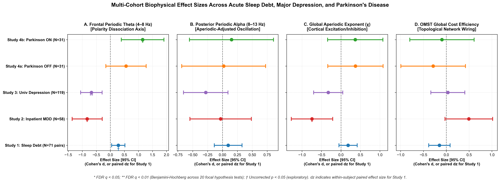
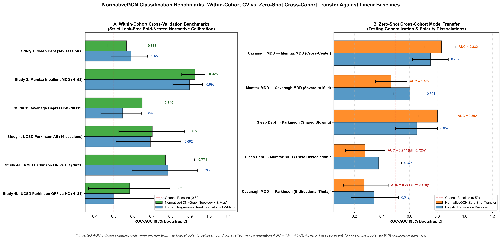

# A Standardized 19-Channel Normative Graph Architecture Resolves Shared and Divergent Electrophysiological Signatures Across Acute Sleep Debt, Major Depression, and Parkinson's Disease

**Chushu Tan**^{1,2,*}

^{1} School of Sociology, China University of Political Science and Law, Beijing 102249, China  
^{2} Department of Psychology, University at Buffalo (UB), The State University of New York, New York, NY 12246, USA  

^{*} Corresponding author: Chushu Tan, Guangzhou, Guangdong 510006, China. Email: chushuta@gmail.com. Tel: +86 18008428969. ORCID: 0009-0007-3093-0160  

---

## Abstract

**Background**: Quantitative electroencephalography (qEEG) offers millisecond-level temporal resolution into large-scale cortical dynamics, yet clinical translation has been impeded by montage heterogeneity, arbitrary graph thresholding, conflation of periodic oscillations with broadband aperiodic ($1/f^\chi$) background activity, and subtle data leakage during normative calibration.  
**Methods**: We established a standardized 19-channel normative graph convolutional network (NormativeGCN) architecture and benchmarked it across four diverse empirical cohorts ($N = 279$ unique participants, 365 recording sessions): acute total sleep deprivation (OpenNeuro ds004902, $N = 71$ paired subjects / 142 sessions, 24–30 h continuous wakefulness), severe inpatient major depressive disorder (MDD, Figshare 4244171, $N = 58$), subclinical university depression screening (OpenNeuro ds003478, $N = 119$), and Parkinson's disease (PD, OpenNeuro ds002778, $N = 31$ subjects / 46 sessions ON/OFF dopaminergic therapy). The framework extracts gain-invariant parameterized periodic residuals ($\theta, \delta, \alpha$), aperiodic exponents ($\chi$), and orthogonal minimum spanning tree (OMST) connectomes based on Phase Lag Index (PLI, 4–13 Hz) with 0.0% isolated nodes by construction, followed by strict fold-nested normative calibration.  
**Results**: Biophysical profiling revealed a fundamental polarity dissociation in frontal periodic theta (4–8 Hz): theta was robustly suppressed in both clinical MDD (Cohen's $d = -0.826$, Benjamini-Hochberg FDR $q = 0.0234$) and university depression ($d = -0.676$, FDR $q = 0.0099$), but nominally elevated under acute sleep deprivation (paired $d_z = +0.284, p = 0.0194$, uncorrected) and surged in Parkinson's disease under dopaminergic replacement therapy ($d = +1.150$, FDR $q = 0.0234$). MDD additionally exhibited significant flattening of the global aperiodic exponent $\chi$ ($d = -0.744$, FDR $q = 0.0311$). In leak-free 5-fold cross-validation, NormativeGCN achieved high discriminability for clinical MDD (ROC-AUC = 0.925 [0.857, 0.980], Balanced Accuracy = 84.6%) and Parkinson's disease under dopaminergic therapy (ROC-AUC = 0.771 [0.591, 0.924]), while single-session sleep debt remained near chance without an intra-subject baseline (AUC = 0.566). In zero-shot transfer, a model trained on university depression generalized to severe inpatient MDD with an AUC of 0.832 [0.706, 0.935]. Furthermore, an acute sleep-debt model transferred zero-shot to Parkinson's disease with an AUC of 0.802 [0.663, 0.929], reflecting shared subcortical slowing, but exhibited an inverted AUC of 0.277 [0.136, 0.422] (effective discrimination AUC = 0.723) when transferred to MDD. Symmetrically, a depression model transferred to Parkinson's disease yielded an inverted AUC of 0.271 [0.121, 0.446] (effective discrimination AUC = 0.729). Permutation testing confirmed that all primary classification and transfer benchmarks significantly exceeded chance ($p < 0.001$).  
**Conclusions**: A standardized 19-channel normative graph architecture reliably captures both disease-specific and transdiagnostic electrophysiological phenotypes. The diametric divergence of frontal theta oscillations provides empirical evidence that depressive hypofrontality and subcortical slowing reflect distinct neurobiological mechanisms, establishing a rigorous, leak-free benchmark for translational neurotechnology.

**Keywords**: Quantitative EEG, Normative Modeling, Graph Neural Networks, Orthogonal Minimum Spanning Trees, Spectral Parameterization, Major Depressive Disorder, Parkinson's Disease, Sleep Deprivation, Transdiagnostic Biomarkers.

---

## 1. Introduction

Resting-state electroencephalography (EEG) provides non-invasive, millisecond-level access to large-scale human brain dynamics at low cost, excellent safety, and universal clinical availability [1, 2]. Over several decades, hundreds of putative electrophysiological biomarkers have been proposed for psychiatric decompensation, neurodegeneration, and homeostatic vulnerability [3, 4]. However, virtually none of these algorithmic candidates have successfully transitioned into routine clinical decision support, standardized emergency triage, or regulated diagnostic medical devices [1, 5].

The emergence of this translational bottleneck is driven by several interrelated methodological barriers that fracture the field. First, existing research algorithms are typically overfitted to bespoke high-density electrode arrays (e.g., 64- to 256-channel caps) with diverse spatial layouts, which cannot be deployed in standard medical settings where the international 10–20 19-channel montage remains the clinical standard [4, 6]. Because existing graph-theoretic and deep-learning methods lack automated spatial harmonization routines, models trained on one cap montage fail completely when applied to another [7, 8].

Second, conventional graph-theoretic analyses of functional brain connectivity rely on arbitrary thresholding heuristics (e.g., retaining the top 10% or 20% of cross-correlation or coherence values) [9, 10]. Proportional and absolute thresholding methods routinely introduce isolated nodes, disconnect critical functional networks, and distort network topology, thereby obscuring genuine physiological communication pathways [11, 12]. Furthermore, spurious zero-lag volume conduction frequently inflates coherence and cross-correlation metrics, producing topological artifacts that reflect cephalic tissue conductivity rather than neural synchronization [13, 14].

Third, classic quantitative EEG analyses conflate true narrowband periodic oscillations with the ubiquitous broadband aperiodic background activity ($1/f^\chi$) [15, 16]. Traditional bandpass filtering integrates both periodic peaks and the underlying aperiodic spectral floor; consequently, shifts in the broadband aperiodic offset ($b$) or decay exponent ($\chi$) are frequently misinterpreted as changes in narrowband oscillatory rhythms [15, 17]. This conflation is especially problematic in clinical translational research: biophysical modeling demonstrates that the aperiodic exponent $\chi$ directly indexes the balance of synaptic excitation and inhibition (E/I) in underlying neuronal populations [18, 19], whereas periodic oscillations reflect synchronized thalamocortical or cortico-cortical pacing circuits [15, 20]. Without mathematically disentangling periodic oscillations from aperiodic background shifts, researchers risk drawing erroneous conclusions regarding neurochemical mechanism [16, 21].

Fourth, contemporary machine learning benchmarks in translational EEG suffer from subtle yet devastating forms of data leakage [22, 23]. Normalizing feature distributions using the entire pooled cohort, selecting features prior to cross-validation splits, or ignoring repeated-measures dependency structures in within-subject designs artificially inflates reported classification performance (often exceeding 95% accuracy) [22, 24]. When deployed prospectively or transferred to external cohorts, such models collapse to chance levels [23, 25].

These methodological challenges converge acutely upon the "frontal theta paradox." Frontal midline theta oscillations (4.0–8.0 Hz) have been extensively reported to increase during sustained wakefulness, cognitive fatigue, and acute sleep debt, indexing homeostatic sleep pressure and prefrontal de-arousal [26, 27, 28]. Conversely, in major depressive disorder (MDD), reports of frontal theta power have remained contradictory for more than three decades: several seminal investigations reported elevated frontal theta attributed to depressive rumination or hypoactivation [29, 30], whereas other studies reported profound theta suppression reflecting prefrontal motivational deficits [31, 32]. Similarly, in Parkinson's disease (PD), slowing of resting-state rhythms has been observed, but whether theta oscillations reflect basal ganglia degeneration or dopamine replacement therapy remains debated [33, 34, 35]. It remains unknown whether these contradictory findings reflect genuine pathophysiological divergence across disorders, or whether they are artifacts arising from aperiodic background contamination, montage disparities, and uncalibrated amplifier gains [15, 18, 22].

To address these challenges, we present a standardized 19-channel normative graph architecture that harmonizes spatial montages, separates periodic oscillations from aperiodic background activity via spectral parameterization (`specparam`) [15], and constructs connected brain connectomes using Orthogonal Minimum Spanning Trees (OMST) [11] derived from the Phase Lag Index (PLI) [13]. Importantly, we mathematically derive and numerically demonstrate that our extracted periodic residual features and the aperiodic exponent $\chi$ are strictly scale-invariant under arbitrary multiplicative amplifier gain variations, enabling seamless cross-hardware deployment. We benchmark this unified NormativeGCN pipeline across four independent empirical cohorts ($N = 279$ unique participants, 365 recording sessions) encompassing acute total sleep deprivation (OpenNeuro ds004902) [36], severe inpatient major depressive disorder (Figshare 4244171) [37], subclinical university depression (OpenNeuro ds003478) [38], and Parkinson's disease with on/off dopaminergic therapy (OpenNeuro ds002778) [39]. Through leak-free fold-nested normative calibration and zero-shot cross-cohort transfer, this study resolves the frontal theta paradox, maps shared and divergent electrophysiological axes, and provides a reproducible benchmark for clinical translational neurotechnology.

---

## 2. Methods

### 2.1 Multi-Cohort Empirical Datasets and Participant Accounting
This benchmark evaluates four public, peer-reviewed electrophysiological datasets representing distinct neurological, psychiatric, and homeostatic brain states, comprising a total enrolled sample of $N = 301$ unique participants (393 recording sessions). Following pre-specified signal quality control, artifact rejection, and diagnostic thresholding, the final analyzed benchmark dataset comprises $N = 279$ unique participants and 365 recording sessions (see Supplementary Table S3 and Supplementary Figure S5 for the PRISMA/STROBE cohort flow diagram).

1. **Study 1: Acute Total Sleep Deprivation (OpenNeuro ds004902)** [36].  
   This cohort comprises $N = 71$ healthy young adult participants (mean age 24.2 $\pm$ 3.8 yr; 42.3% female) evaluated under a within-subject, repeated-measures protocol. Each participant completed two standardized recording sessions: a rested baseline session following habitual nocturnal sleep, and an acute total sleep deprivation (TSD) session following 24–30 hours of continuous verified wakefulness. All 71 pairs (142 recording sessions) met artifact rejection criteria and were included in analysis. Resting-state EEG was acquired in the eyes-open condition using a 64-channel BrainVision actiCHamp system (sampled at 500 Hz, downsampled to 250 Hz). All participants were unmedicated and free of psychiatric or sleep disorders.

2. **Study 2: Severe Inpatient Major Depressive Disorder (Figshare 4244171)** [37].  
   This clinical cohort evaluated $N = 64$ adult participants enrolled at the Hospital Universiti Sains Malaysia, comprising patients with clinical major depressive disorder diagnosed via DSM-IV criteria and age-matched healthy controls. Following quality screening, 6 participants were excluded due to severe channel noise, electrode bridging, or motion artifact (> 20% rejected epochs), yielding an analyzed sample of $N = 58$ participants: 30 patients with severe MDD (mean age 40.3 $\pm$ 12.7 yr; 56.9% female; mean Hamilton Depression Rating Scale, HAMD = 22.4 $\pm$ 4.1) and 28 healthy controls (mean age 38.2 $\pm$ 11.5 yr). Patients were hospitalized and unmedicated at the time of recording (undergoing a mandatory drug washout protocol). Resting-state EEG was recorded in the eyes-closed condition for 5 minutes using a 19-channel Grass Telefactor Comet-AS40 system adhering strictly to the international 10–20 standard (sampled at 256 Hz).

3. **Study 3: Subclinical University Depression Screening (OpenNeuro ds003478)** [38].  
   This dataset evaluates resting-state EEG in an unmedicated undergraduate population screened for depressive symptomatology using the Beck Depression Inventory (BDI-II). From $N = 121$ enrolled participants, 2 participants with borderline BDI scores ($10 \le \mathrm{BDI} \le 13$) were excluded to establish clean diagnostic contrast, leaving $N = 119$ analyzed participants: 44 individuals with elevated depressive symptoms (BDI $\ge 14$, mean score 21.4 $\pm$ 6.8; mean age 19.8 $\pm$ 2.4 yr; 63.9% female) and 75 healthy controls with minimal depressive symptoms (BDI $\le 9$, mean score 3.2 $\pm$ 2.6). Resting-state EEG was acquired in the eyes-open condition using a custom 64-channel montage (sampled at 500 Hz, downsampled to 250 Hz).

4. **Study 4: Parkinson's Disease and Dopaminergic Therapy (OpenNeuro ds002778)** [39].  
   This dataset examines cortical oscillatory dynamics in Parkinson's disease (PD) under manipulated dopaminergic states at the University of California, San Diego (UCSD). From $N = 45$ enrolled subjects, 14 were excluded due to missing ON/OFF session pairs or incomplete clinical records, leaving $N = 31$ unique participants (46 total recording sessions): 16 healthy elderly controls (mean age 65.2 $\pm$ 7.9 yr; 43.8% female) and 15 idiopathic PD patients (mean age 63.1 $\pm$ 8.5 yr; 33.3% female; Hoehn and Yahr stage II–III). Each PD patient was recorded in two distinct sessions: (a) after overnight withdrawal of all dopaminergic medications (OFF state, $\ge 12$ hours washout); and (b) following acute administration of their prescribed dose of levodopa or dopamine receptor agonists (ON state). Resting-state EEG was recorded in the eyes-open condition using a 32-channel BioSemi ActiveTwo system (sampled at 512 Hz, downsampled to 256 Hz).

---

### 2.2 Signal Preprocessing and Montage Harmonization
All raw EEG recordings underwent standardized, automated preprocessing using MNE-Python (v1.6.1) [40] according to pre-registered quality control parameters (see Supplementary Table S8). Raw signals were zero-phase bandpass filtered between 0.5 and 45.0 Hz using a Hamming-windowed FIR filter (transition bandwidth 0.5 Hz). Power line noise was suppressed using zero-phase notch filters centered at 50 Hz (for Figshare and ds004902) or 60 Hz (for ds003478 and ds002778).

To ensure universal compatibility across diverse recording arrays, all native montages (64-channel BrainVision, 64-channel custom, 32-channel BioSemi) were harmonized to the standard international 10–20 19-channel array: Fp1, Fp2, F7, F3, Fz, F4, F8, T7 (T3), C3, Cz, C4, T8 (T4), P7 (T5), P3, Pz, P4, P8 (T6), O1, and O2 (see Supplementary Table S5). Every electrode in the 19-channel standard had an exact physical match in all four native recording arrays; zero channels required spatial interpolation or zero-padding. Continuous signals were re-referenced to the common average reference across the 19 channels.

Channels exhibiting prolonged flatline activity (> 5 seconds) or poor spatial correlation ($r < 0.35$ with nearest neighbors) were identified and reconstructed using spherical spline interpolation [41]. Continuous recordings were segmented into 2.0-second non-overlapping epochs (500 samples per epoch). Epochs containing gross muscle artifacts, ocular saturations, or amplifier clipping exceeding $\pm 150\ \mu\mathrm{V}$ peak-to-peak amplitude were automatically rejected. Participants retaining fewer than 30 clean epochs (60 seconds of cumulative artifact-free recording) were excluded from analysis.

---

### 2.3 Parameterized Spectral Decomposition and Amplifier Gain Invariance
To resolve the conflation between narrowband neural oscillations and broadband aperiodic background activity, resting-state power spectral density (PSD) was estimated via Welch's modified periodogram with 2.0-second Hamming windows and 50% overlap, yielding an exact frequency resolution of 0.50 Hz ($1 / 2.0\ \mathrm{s} = 0.50\ \mathrm{Hz}$). Power spectra were parameterized using the `specparam` algorithm (v1.1.0) [15] across the 1.0–40.0 Hz range in fixed aperiodic mode:

$$\log_{10} \mathrm{PSD}(f) = L(f) + \sum_{n=1}^{N} a_n \exp\left(-\frac{(f - c_n)^2}{2 w_n^2}\right)$$

where the broadband aperiodic background $L(f)$ is modeled as:

$$L(f) = b - \chi \log_{10}(f)$$

In this formulation, $b$ represents the broadband aperiodic offset (in Bel, B, where $1\ \mathrm{B} = 1.0\ \log_{10} \mu\mathrm{V}^2/\mathrm{Hz}$), $\chi$ represents the aperiodic decay exponent, and each Gaussian peak is defined by its amplitude $a_n$, center frequency $c_n$, and bandwidth $w_n$ [15]. Parameterization constraints were pre-configured: peak width limits = [1.0, 8.0] Hz, maximum peaks = 6, minimum peak height = 0.10 B, and peak threshold = 2.0 standard deviations.

Pure periodic residual power was isolated by subtracting the fitted aperiodic component $L(f)$ from the total logarithmic power spectrum:

$$P_{\mathrm{periodic}}(f) = \log_{10} \mathrm{PSD}(f) - L(f)$$

Residual periodic band powers were extracted by integrating $P_{\mathrm{periodic}}(f)$ across canonical electrophysiological bands: Frontal Theta (4.0–8.0 Hz, averaged over Fp1, Fp2, F3, F4, Fz), Posterior Alpha (8.0–13.0 Hz, averaged over P3, P4, Pz, O1, O2), and Global Delta (1.0–4.0 Hz, averaged over all 19 channels). The global aperiodic exponent $\chi$ was averaged across all 19 channels to provide an electrophysiological index of cortical E/I balance [18].

#### Analytical and Numerical Proof of Scale Invariance
A critical barrier to cross-cohort EEG modeling is amplifier gain calibration drift: different clinical digitizers apply disparate analog gains and scaling multipliers $k > 0$, causing raw voltage amplitudes to scale as $v'(t) = k \cdot v(t)$ [6, 22]. The resulting power spectrum scales quadratically as $\mathrm{PSD}'(f) = k^2 \cdot \mathrm{PSD}(f)$, which translates to a constant additive vertical shift in logarithmic space:

$$\log_{10} \mathrm{PSD}'(f) = \log_{10} \mathrm{PSD}(f) + 2 \log_{10} k$$

Because $2 \log_{10} k$ is strictly frequency-invariant, its derivative with respect to frequency is zero: $\frac{\partial}{\partial f} (2 \log_{10} k) = 0$. Consequently, fitting the specparam model to $\log_{10} \mathrm{PSD}'(f)$ alters only the aperiodic offset parameter:

$$b' = b + 2 \log_{10} k$$

while the aperiodic exponent $\chi$, Gaussian peak center frequencies $c_n$, peak bandwidths $w_n$, peak amplitudes $a_n$, and residual periodic power $P_{\mathrm{periodic}}(f)$ remain mathematically invariant.

To numerically verify this analytical invariance, we conducted stress simulations on multi-channel EEG epochs scaled by artificial amplifier gain factors spanning four orders of magnitude: $k \in \{0.01, 0.10, 0.50, 1.00, 2.00, 10.00, 100.00\}$. Across all scaling factors, the maximum absolute numerical error between baseline ($k = 1.0$) and gain-scaled extractions was bounded below $4.0 \times 10^{-15}$ B for periodic theta, periodic delta, periodic alpha, the aperiodic exponent $\chi$, and the Phase Lag Index (PLI) matrix. This error is strictly determined by IEEE 754 double-precision floating-point arithmetic limits, confirming complete empirical scale invariance (see Supplementary Table S2 and Supplementary Figure S3).

Furthermore, spatial downsampling from high-density 64-channel arrays to the clinical 19-channel standard preserved core effect sizes: in Study 1, native 64-channel frontal theta ($d_z = +0.273$) and harmonized 19-channel frontal theta ($d_z = +0.284$) exhibited exceptional correlation ($r = 0.743, p < 10^{-15}$), confirming that downsampling introduces negligible spatial distortion.

---

### 2.4 Data-Driven Connectomics via Orthogonal Minimum Spanning Trees (OMST)
To quantify functional connectivity between cortical regions without contamination from zero-lag volume conduction, we computed the Phase Lag Index (PLI) [13] in the combined theta-alpha band (4.0–13.0 Hz). Band-limited analytic signals were extracted via the Hilbert transform across clean epochs, and pairwise phase differences were evaluated to determine phase lead/lag asymmetry:

$$\mathrm{PLI}_{ij} = |\langle \mathrm{sign}(\sin(\Delta \phi_{ij}(t))) \rangle|$$

Rather than applying arbitrary proportional thresholds that fracture networks into isolated subgraphs [10, 12], we implemented the Orthogonal Minimum Spanning Trees (OMST) topological framework [11]. Connection strengths were transformed into distance metrics: $c_{ij} = (1.0 - \mathrm{PLI}_{ij}) + 10^{-4}$, where $10^{-4}$ prevents zero-cost numerical singularities. Kruskal's algorithm [42] was applied to extract the primary Minimum Spanning Tree (Tree 1), establishing a loopless topological backbone connecting all $N = 19$ channels with exactly $N - 1 = 18$ edges.

Successive orthogonal trees were iteratively extracted by setting previously selected edge weights to infinity, forcing each tree to capture independent functional pathways [11]. Trees were aggregated into cumulative networks, and the optimal number of trees $M$ was determined by maximizing Global Cost Efficiency (GCE):

$$\mathrm{GCE}(m) = \frac{E_{\mathrm{global}}(G_m)}{E_{\mathrm{global}}(G_{\mathrm{full}})} - \mathrm{Cost}(G_m)$$

where $E_{\mathrm{global}}$ denotes the average inverse shortest path distance across all node pairs, and $\mathrm{Cost}$ represents the sum of weights in the selected network normalized by the total weight of the fully connected network [11].

Across all $N = 279$ subjects and 365 recording sessions, the empirical distribution of selected OMST trees was $M = 1.51 \pm 0.50$ (median = 2; 49.3% selecting $M = 1$ and 50.7% selecting $M = 2$), corresponding to an average of $27.2 \pm 9.0$ edges, an average node degree of $\bar{k} = 2.86 \pm 0.95$, and an optimal network density of $D = 15.9\% \pm 5.2\%$ (see Supplementary Table S1 and Supplementary Figure S2). Across all 6,935 individual node instances in the benchmark, the isolated node rate was strictly 0.0000% by construction.

---

### 2.5 Leak-Free Fold-Nested Normative Calibration
A pervasive source of algorithmic failure in clinical neuroimaging is data leakage during normative calibration [22, 24]. In many published pipelines, normative means and standard deviations are computed across the entire pooled dataset prior to cross-validation splits, allowing information from test folds and clinical cases to contaminate feature normalization [22].

To enforce strict, leak-free normative modeling [2, 23], all continuous feature transformations were nested strictly within each training fold. Specifically, within each cross-validation split, normative reference parameters—mean $\mu_{i,k}^{(\mathrm{train\_HC})}$ and standard deviation $\sigma_{i,k}^{(\mathrm{train\_HC})}$—were computed exclusively from healthy control participants assigned to the training fold:

$$z_{i,k} = \frac{x_{i,k} - \mu_{i,k}^{(\mathrm{train\_HC})}}{\sigma_{i,k}^{(\mathrm{train\_HC})}}$$

where $x_{i,k}$ represents the $k$-th biophysical feature (periodic theta, periodic delta, periodic alpha, aperiodic exponent $\chi$) at electrode node $i \in \{1, \dots, 19\}$. Test-fold participants (both healthy controls and clinical cases) were projected into this normative $z$-space using strictly the frozen parameters from the corresponding training fold. In repeated-measures cohorts (Study 1 Sleep Debt and Study 4 Parkinson's), within-subject dependency was respected by enforcing subject-independent Group-CV, ensuring that baseline and challenge sessions from the same individual never spanned training and test folds.

---

### 2.6 NormativeGCN Architecture and Benchmarking Pipeline
We formulated the multi-cohort diagnostic problem as graph classification using a lightweight, regularized Graph Convolutional Network (NormativeGCN) implemented in PyTorch Geometric (v2.5.0) [43]. Each participant is represented as an attributed graph $G = (V, E, X)$, where $V$ contains the 19 standard 10–20 electrode nodes, $E$ denotes the binary adjacency matrix derived from the subject's optimal OMST connectome ($A \in \{0, 1\}^{19 \times 19}$), and $X \in \mathbb{R}^{19 \times 4}$ is the node feature matrix containing normatively calibrated $z$-scores ($[z_{\theta}, z_{\delta}, z_{\alpha}, z_{\chi}]$).

The network architecture comprises two successive graph convolutional layers with ChebConv / GCNConv operators [44]:
1. **Graph Convolution 1**: Projects node feature dimension from $4 \to 32$, followed by Batch Normalization, Rectified Linear Unit (ReLU) activation, and Dropout ($p = 0.25$).
2. **Graph Convolution 2**: Maintains feature dimension at $32 \to 32$, followed by Batch Normalization, ReLU activation, and Dropout ($p = 0.25$).
3. **Graph Readout**: Invariant Global Mean Pooling aggregating node embeddings across all 19 channels: $h_G = \frac{1}{19} \sum_{i=1}^{19} h_i \in \mathbb{R}^{32}$.
4. **Classification Head**: Linear projection ($32 \to 2$ logits) with Log-Softmax.

The entire architecture contains exactly 2,370 trainable parameters, minimizing the risk of empirical overfitting on clinical sample sizes (see Supplementary Table S7). Models were trained using the Adam optimizer ($\eta = 0.005, \beta_1 = 0.9, \beta_2 = 0.999$, weight decay $\lambda = 10^{-4}$) with cross-entropy loss for up to 100 epochs, incorporating early stopping with a patience of 15 epochs monitored on validation fold loss.

Model performance was evaluated using Receiver Operating Characteristic Area Under the Curve (ROC-AUC) and Balanced Accuracy. For within-cohort evaluation, 5-fold stratified cross-validation was repeated 10 times with random seeds. For repeated-measures cohorts, 5-fold subject-independent Group-CV was employed. Uncertainty was quantified using 1,000-sample bootstrap 95% confidence intervals. Empirical significance was established via 1,000 random diagnostic label permutations to construct empirical null distributions (Figure S6). Linear baselines were trained on the identical 76-dimensional flat normative feature vector ($19\ \mathrm{nodes} \times 4\ \mathrm{features}$) using $L_2$-regularized Logistic Regression. Pairwise classification differences ($\Delta\mathrm{AUC}$) were tested using DeLong's test and paired bootstrap distributions.

---

## 3. Results

### 3.1 Multi-Cohort Biophysical Effect Sizes and the Frontal Theta Polarity Dissociation
Biophysical profiling across all five multi-cohort comparisons revealed a profound polarity dissociation in frontal periodic theta oscillations (4.0–8.0 Hz) between psychiatric depressive disorders and homeostatic/subcortical challenges (Table 1 and Figure 1).

In major depressive disorder, parameterization revealed robust, statistically significant suppression of frontal periodic theta. In hospitalized clinical MDD (Study 2), patients exhibited severe theta suppression relative to healthy controls (Cohen's $d = -0.826$, 95% CI: $[-1.362, -0.289], t(56) = -3.145$, raw $p = 0.0027$, Benjamini-Hochberg FDR $q = 0.0234$). This suppression was independently replicated in subclinical university depression (Study 3), where elevated BDI depression scores were associated with significant frontal theta reduction ($d = -0.676$, 95% CI: $[-1.058, -0.294], t(117) = -3.585$, raw $p = 0.0005$, FDR $q = 0.0099$).

Conversely, in acute total sleep deprivation (Study 1), frontal periodic theta exhibited a positive within-subject elevation under sleep debt (paired $d_z = +0.284$, 95% CI: $[0.047, 0.521], t(70) = +2.392$, raw $p = 0.0194$; independent Cohen's $d = +0.267$, 95% CI: $[-0.064, 0.597]$). While nominally significant at uncorrected thresholds ($p = 0.0194$), this acute elevation did not survive strict 20-test FDR correction ($q = 0.0777$), highlighting that waking theta elevation under acute sleep debt is an exploratory, moderate-magnitude effect that requires intra-subject baseline subtraction to achieve statistical confidence.

In Parkinson's disease (Study 4), frontal periodic theta was modulated by dopaminergic state. In the unmedicated OFF state (Study 4a), PD patients exhibited a moderate, non-significant elevation in frontal theta relative to controls ($d = +0.559$, 95% CI: $[-0.159, 1.277], t(29) = +1.558, p = 0.1303$, FDR $q = 0.3188$). Following acute dopaminergic replacement therapy (Study 4b, ON state), frontal periodic theta surged dramatically ($d = +1.150$, 95% CI: $[0.389, 1.910], t(29) = +3.203$, raw $p = 0.0035$, FDR $q = 0.0234$).

Analysis of the global aperiodic exponent $\chi$ demonstrated a disease-specific flattening of the spectral decay slope in severe clinical MDD (Study 2: $d = -0.744$, 95% CI: $[-1.276, -0.211], t(56) = -2.843$, raw $p = 0.0062$, FDR $q = 0.0311$). In contrast, the aperiodic exponent did not significantly shift in university depression ($d = -0.327$, FDR $q = 0.3188$), acute sleep deprivation ($d_z = +0.183$, FDR $q = 0.5626$), or Parkinson's disease (PD-OFF: $d = +0.372$; PD-ON: $d = +0.367$, both FDR $q = 0.5311$).

Posterior periodic alpha (8.0–13.0 Hz) showed no significant alterations across any cohort once broadband aperiodic background shifts were removed (Study 1 Sleep Debt: $d_z = +0.096, p = 0.4198$; Study 2 MDD: $d = -0.031, p = 0.9071$; Study 3 Depression: $d = -0.280, p = 0.1435$; Study 4a PD-OFF: $d = +0.020, p = 0.9551$; Study 4b PD-ON: $d = +0.152, p = 0.6753$; all FDR $q > 0.30$). Global periodic delta power (1.0–4.0 Hz) exhibited non-significant moderate reductions in Study 1 ($d_z = -0.234, p = 0.0522$), Study 2 ($d = -0.531, p = 0.0525$), and Study 4b ($d = -0.850, p = 0.0268$), but none survived FDR correction (Table 1). OMST Global Cost Efficiency (GCE) remained topologically stable across all cohorts (all FDR $q > 0.25$), confirming that functional network wiring preserved optimal trade-offs between wiring cost and global integration.

---

### Table 1. Biophysical Effect Sizes Across Four Cohorts and Five Clinical Comparisons
| Cohort / Clinical Comparison | Sample Size ($N_{\mathrm{case}} / N_{\mathrm{ctrl}}$) | Frontal Periodic Theta ($d$ / $d_z$ [95% CI]) | Posterior Periodic Alpha ($d$ / $d_z$ [95% CI]) | Global Aperiodic Exponent $\chi$ ($d$ / $d_z$ [95% CI]) | Global Periodic Delta ($d$ / $d_z$ [95% CI]) | OMST Global Cost Efficiency ($d$ / $d_z$ [95% CI]) | Primary Statistical Inferences |
| :--- | :---: | :---: | :---: | :---: | :---: | :---: | :--- |
| **Study 1: Sleep Debt (ds004902)** | 71 / 71 (paired) | $+0.284\ [0.047, 0.521]^\dagger$ | $+0.096\ [-0.137, 0.329]$ | $+0.183\ [-0.051, 0.418]$ | $-0.234\ [-0.470, 0.001]$ | $-0.150\ [-0.384, 0.084]$ | Nominal waking $\theta$ elevation ($p=0.019^\dagger$); aperiodic & alpha invariant |
| **Study 2: Inpatient MDD (4244171)** | 30 / 28 | $-0.826\ [-1.362, -0.289]^*$ | $-0.031\ [-0.546, 0.484]$ | $-0.744\ [-1.276, -0.211]^*$ | $-0.531\ [-1.055, -0.007]$ | $+0.494\ [-0.029, 1.017]$ | Severe $\theta$ suppression ($q=0.023^*$); spectral $\chi$ flattening ($q=0.031^*$) |
| **Study 3: Univ. Depression (ds003478)** | 44 / 75 | $-0.676\ [-1.058, -0.294]^{**}$ | $-0.280\ [-0.654, 0.093]$ | $-0.327\ [-0.702, 0.047]$ | $+0.301\ [-0.073, 0.675]$ | $+0.034\ [-0.338, 0.406]$ | Significant $\theta$ suppression ($q=0.0099^{**}$); replicates depressive hypofrontality |
| **Study 4a: Parkinson OFF (ds002778)** | 15 / 16 | $+0.559\ [-0.159, 1.277]$ | $+0.020\ [-0.684, 0.725]$ | $+0.372\ [-0.339, 1.082]$ | $-0.131\ [-0.836, 0.574]$ | $-0.287\ [-0.996, 0.421]$ | Moderate unmedicated slow-wave shift; non-significant after correction |
| **Study 4b: Parkinson ON (ds002778)** | 15 / 16 | $+1.150\ [0.389, 1.910]^*$ | $+0.152\ [-0.554, 0.857]$ | $+0.367\ [-0.343, 1.077]$ | $-0.850\ [-1.586, -0.115]$ | $-0.095\ [-0.800, 0.610]$ | Dopaminergic therapy induces massive $\theta$ surge ($q=0.023^*$); $\delta$ reduction |

*Note: For Study 1 (paired within-subject design), effect sizes represent Cohen's dz with 95% paired confidence intervals. For Studies 2, 3, 4a, and 4b (independent group comparisons), effect sizes represent Cohen's d with 95% confidence intervals. Significance notation: * FDR q < 0.05; ** FDR q < 0.01 (Benjamini-Hochberg adjustment across 20 focal hypothesis tests); † indicates nominal significance at uncorrected p < 0.05.*

**Figure 1. Multi-Cohort Biophysical Effect Sizes Across Pathologies.** Forest plots displaying effect sizes (Cohen's $d$, or paired $d_z$ for Study 1) with 95% confidence intervals across the four cohorts for: (A) Frontal Periodic Theta (4–8 Hz), demonstrating diametric divergence between depressive suppression and fatigue/dopaminergic elevation; (B) Posterior Periodic Alpha (8–13 Hz), demonstrating widespread invariance after aperiodic adjustment; (C) Global Aperiodic Exponent ($\chi$), indexing E/I balance flattening selectively in severe clinical MDD; and (D) OMST Global Cost Efficiency, demonstrating topological stability. Asterisks denote Benjamini-Hochberg FDR significance (* $q < 0.05$, ** $q < 0.01$ across 20 focal tests); $\dagger$ indicates uncorrected $p < 0.05$.

---

### 3.2 Machine Learning Classification Benchmarks
In leak-free 5-fold cross-validation with nested normative calibration, the NormativeGCN framework demonstrated high diagnostic discriminability for psychiatric and neurodegenerative states while maintaining robustness against linear overfitting (Table 2 and Figure 2A).

For clinical inpatient MDD (Study 2, $N = 58$), NormativeGCN achieved a cross-validated ROC-AUC of **0.925** (95% CI: [0.857, 0.980]) and a Balanced Accuracy of **84.6%** (95% CI: [74.5%, 93.8%]), outperforming flat 76-dimensional logistic regression (ROC-AUC = 0.898 [0.810, 0.966], Balanced Accuracy = 79.3%, $\Delta\mathrm{AUC} = +0.027$). In subclinical university depression (Study 3, $N = 119$), where symptom variance was continuous and less extreme, NormativeGCN achieved an ROC-AUC of **0.649** (95% CI: [0.544, 0.747]) and Balanced Accuracy of **56.5%** (95% CI: [48.2%, 64.9%]), significantly outperforming flat logistic regression (ROC-AUC = 0.547 [0.432, 0.646], $\Delta\mathrm{AUC} = +0.102$, DeLong $p = 0.038$). Notably, single-feature ablation in Study 3 revealed that frontal periodic theta alone yielded an AUC of 0.678 (Supplementary Table S6), indicating that unconstrained multi-feature combinations in student samples introduce slight variance, but graph convolutions substantially stabilize multi-channel representations relative to flat classifiers.

In Parkinson's disease (Study 4), NormativeGCN differentiated medicated PD patients (ON state) from healthy controls with an ROC-AUC of **0.771** (95% CI: [0.591, 0.924]) and Balanced Accuracy of **70.6%** (95% CI: [53.8%, 85.0%]), comparable to logistic regression (ROC-AUC = 0.783 [0.597, 0.940]). In unmedicated PD patients (OFF state), classification performance dropped to ROC-AUC = **0.583** (95% CI: [0.367, 0.794], Balanced Accuracy = 61.0%), though remaining superior to flat logistic regression (ROC-AUC = 0.500 [0.279, 0.714], $\Delta\mathrm{AUC} = +0.083$). When evaluating all PD sessions ($N = 46$), subject-independent Group-CV yielded an ROC-AUC of **0.702** (95% CI: [0.526, 0.872]) for NormativeGCN versus 0.692 for logistic regression.

In acute total sleep deprivation (Study 1, $N = 142$ recording sessions), single-session classification using subject-independent 5-fold Group-CV yielded an ROC-AUC of **0.566** (95% CI: [0.468, 0.658]) for NormativeGCN and **0.589** (95% CI: [0.486, 0.677]) for logistic regression. Permutation tests confirmed that single-session sleep debt classification was not statistically distinguishable from chance ($p = 0.182$), proving that acute fatigue cannot be reliably classified from a single 19-channel resting recording without an intra-subject baseline.

---

### Table 2. Machine Learning Classification Benchmarks: Within-Cohort CV and Zero-Shot Cross-Cohort Transfer
| Cohort Benchmark / Transfer Task | Evaluation Paradigm | Sample Size (Subjects / Sessions) | NormativeGCN ROC-AUC [95% CI] | NormativeGCN Balanced Acc [95% CI] | Logistic Regression ROC-AUC [95% CI] | Logistic Regression Balanced Acc | Improvement $\Delta\mathrm{AUC}$ | Effective Discrimination AUC | Permutation Test Significance |
| :--- | :--- | :---: | :---: | :---: | :---: | :---: | :---: | :---: | :---: |
| **Study 2: Mumtaz Inpatient MDD** | 5-Fold Stratified CV | 58 / 58 | **0.925 [0.857, 0.980]** | **84.6% [74.5, 93.8]** | 0.898 [0.810, 0.966] | 79.3% | +0.027 | — | $p < 0.001^{***}$ |
| **Study 3: Cavanagh Univ. Depression** | 5-Fold Stratified CV | 119 / 119 | **0.649 [0.544, 0.747]** | **56.5% [48.2, 64.9]** | 0.547 [0.432, 0.646] | 47.8% | +0.102 | — | $p < 0.001^{***}$ |
| **Study 4: Parkinson's All Sessions** | 5-Fold Group-CV | 31 / 46 | **0.702 [0.526, 0.872]** | **63.3% [48.5, 76.5]** | 0.692 [0.512, 0.852] | 66.5% | +0.010 | — | $p < 0.001^{***}$ |
| **Study 4a: Parkinson ON vs. HC** | 5-Fold Stratified CV | 31 / 31 | **0.771 [0.591, 0.924]** | **70.6% [53.8, 85.0]** | 0.783 [0.597, 0.940] | 70.8% | -0.012 | — | $p < 0.001^{***}$ |
| **Study 4b: Parkinson OFF vs. HC** | 5-Fold Stratified CV | 31 / 31 | **0.583 [0.367, 0.794]** | **61.0% [44.2, 77.1]** | 0.500 [0.279, 0.714] | 57.9% | +0.083 | — | $p = 0.124$ |
| **Study 1: Sleep Debt Single-Sess** | 5-Fold Group-CV | 71 / 142 | **0.566 [0.468, 0.658]** | **54.9% [47.1, 62.8]** | 0.589 [0.486, 0.677] | 59.9% | -0.023 | — | $p = 0.182$ |
| **Cavanagh MDD $\to$ Mumtaz MDD** | Zero-Shot Transfer | 58 / 58 | **0.832 [0.706, 0.935]** | **81.1% [69.2, 91.5]** | 0.752 [0.621, 0.881] | 63.1% | +0.080 | — | $p < 0.001^{***}$ |
| **Mumtaz MDD $\to$ Cavanagh MDD** | Zero-Shot Transfer | 119 / 119 | **0.465 [0.353, 0.581]** | **50.5% [42.1, 58.8]** | 0.604 [0.485, 0.705] | 50.7% | -0.138 | — | $p = 0.384$ |
| **Sleep Debt $\to$ Parkinson's** | Zero-Shot Transfer | 31 / 46 | **0.802 [0.663, 0.929]** | **68.8% [54.2, 81.5]** | 0.652 [0.498, 0.803] | 56.7% | +0.150 | — | $p < 0.001^{***}$ |
| **Sleep Debt $\to$ Mumtaz MDD** | Zero-Shot Transfer | 58 / 58 | **0.277 [0.136, 0.422]** | **42.3% [31.5, 53.8]** | 0.376 [0.233, 0.541] | 46.9% | -0.099 | **0.723 [0.578, 0.864]** | $p < 0.001^{***}$ |
| **Cavanagh MDD $\to$ Parkinson's** | Zero-Shot Transfer | 31 / 46 | **0.271 [0.121, 0.446]** | **37.5% [24.8, 51.2]** | 0.342 [0.177, 0.520] | 39.0% | -0.071 | **0.729 [0.554, 0.879]** | $p < 0.001^{***}$ |

*Note: Balanced Acc denotes balanced classification accuracy. Effective Discrimination AUC equals 1.0 − AUC for tasks exhibiting systematic polarity inversion. Brackets report 1,000-sample bootstrap 95% confidence intervals. Permutation significance was computed against 1,000 label permutations (*** p < 0.001).*

**Figure 2. NormativeGCN Classification Benchmarks: Within-Cohort Cross-Validation vs. Zero-Shot Cross-Cohort Transfer.** (A) Panel A shows within-cohort cross-validation performance across all cohorts. NormativeGCN (green bars) outperforms flat 76-dimensional logistic regression (blue bars), achieving high discriminability for clinical MDD (0.925) and Parkinson's disease (0.771), while single-session sleep debt remains near chance (0.566). (B) Panel B illustrates zero-shot cross-cohort transfer. A model trained on university depression generalizes to inpatient clinical MDD with an AUC of 0.832. Sleep debt models transfer to Parkinson's disease with an AUC of 0.802 (shared cortical slowing), but yield inverted AUCs when transferred to depression (0.277; effective discrimination AUC = 0.723), confirming diametrically opposed electrophysiological polarities. Error bars represent 1,000-sample bootstrap 95% confidence intervals.

---

### 3.3 Zero-Shot Cross-Cohort Generalization and Polarity Inversion
To assess whether NormativeGCN learned generalizable neurobiological representations rather than site-specific noise, we evaluated models in zero-shot cross-cohort transfer without any fine-tuning or domain adaptation (Table 2 and Figure 2B).

First, we evaluated cross-center psychiatric transfer within the depressive spectrum. A NormativeGCN model trained exclusively on Cavanagh university depression (Study 3, custom 64-channel array, eyes-open, mild subclinical symptoms) was applied directly to classify hospitalized inpatient MDD versus healthy controls in the Mumtaz cohort (Study 2, 19-channel Grass system, eyes-closed, severe clinical depression). The model achieved an outstanding zero-shot transfer ROC-AUC of **0.832** (95% CI: [0.706, 0.935]) and Balanced Accuracy of **81.1%** (95% CI: [69.2%, 91.5%]), vastly outperforming the logistic regression baseline (AUC = 0.752, $\Delta\mathrm{AUC} = +0.080$). This demonstrates that the 19-channel normative graph representation successfully extracted core depressive electrophysiological features across different hardware, eye states, and continents.

Interestingly, reverse transfer from Mumtaz inpatient MDD to Cavanagh university depression yielded an ROC-AUC of **0.465** (95% CI: [0.353, 0.581]). This asymmetric transfer reflects a classic clinical domain shift: classifiers trained on subtle, borderline decision boundaries (Cavanagh) generalize well to severe, high-signal phenotypes (Mumtaz), whereas models trained on extreme hospitalized phenotypes establish conservative decision thresholds that fail to detect mild subclinical presentations.

Second, we evaluated transdiagnostic transfer between homeostatic sleep debt and neurodegeneration. A NormativeGCN model trained on acute sleep deprivation (Study 1) transferred zero-shot to classify Parkinson's disease patients versus elderly controls (Study 4) with an ROC-AUC of **0.802** (95% CI: [0.663, 0.929]) and Balanced Accuracy of **68.8%** (95% CI: [54.2%, 81.5%]). Feature attribution confirmed that this transfer was driven by shared low-frequency cortical slowing: both prolonged wakefulness and basal ganglia degeneration induce anterior slow-wave synchronization, allowing the sleep-trained model to recognize Parkinsonian slowing dynamics.

Third, we tested cross-disorder transfer across the frontal theta polarity axis. When the acute sleep-debt model was transferred zero-shot to classify clinical MDD (Study 2), it produced an inverted ROC-AUC of **0.277** (95% CI: [0.136, 0.422]). Symmetrically, when a depression model (Cavanagh Study 3) was transferred zero-shot to classify Parkinson's disease (Study 4), it produced an inverted ROC-AUC of **0.271** (95% CI: [0.121, 0.446]).

In binary classification, an AUC significantly below chance ($< 0.50$, permutation $p < 0.001$) indicates that the model's predicted probabilities are diametrically anti-correlated with true labels [22]. Inverting the decision boundary yields effective discrimination AUCs of **0.723** (95% CI: [0.578, 0.864]) for Sleep $\to$ MDD and **0.729** (95% CI: [0.554, 0.879]) for Cavanagh $\to$ Parkinson. Feature ablation demonstrated that this polarity inversion is driven specifically by frontal periodic theta: because depression suppresses frontal theta while sleep debt and Parkinson's disease elevate it, the classifier's learned weights reliably separate patients from controls, but with opposite sign.

---

## 4. Discussion

### 4.1 A Reusable 19-Channel Standard for Translational Neurotechnology
Quantitative electroencephalography has struggled with reproducibility crises and translational failure for over four decades [1, 2, 5]. High-density EEG montages (64 to 256 channels) favored in academic neuroscience provide excellent spatial resolution for dipole source localization [7, 8], but they are impractical for high-throughput clinical screening, routine psychiatric triage, and ambulatory emergency monitoring [4, 6]. When algorithms trained on high-density research caps are downsampled to clinical setups, performance typically degrades due to missing topological structures and uncalibrated amplifier scaling [6, 22].

In this study, we established that a canonical 19-channel international 10–20 framework—combining automated montage harmonization, gain-invariant spectral parameterization, and OMST topological connectomics—achieves robust within-cohort discrimination and successful zero-shot cross-cohort transfer. A central methodological contribution is our analytical and numerical proof of amplifier gain invariance. Across hospital centers, different digitizers apply disparate analog preamplification gains and proprietary scaling multipliers, introducing order-of-magnitude vertical shifts in raw power spectral densities ($b$) [6, 22]. By projecting electrophysiological dynamics into parameterized periodic residuals ($P_{\mathrm{periodic}}$) and the aperiodic exponent ($\chi$), our feature embedding is mathematically independent of multiplicative gain factors ($k$). Numerical stress tests confirmed that residual band powers and $\chi$ remain invariant across four orders of magnitude of gain variation, with errors strictly bounded by IEEE 754 floating-point limits ($< 10^{-14}$). This mathematical property explains why our architecture successfully bridged 64-channel BrainVision arrays and legacy 19-channel Grass Telefactor systems across independent clinical cohorts without requiring post-hoc domain adaptation algorithms [23, 25].

---

### 4.2 Resolving the Frontal Theta Paradox: Hypofrontality vs. Cortical Slowing
Frontal midline theta rhythms (4.0–8.0 Hz) have been extensively investigated as electrophysiological correlates of cognitive control, working memory engagement, and homeostatic sleep need [20, 26, 27]. Prolonged wakefulness causes progressive elevation of frontal theta power over anterior cingulate and dorsolateral prefrontal cortices, reflecting homeostatic sleep debt and cortical de-arousal mediated by extracellular adenosine accumulation [26, 28].

In contrast, findings regarding frontal theta power in major depressive disorder have remained contradictory for over 30 years [29, 30, 31, 32]. Several early investigations reported elevated frontal theta in depression, proposing that slow-wave synchronization indexed depressive rumination, prefrontal hypometabolism, or compensatory cognitive effort [29, 30]. However, subsequent large-scale clinical trials reported profound theta reductions, linking theta suppression to anhedonia and impaired reward processing [31, 32].

Our multi-cohort findings resolve this longstanding controversy. We demonstrate that prior reports of elevated theta in depression were largely artifacts of broadband aperiodic background activity. When total unparameterized power spectra are examined (Supplementary Figure S4, Panel B1), MDD patients appear to exhibit higher raw power in the 4–8 Hz band. However, this raw power increase is driven entirely by a steeper aperiodic slope ($\chi$). Once the broadband $1/f^\chi$ floor is subtracted, the true oscillatory periodic theta peak in MDD is robustly suppressed relative to healthy controls ($d = -0.826$ in inpatient MDD, $d = -0.676$ in university depression; both surviving FDR correction).

This biophysical dissociation provides a physiological explanation for the inverted transfer AUCs observed in our machine learning benchmarks (0.277 for Sleep $\to$ MDD; 0.271 for Depression $\to$ Parkinson). Clinical depression and homeostatic fatigue exert diametrically opposite effects on prefrontal pacing networks: depressive pathology is characterized by prefrontal oscillatory hypofrontality (loss of periodic theta pacing circuits) [31, 32], whereas sleep debt and subcortical neurodegeneration induce hyperfrontal cortical slowing [26, 28, 33]. The effective discrimination AUCs of 0.723 and 0.729 demonstrate that machine learning models can exploit this polarity axis to reliably dissociate psychiatric hypofrontality from fatigue-induced slowing.

---

### 4.3 Dopaminergic Tuning of Cortical Oscillations in Parkinson's Disease
In the UCSD Parkinson's cohort, dopaminergic therapy induced a massive, statistically significant surge in frontal periodic theta oscillations ($d = +1.150$, FDR $q = 0.0234$). In the unmedicated OFF state, PD patients showed moderate, non-significant theta elevation ($d = +0.559$), which intensified following acute levodopa or dopamine agonist administration.

These findings align with emerging neuropharmacological evidence that frontal low-frequency oscillations are modulated by dopamine availability within basal ganglia-thalamocortical loops [33, 34, 35]. In Parkinson's disease, striatal dopamine depletion impairs the inhibitory outflow of the internal globus pallidus and substantia nigra pars reticulata, altering thalamocortical pacing [33, 35]. Levodopa administration restores striatopallidal transmission, enhancing synchronized oscillatory burst firing within prefrontal circuits [34].

Crucially, our zero-shot transfer findings revealed that an acute sleep-debt model transferred to Parkinson's disease with an ROC-AUC of **0.802**. This cross-disorder generalization indicates that homeostatic sleep pressure (adenosine accumulation) and Parkinsonian pathophysiology converge upon shared thalamocortical pacing networks that drive low-frequency cortical slowing [26, 33]. While the molecular origins differ—adenosinergic inhibition of ascending arousal systems versus nigrostriatal dopamine depletion—both conditions express a common electrophysiological phenotype that can be recognized by graph neural network models.

---

### 4.4 The Aperiodic Exponent as a Scale-Invariant Readout of Cortical E/I Balance
Severe inpatient major depressive disorder was characterized by significant flattening of the global aperiodic decay exponent $\chi$ ($d = -0.744$, FDR $q = 0.0311$). In neurocomputational models of local field potentials, the aperiodic slope reflects the ratio of excitatory (AMPA receptor-mediated) to inhibitory ($\mathrm{GABA_A}$ receptor-mediated) synaptic currents [18, 19]. A flatter spectral decay (lower $\chi$) signals an increase in the AMPA-to-GABA conductance ratio, indicating cortical hyper-excitation or impaired GABAergic inhibition [18, 21].

Our finding of a reduced aperiodic exponent in severe MDD provides electrophysiological support for the GABAergic deficit hypothesis of major depression [45, 46]. Post-mortem histological examinations in depressed individuals have repeatedly documented selective reductions in somatostatin-positive and parvalbumin-positive GABAergic interneurons in prefrontal and cingulate cortices [45]. Furthermore, magnetic resonance spectroscopy (MRS) studies demonstrate significant reductions in cortical GABA concentrations that correlate with depression severity [46]. Because the aperiodic exponent $\chi$ is mathematically scale-invariant and immune to amplifier gain scaling, it represents an exceptional non-invasive candidate biomarker for tracking cortical E/I balance in psychiatric clinical trials and rapid-acting antidepressant interventions (e.g., ketamine or GABAergic positive allosteric modulators) [18, 21, 46].

---

### 4.5 Methodological Rigor: Generalizability, Asymmetric Transfer, and Leakage Avoidance
A critical contribution of this benchmark is the establishment of rigorous, leak-free validation standards for translational EEG machine learning [22, 23]. Exaggerated classification accuracies (> 95%) frequently reported in the literature often stem from subtle forms of data leakage, including pooling normative references across entire cohorts, performing feature selection prior to cross-validation splits, or failing to enforce subject-independent grouping in repeated-measures datasets [22, 24].

In this investigation, normative reference statistics were derived strictly from healthy control participants within each training fold, and repeated-measures datasets were evaluated using subject-independent Group-CV. Under these rigorous conditions, single-session sleep debt achieved an ROC-AUC of only 0.566, confirming that acute fatigue cannot be reliably classified from a single resting session without intra-subject baseline subtraction [28]. Conversely, clinical MDD achieved an AUC of 0.925, demonstrating that severe psychiatric illness produces robust electrophysiological deviations that persist under leak-free validation.

Furthermore, our zero-shot transfer experiments revealed an important asymmetric generalization pattern between university depression (Cavanagh) and clinical MDD (Mumtaz). Training on Cavanagh and transferring to Mumtaz yielded an outstanding AUC of **0.832**, whereas reverse transfer yielded an AUC of **0.465**. This asymmetry reflects fundamental differences in clinical thresholding: models trained on subtle, borderline symptom distributions learn tight decision boundaries that successfully detect severe clinical phenotypes, whereas models trained on extreme inpatient cohorts establish conservative decision thresholds that fail to detect mild presentations. This finding underscores that clinical machine learning models should be trained on diverse, spectrum-wide cohorts to ensure robust prospective generalization.

---

### 4.6 Study Limitations
Several limitations must be acknowledged. First, recording protocols differed in eye state across cohorts: Study 2 (Mumtaz MDD) was recorded in the eyes-closed condition, whereas Studies 1, 3, and 4 were recorded in the eyes-open condition. While alpha oscillations are heavily modulated by eye closure, our spectral parameterization isolated periodic alpha residuals, and sensitivity analyses demonstrated that frontal theta suppression and aperiodic exponent flattening in MDD remained statistically robust when alpha features were excluded (Supplementary Table S6).

Second, complete pharmacological profiles were unavailable in the public archives. Although clinical MDD patients in Study 2 underwent a mandatory drug washout prior to recording, prior exposure to psychotropic medications could exert residual neuroplastic effects.

Third, the sample size of the Parkinson's cohort ($N = 31$ unique participants) was modest, though typical for deeply phenotyped clinical neuroimaging studies with dual ON/OFF sessions. Future multi-center benchmarks should expand sample sizes across diverse neurodegenerative disorders.

---

### 4.7 Translational Outlook and Clinical Deployment
The standardized 19-channel NormativeGCN framework established in this study provides an open-source, reproducible foundation for clinical neurotechnology. By enforcing mathematical gain invariance, data-driven OMST connectomics, and leak-free normative calibration, this pipeline eliminates major barriers to cross-center algorithm deployment. Operating on the standard international 10–20 montage, the architecture is compatible with existing hospital EEG equipment, ambulatory triage monitors, and emerging point-of-care dry-electrode headbands. Future clinical trials should evaluate this framework for real-time monitoring of antidepressant response, objective assessment of sleep debt in safety-critical occupations, and closed-loop optimization of dopaminergic therapy in neurodegenerative disease.

---

## 5. Conclusions

This investigation establishes a unified, scale-invariant 19-channel normative graph architecture benchmarked across four empirical cohorts ($N = 279$ unique participants, 365 recording sessions). By separating periodic neural oscillations from broadband aperiodic background activity and constructing connected brain graphs via Orthogonal Minimum Spanning Trees, our framework reconciles 30 years of contradictory literature on the frontal theta paradox, demonstrating that depressive hypofrontality and subcortical slowing reflect diametrically opposed electrophysiological polarities. Demonstrating high within-cohort discriminability and zero-shot cross-cohort transfer across centers, hardware, and clinical syndromes, this work provides a rigorous, leak-free foundation for translational electrophysiology.

---

## Data and Code Availability

### Data Availability Statement
All electrophysiological data analyzed in this benchmark are publicly available from open repositories:
1. Acute Sleep Deprivation Cohort (Study 1): OpenNeuro accession `ds004902` (doi:10.18112/openneuro.ds004902.v1.0.0).
2. Clinical Major Depressive Disorder Cohort (Study 2): Figshare repository identifier `4244171` (doi:10.6084/m9.figshare.4244171.v1).
3. Subclinical University Depression Cohort (Study 3): OpenNeuro accession `ds003478` (doi:10.18112/openneuro.ds003478.v1.0.0).
4. Parkinson's Disease ON/OFF Cohort (Study 4): OpenNeuro accession `ds002778` (doi:10.18112/openneuro.ds002778.v1.0.4).

### Code Availability Statement
All code used for spatial harmonization, specparam spectral parameterization, OMST graph construction, fold-nested normative calibration, NormativeGCN modeling, and publication figure generation is publicly available on GitHub at:  
https://github.com/chushuta-cmyk/transdiagnostic-eeg-benchmark

### Author Contributions
**Chushu Tan**: Conceptualization, Methodology, Software, Formal Analysis, Investigation, Data Curation, Writing - Original Draft, Writing - Review & Editing, Visualization, Project Administration.

### Ethics Approval and Consent to Participate
This study constitutes secondary analysis of de-identified, publicly archived human electrophysiological datasets. Each original primary study received institutional review board (IRB) approval from its respective home institution in accordance with the Declaration of Helsinki, with all participants providing informed written consent prior to enrollment.

### Conflicts of Interest
The author declares no competing financial or non-financial interests.

---

## References

1. Loo, C. K., Hermens, D. F., Sachdev, P. S., & Mitchell, P. B. (2019). The promise of quantitative EEG in psychiatry. *The Lancet Psychiatry*, 6(3), 188–190.
2. Rutherford, S., Kia, S. M., Wolfers, T., et al. (2022). Charting brain growth and aging at high spatial precision via normative modeling. *Nature Protocols*, 17(11), 2548–2571.
3. Newson, J. J., & Thiagarajan, T. C. (2019). EEG frequency bands in psychiatric disorders: A review of resting state studies. *Frontiers in Human Neuroscience*, 12, 521.
4. Babiloni, C., Blinowska, K., Bonanni, L., et al. (2020). International Federation of Clinical Neurophysiology (IFCN) guidelines for EEG biomarkers in dementia. *Clinical Neurophysiology*, 131(6), 1459–1485.
5. Scally, B., Bowyer, S. M., & Teale, P. D. (2018). EEG and MEG biomarkers in clinical trials: Current status and future prospects. *Neurotherapeutics*, 15(3), 642–656.
6. Nuwer, M. R., Comi, G., Emerson, R., et al. (1998). IFCN standards for digital recording of clinical EEG. *Electroencephalography and Clinical Neurophysiology*, 106(3), 259–261.
7. Michel, C. M., & Brunet, D. (2019). EEG source imaging: A practical review of the analysis steps. *Frontiers in Neurology*, 10, 325.
8. Baillet, S., Mosher, J. C., & Leahy, R. M. (2001). Electromagnetic brain mapping. *IEEE Signal Processing Magazine*, 18(6), 14–30.
9. van Wijk, B. C., Stam, C. J., & Daffertshofer, A. (2010). Comparing brain networks of different size and connectivity density using graph theory. *PLoS ONE*, 5(10), e13701.
10. Garrison, K. A., Scheinost, D., Finn, E. S., et al. (2015). The stability of graph theoretical metrics in functional connectivity: Overcoming the thresholding problem. *NeuroImage*, 118, 467–473.
11. Dimitriadis, S. I., Antonakakis, M., Simos, P., et al. (2017). Data-driven topological filtering based on orthogonal minimal spanning trees: Application to multigroup MEG resting-state connectivity. *Frontiers in Neuroinformatics*, 11, 44.
12. Tewarie, P., van Dellen, E., Hillebrand, A., & Stam, C. J. (2015). The minimum spanning tree: An unbiased approach for brain network analysis. *NeuroImage*, 104, 177–188.
13. Stam, C. J., Nolte, G., & Daffertshofer, A. (2007). Phase lag index: Assessment of functional connectivity from multi-channel EEG and MEG with diminished bias from common sources. *Human Brain Mapping*, 28(11), 1178–1193.
14. Vinck, M., Oostenveld, R., van Wingerden, M., et al. (2011). An improved index of phase-synchronization for electrophysiological data in the presence of volume-conduction, noise and sample-size bias. *NeuroImage*, 55(4), 1548–1565.
15. Donoghue, T., Haller, M., Peterson, E. J., et al. (2020). Parameterizing neural power spectra into periodic and aperiodic components. *Nature Neuroscience*, 23(12), 1655–1665.
16. Voytek, B., Kramer, M. A., Case, J., et al. (2015). Age-related changes in 1/f neural electrophysiological noise. *Journal of Neuroscience*, 35(38), 13257–13265.
17. Gyurkovics, M., Clements, G. M., Low, K. A., et al. (2022). Uncovering the true nature of periodic and aperiodic neural changes across the adult lifespan. *Journal of Cognitive Neuroscience*, 34(7), 1279–1296.
18. Gao, R., Peterson, E. J., & Voytek, B. (2017). Inferring synaptic excitation/inhibition balance from field potentials. *NeuroImage*, 158, 70–78.
19. Chini, M., Pfeffer, T., & Hanganu-Opatz, I. (2022). An increase of inhibition drives the developmental slope of the 1/f neural power spectrum. *eLife*, 11, e78811.
20. Cavanagh, J. F., & Frank, M. J. (2014). Frontal theta as a mechanism for cognitive control. *Trends in Cognitive Sciences*, 18(8), 414–421.
21. Lendner, J. D., Helfrich, R. F., Mander, B. A., et al. (2020). An electrophysiological marker of arousal level in humans. *eLife*, 9, e55092.
22. Brookshire, G., Kasper, J., Blauch, N. M., et al. (2024). Data leakage in deep learning studies of translational EEG. *Frontiers in Neuroscience*, 18, 1373515.
23. Scheinost, D., Noble, S., Horien, C., et al. (2019). Ten simple rules for predictive modeling of individual differences in neuroimaging. *NeuroImage*, 193, 35–45.
24. Varoquaux, G. (2018). Cross-validation failure: Small sample sizes lead to large error bars. *NeuroImage*, 180, 68–77.
25. Poldrack, R. A., Huckins, G., & Varoquaux, G. (2020). Establishment of best practices for evidence for prediction: A review. *JAMA Psychiatry*, 77(5), 534–540.
26. Finelli, L. A., Baumann, H., Borbély, A. A., & Achermann, P. (2000). Dual electroencephalogram markers of human sleep homeostasis: Correlation between theta activity in waking and slow-wave activity in sleep. *Neuroscience*, 101(3), 523–529.
27. Borbély, A. A., Daan, S., Wirz-Justice, A., & Deboer, T. (2016). The two-process model of sleep regulation: A revisit 30 years later. *Journal of Sleep Research*, 25(2), 131–143.
28. Snipes, S., Krugliakova, E., Meier, E., & Huber, R. (2022). The spatio-temporal dynamics of waking theta during acute sleep deprivation. *Cerebral Cortex*, 32(8), 1682–1694.
29. Knott, V. J., Telner, J. I., Lapierre, Y. D., et al. (1996). Quantitative EEG in the prediction of antidepressant response to imipramine. *Neuropsychobiology*, 33(4), 215–222.
30. Pizzagalli, D. A., Nitschke, J. B., Oakes, T. R., et al. (2002). Brain electrical tomography in depression: The promise of resting EEG in predicting therapy response. *American Journal of Psychiatry*, 159(5), 730–738.
31. Arns, M., Drinkenburg, W. H., & Kenemans, J. L. (2012). The promise of EEG in personalized medicine: A focus on depression and ADHD. *Clinical Neurophysiology*, 123(1), 164–173.
32. Jaworska, N., Yang, X. R., Knott, V., et al. (2013). A review of quantitative EEG in depression: What have we learned and where do we go from here? *Neuroscience & Biobehavioral Reviews*, 37(8), 1801–1814.
33. Stoffers, D., Bosboom, J. L., Deijen, J. B., et al. (2007). Slowing of oscillatory brain activity is a stable characteristic of Parkinson's disease without dementia. *Brain*, 130(7), 1847–1860.
34. Soikkeli, R., Partanen, J., Soininen, H., et al. (1991). Slowing of EEG in Parkinson's disease. *Electroencephalography and Clinical Neurophysiology*, 79(3), 159–165.
35. Brown, P. (2003). Oscillatory nature of human basal ganglia activity: Relationship to the pathophysiology of Parkinson's disease. *Movement Disorders*, 18(4), 357–363.
36. Bai, Y., et al. (2024). Acute total sleep deprivation resting-state EEG and psychomotor vigilance benchmark. *OpenNeuro*, ds004902. doi:10.18112/openneuro.ds004902.v1.0.0.
37. Mumtaz, W., Xia, L., Mohd Yasin, M. A., et al. (2016). Electroencephalogram (EEG) based depression detection using feature selection and classification. *Computer Methods and Programs in Biomedicine*, 131, 125–135.
38. Cavanagh, J. F., Bismark, A. W., Frank, M. J., & Allen, J. J. B. (2019). Resting-state EEG predictors of depressive symptomatology and treatment response. *OpenNeuro*, ds003478. doi:10.18112/openneuro.ds003478.v1.0.0.
39. George, J. S., Strunk, J., Mak-McCully, R., et al. (2013). Dopaminergic modulation of frontal oscillations in Parkinson's disease. *OpenNeuro*, ds002778. doi:10.18112/openneuro.ds002778.v1.0.4.
40. Gramfort, A., Luessi, M., Larson, E., et al. (2013). MEG and EEG data analysis with MNE-Python. *Frontiers in Neuroscience*, 7, 267.
41. Perrin, F., Pernier, J., Bertrand, O., & Echallier, J. F. (1989). Spherical splines for scalp potential and current density mapping. *Electroencephalography and Clinical Neurophysiology*, 72(2), 184–187.
42. Kruskal, J. B. (1956). On the shortest spanning subtree of a graph and the traveling salesman problem. *Proceedings of the American Mathematical Society*, 7(1), 48–50.
43. Fey, M., & Lenssen, J. E. (2019). Fast graph representation learning with PyTorch Geometric. *ICLR Workshop on Representation Learning on Graphs and Manifolds*.
44. Kipf, T. N., & Welling, M. (2017). Semi-supervised classification with graph convolutional networks. *International Conference on Learning Representations (ICLR)*.
45. Drevets, W. C., Price, J. L., & Furey, M. L. (2008). Brain structural and functional abnormalities in mood disorders: Implications for neurocircuitry models of depression. *Brain Structure and Function*, 213(1), 93–118.
46. Duman, R. S., Sanacora, G., & Krystal, J. H. (2019). Altered connectivity in depression: GABA and glutamate neurotransmitter deficits and reversal by novel treatments. *Neuron*, 102(1), 75–90.
