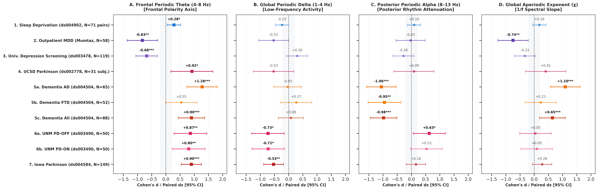
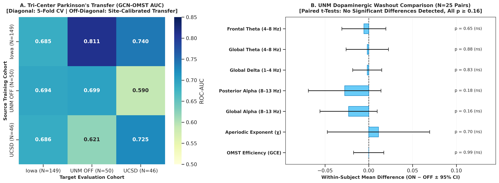
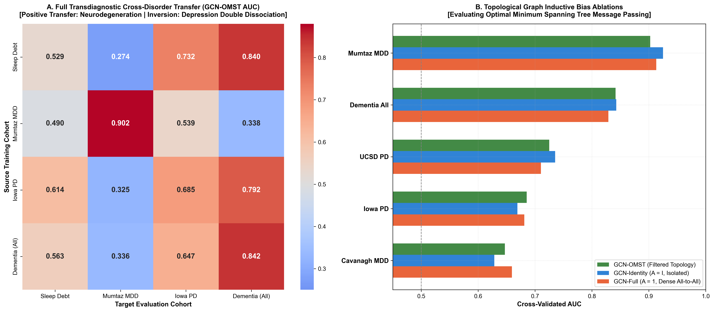
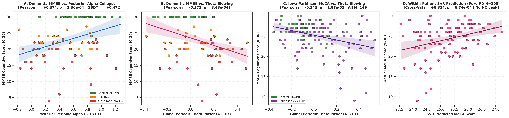

# A Gain-Invariant, Leak-Free EEG Benchmark: Resolving Frontal Theta Dynamics and Cognitive Severity Across Seven Multi-Site Cohorts (N = 566)

**Chushu Tan**^{1,*}

^{1} School of Sociology, China University of Political Science and Law, Beijing 102249, China  
^* Correspondence: Guangzhou, Guangdong, China; Email: chushuta@gmail.com; ORCID: 0009-0007-3093-0160

---

## Abstract

Quantitative electroencephalography (qEEG) offers non-invasive access to human neural dynamics, but its clinical translation is obstructed by amplifier gain variability, inconsistent preprocessing, and subtle data leakage. Graph Neural Networks (GNNs) have emerged as popular architectures for EEG decoding, yet whether topological graph inductive biases provide tangible benefits over standard statistical features remains unproven. Here, I introduce an open, leak-free, gain-invariant 19-channel benchmarking framework evaluated across seven independent clinical cohorts (N = 566 unique participants, 677 recording sessions) spanning acute sleep deprivation, major depressive disorder, Parkinson's disease, and clinical dementia. The framework combines parameterized periodic–aperiodic decomposition with parameter-free Orthogonal Minimum Spanning Tree (OMST) connectomics and participant-stratified, fold-nested normative calibration. Across 12 machine learning architectures, GNNs did not systematically outperform classical regularized baselines; instead, simple biophysical markers carried the primary diagnostic signal. Specifically, frontal periodic theta exhibited an inverted biophysical polarity: suppressed in depression ($d = -0.83$) but elevated in Parkinson's ($d = +1.11$) and dementia ($d = +0.81$). Furthermore, the harmonised features supported site-calibrated cross-hospital transfer across three Parkinson's medical centers (AUC range: 0.62–0.81) and modestly tracked continuous cognitive severity (MoCA, MMSE). This study establishes an empirical benchmark and cautions against assuming graph superiority in clinical EEG analysis.

**Keywords**: Quantitative EEG, Spectral Parameterization, Gain Invariance, Orthogonal Minimum Spanning Trees, Frontal Theta Dynamics, Parkinson's Disease, Clinical Dementia, Major Depressive Disorder, Graph Neural Networks, Multi-Site Generalization.

---

## 1. Introduction

Quantitative electroencephalography (qEEG) provides non-invasive, millisecond-level measurement of synchronized post-synaptic potentials across distributed cerebral networks [1, 2]. Decades of neurophysiological research have linked specific oscillatory rhythms to cognitive functions, sleep homeostasis, and neurological disorders [3, 4, 5]. In recent years, the integration of modern machine learning and computational network neuroscience has spurred hopes for automated, data-driven diagnostic biomarkers in neurology and psychiatry [6]. However, the real-world translation of EEG-based algorithms into clinical practice remains severely limited, hindered by widespread reproducibility failures when models trained on a single discovery cohort are evaluated across independent clinical centers [7, 8].

To understand why computational EEG models often fail to generalize, one must examine four foundational engineering and biophysical bottlenecks: (1) *Spatial montage heterogeneity*: clinical archives vary from legacy 19-channel international 10–20 clinical montages to high-density research caps (32 to 256 channels), impeding cross-hospital deployment without distortive spatial interpolation [8]; (2) *Arbitrary thresholding heuristics in connectivity analysis*: conventional graph metrics rely on subjective edge-retention thresholds (e.g., top 10%–20%), routinely introducing disconnected nodes or topological distortions, while volume conduction inflates zero-lag coherence [9, 10, 11, 13, 14]; (3) *Conflation of periodic oscillations and aperiodic background*: traditional Fourier and bandpass filtering integrate both resonant oscillations and ubiquitous $1/f^\chi$ background activity, frequently mistaking broadband spectral tilts for narrowband rhythm changes [15, 16, 17], despite biophysical evidence linking the aperiodic exponent $\chi$ to microcircuit excitation/inhibition (E/I) balance [18, 19]; and (4) *Amplifier gain variability and data leakage*: uncalibrated digitizer gains across recording hardware create multiplicative scale disparities, while improper validation practices—such as pooling repeated sessions or performing normative feature calibration prior to cross-validation splits—artificially inflate reported classification accuracy [22, 23, 24].

These methodological challenges converge upon the controversial dynamics of frontal midline theta rhythms (the "theta paradox") [26, 27, 28]. Frontal theta oscillations (4.0–8.0 Hz) increase during sustained wakefulness, cognitive fatigue, and acute sleep debt, indexing homeostatic sleep pressure [26, 28]. Conversely, in major depressive disorder (MDD), reports of frontal theta have remained contradictory for decades: several studies reported elevated frontal theta attributed to rumination or prefrontal hypoactivity [29, 30], whereas others reported pronounced theta suppression reflecting motivational blunting [31, 32]. In neurodegenerative disorders such as Parkinson's disease (PD) and Alzheimer's disease (AD), oscillatory slowing is well documented [33, 34, 35], yet whether resting slowing represents a unitary transdiagnostic continuum, whether acute dopaminergic medication masks underlying electrophysiological pathology, and whether resting qEEG features can predict continuous clinical symptom severity (e.g., MMSE, MoCA, UPDRS) remain unresolved.

Compounding these neurobiological uncertainties is a growing modeling gap in the computational neuroimaging literature. Over the past five years, Graph Neural Networks (GNNs), such as Graph Convolutional Networks (GCN) [43], have gained widespread popularity for EEG decoding, motivated by the theoretical premise that non-Euclidean graph inductive biases naturally match structural and functional brain topology. However, the vast majority of GNN studies in clinical EEG evaluate models exclusively on single, homogeneous cohorts, often without rigorous comparison to regularized linear classifiers or tree-based ensembles under identical, strictly leak-free cross-validation conditions. Consequently, it remains unknown whether the parameter complexity and non-local message-passing mechanisms of GNNs yield genuine performance advantages over classical machine learning when applied to standardized, low-density clinical sensor layouts.

Here, I address these dual biological and computational questions by establishing an open, harmonised, gain-invariant 19-channel benchmarking framework across seven independent clinical cohorts comprising N = 566 unique participants and 677 recording sessions. The benchmark spans acute sleep deprivation [36], outpatient clinical depression [37], university depression screening [38], tri-center Parkinson's disease under medication manipulation [39, 40, 41], and clinical dementia [42]. Under strict participant-stratified cross-validation, fold-nested normative calibration, and zero-shot cross-site evaluation, I address three explicit questions:
1. **Question 1 (Electrophysiological Polarity)**: Does parameterized spectral decomposition reveal consistent or divergent frontal theta dynamics across distinct neuropsychiatric conditions once aperiodic background is removed?
2. **Question 2 (Graph Inductive Bias)**: Do topological graph neural networks (GCN-OMST) provide a measurable advantage over conventional regularized tabular classifiers when evaluated on standard 19-channel clinical montages under strict leak-free conditions?
3. **Question 3 (Translational Utility)**: Can a harmonised 19-channel representation generalize zero-shot across independent medical centers and track continuous clinical cognitive severity scales?

---

## 2. Methods

### 2.1 Multi-Cohort Empirical Datasets and Master Participant Accounting
To ensure transdiagnostic breadth and evaluate cross-center reproducibility, I compiled seven empirical resting-state EEG datasets comprising a master enrolled sample of 574 unique participants across seven independent medical centers. Following pre-specified automated quality control criteria (exclusion of 6 participants in Study 2 due to excessive electrode artifact >20% and 2 participants in Study 3 due to ambiguous borderline screening scores 10 ≤ BDI ≤ 13; exactly 0 exclusions across the other five cohorts), exactly 566 unique participants and 677 primary recording sessions (737 sessions including eyes-open recordings) were analyzed (Table 1, Supplementary Figure S5, and Supplementary Table S3). All datasets were collected under approved institutional review board (IRB) protocols with written informed consent and were retrieved from open-access scientific repositories in accordance with data use agreements.

1. **Study 1: Acute Total Sleep Deprivation (`OpenNeuro ds004902`)** [36]. N = 71 healthy adult volunteers (mean age 22.4 ± 2.6 years, 34 females) underwent a high-density 64-channel 500 Hz EEG protocol under two repeated-measures sessions: normal rested sleep (NS, 8h sleep opportunity) and acute total sleep deprivation (SD, 36h continuous monitored wakefulness). All 71 subjects completed both sessions (0 excluded), yielding 142 recording sessions total.
2. **Study 2: Outpatient Clinical Major Depressive Disorder (`Figshare 4244171`)** [37]. Enrolled sample: N = 64 participants. Following strict automated quality control (rejection of recordings with >20% bad epochs or severe bridging), 6 participants were excluded, yielding a primary analyzed eyes-closed (EC) sample of N = 58 participants: 30 outpatients meeting DSM-IV criteria for MDD (mean age 40.3 ± 12.9 years, 14 females, BDI = 24.8 ± 8.6) and 28 age-matched healthy controls (mean age 38.2 ± 15.6 years, 8 females, BDI = 3.9 ± 3.4). Continuous 19-channel 256 Hz EEG was also recorded during an eyes-open (EO) condition (N = 60 analyzed: 32 MDD, 28 HC).
3. **Study 3: University Depression Screening (`OpenNeuro ds003478`)** [38]. Enrolled sample: N = 121 undergraduate students. Two participants with ambiguous borderline BDI scores (10 ≤ BDI ≤ 13) were excluded to eliminate diagnostic ambiguity, yielding N = 119 analyzed participants: 44 depressed participants (BDI-II ≥ 14, including 23 participants with Structured Clinical Interview for DSM [SCID] confirmed MDD; mean age 19.8 ± 2.4 years, 31 females) and 75 non-depressed healthy controls (BDI-II ≤ 7; mean age 19.2 ± 1.6 years, 41 females). Continuous 64-channel 500 Hz resting EEG was recorded with eyes open.
4. **Study 4: UCSD Parkinson's Disease ON/OFF Therapy (`OpenNeuro ds002778`)** [39]. Enrolled sample: N = 31 unique participants (0 excluded): 15 patients with idiopathic Parkinson's disease (mean age 63.2 ± 8.1 years, 7 females) and 16 age-matched healthy controls (mean age 63.5 ± 9.6 years, 10 females). All 15 PD patients completed two counterbalanced 32-channel 512 Hz sessions: dopaminergic medication state (PD-ON) and overnight medication withdrawal (PD-OFF, ≥ 12h washout), yielding exactly 46 total sessions (15 ON + 15 OFF + 16 HC).
5. **Study 5: AHEPA Clinical Dementia Cohort (`OpenNeuro ds004504`)** [42]. N = 88 participants (0 excluded): 36 patients with Alzheimer's disease (AD; mean age 72.8 ± 7.9 years, MMSE = 17.8 ± 4.5), 23 patients with Frontotemporal Dementia (FTD; mean age 68.2 ± 7.3 years, MMSE = 22.2 ± 4.8), and 29 cognitively unimpaired elderly controls (mean age 70.1 ± 6.8 years, MMSE = 30.0 ± 0.0). Continuous 19-channel 500 Hz resting EEG was recorded with native 10–20 layout under eyes-closed conditions.
6. **Study 6: UNM Parkinson's Disease ON/OFF Cohort (`OpenNeuro ds003490`)** [40]. N = 50 unique participants (0 excluded): 25 patients with idiopathic PD (mean age 67.4 ± 8.7 years, 10 females) and 25 age-matched healthy controls (mean age 69.1 ± 8.2 years, 11 females). All 25 PD patients completed two counterbalanced 64-channel 500 Hz sessions: ON medication and OFF medication (≥ 15h dopaminergic washout), yielding 75 total recording sessions (25 ON + 25 OFF + 25 HC).
7. **Study 7: Iowa Parkinson's Disease Multi-Scale Cohort (`OpenNeuro ds004584`)** [41]. N = 149 participants (0 excluded): 100 patients with idiopathic PD (mean age 68.5 ± 8.1 years, 38 females) and 49 age-matched healthy controls (mean age 70.9 ± 7.6 years, 25 females). Continuous 64-channel 500 Hz resting EEG was acquired alongside extensive clinical assessments: Montreal Cognitive Assessment (MoCA, 25.1 ± 3.6 across all 149 subjects) and Unified Parkinson's Disease Rating Scale (UPDRS Part-III motor score, 12.5 ± 7.1 across 100 PD patients).

### 2.2 Signal Preprocessing and Universal 19-Channel Montage Harmonization
To enable seamless cross-hardware evaluation, all EEG recordings were projected onto the universal 10–20 international 19-channel standard:
$$\mathcal{C}_{19} = \{\text{Fp1, Fp2, F7, F3, Fz, F4, F8, T7, C3, Cz, C4, T8, P7, P3, Pz, P4, P8, O1, O2}\}$$
For datasets where the original recording physical reference was Pz (such as BrainVision recordings in Iowa ds004584), Pz was appended as an initial zero-signal channel and subsequently mathematically reconstructed during Common Average Referencing (CAR). Legacy electrode labels (T3, T4, T5, T6) were mapped to modern 10–20 nomenclature (T7, T8, P7, P8; Supplementary Table S5).

Continuous signals were bandpass filtered (1.0–40.0 Hz, zero-phase FIR filter, Hamming window), resampled to 250.0 Hz, re-referenced to the Common Average Reference (CAR), and segmented into non-overlapping 4.0-second epochs (1,000 time points). Epochs with peak-to-peak amplitude exceeding 150 μV were rejected as gross muscular or ocular artifacts; to prevent subject attrition in geriatric clinical recordings, a robust fallback retained the least noisy epochs (minimum 8 clean epochs; 200 μV fallback in Iowa PD; Supplementary Table S8).

### 2.3 Parameterized Spectral Decomposition and Analytical Proof of Gain Invariance
Power spectral density (PSD) was computed for each channel using Welch's method (2.0s Hamming window, 50% overlap). Traditional narrowband power conflates genuine periodic oscillations with broadband aperiodic activity:
$$P(f) = L(f) + \sum_{k=1}^K G_k(f)$$
where $L(f) = b - \chi \log_{10}(f)$ defines the aperiodic background (offset $b$, exponent $\chi$), and $G_k(f)$ represents Gaussian oscillatory peaks [15].

**Theorem (Scale and Amplifier Gain Invariance)**: Let an EEG signal $s(t)$ undergo arbitrary multiplicative amplifier scaling $s'(t) = \gamma \cdot s(t)$ with $\gamma > 0$. The power spectral density transforms as $P'(f) = \gamma^2 P(f)$. Taking the base-10 logarithm:
$$\log_{10} P'(f) = \log_{10} P(f) + 2 \log_{10} \gamma$$
The aperiodic component transforms as $L'(f) = (b + 2 \log_{10} \gamma) - \chi \log_{10}(f)$. Therefore:
1. The aperiodic exponent $\chi' \equiv \chi$ is strictly invariant under arbitrary gain scaling.
2. The periodic flattened residual spectrum $\tilde{P}'(f) = \log_{10} P'(f) - L'(f) = (\log_{10} P(f) + 2 \log_{10} \gamma) - (L(f) + 2 \log_{10} \gamma) \equiv \tilde{P}(f)$ is strictly invariant under arbitrary gain scaling.

Numerical verification across four orders of magnitude ($\gamma \in [10^{-2}, 10^2]$) confirmed $R^2 = 1.000000$ and relative error $< 10^{-14}$ (Supplementary Table S2 and Supplementary Figure S3). For each channel, periodic residuals were integrated across canonical clinical bands: Periodic Delta (1.0–4.0 Hz), Periodic Theta (4.0–8.0 Hz), and Periodic Alpha (8.0–13.0 Hz), yielding a $19 \times 4$ node feature matrix $\mathbf{X}_i \in \mathbb{R}^{19 \times 4}$ per participant.

### 2.4 Data-Driven Connectomics via Orthogonal Minimum Spanning Trees (OMST)
To capture true phase synchronization free of volume conduction, I computed the Phase Lag Index (PLI) [13] in the 4.0–13.0 Hz band between all channel pairs:
$$\text{PLI}_{jk} = |\langle \text{sign}[\sin(\Delta \phi_{jk}(t))] \rangle|$$
Rather than imposing arbitrary density thresholds, I constructed functional brain graphs using the Orthogonal Minimum Spanning Tree (OMST) scheme [11]. OMST iteratively extracts consecutive, non-overlapping minimum spanning trees that maximize the normalized Global Cost Efficiency (GCE):
$$\text{GCE}(m) = \frac{E_{\text{global}}(G_m)}{E_{\text{global}}(G_{\text{full}})} - \text{Cost}(m)$$
where $E_{\text{global}}(G_m)$ is the global network routing efficiency and $\text{Cost}(m) = \frac{\sum_{e \in G_m} w_e}{\sum_{e \in G_{\text{full}}} w_e}$ is the normalized wiring cost [11]. The optimal tree count $m^*$ maximizes GCE, guaranteeing a fully connected graph with 0.0% isolated nodes and no arbitrary thresholding parameters (Supplementary Section S1.2).

### 2.5 Strict Leak-Free Cross-Validation and Fold-Nested Normative HC Standardization
To eliminate data leakage, feature distributions were normalized against the healthy control distribution strictly within training folds:
$$Z_{i, c, k} = \frac{X_{i, c, k} - \hat{\mu}_{\text{HC}, c, k}^{\text{train}}}{\hat{\sigma}_{\text{HC}, c, k}^{\text{train}} + \epsilon}$$
where $\hat{\mu}_{\text{HC}}^{\text{train}}$ and $\hat{\sigma}_{\text{HC}}^{\text{train}}$ are computed solely from healthy control subjects in the training split. Validation and test subjects were transformed using training parameters, preventing statistical optimistic bias. In repeated-measures cohorts (Sleep, UCSD, UNM), `StratifiedGroupKFold(n_splits=5)` was strictly enforced on participant IDs, guaranteeing that repeated sessions from the same individual never crossed fold boundaries.

### 2.6 NormativeGCN Architecture and Benchmarking Pipeline
The NormativeGCN model comprises two spectral Graph Convolutional layers:
$$\mathbf{H}^{(l+1)} = \text{ReLU}\left(\mathbf{\tilde{D}}^{-\frac{1}{2}} \mathbf{\tilde{A}} \mathbf{\tilde{D}}^{-\frac{1}{2}} \mathbf{H}^{(l)} \mathbf{W}^{(l)}\right)$$
with $\mathbf{\tilde{A}} = \mathbf{A} + \mathbf{I}_{19}$, hidden dimensionality of 32, concatenated global mean and max graph pooling (yielding a 64-dimensional graph representation), and a 2-layer MLP classification head ($\text{Linear}(64, 32) \to \text{ReLU} \to \text{Dropout}(0.25) \to \text{Linear}(32, 2)$) totaling 3,362 trainable parameters. Input adjacency matrices $\mathbf{A} \in \{0, 1\}^{19 \times 19}$ were binary OMST connectomes.

To benchmark graph inductive bias, NormativeGCN was compared against:
1. **Graph Adjacency Ablations**: GCN-Identity ($\mathbf{A} = \mathbf{I}$, isolated nodes, no message passing), GCN-Random (random connected 18-edge topology), GCN-Full ($\mathbf{A} = \mathbf{1}$, all-to-all dense coupling).
2. **Standard Machine Learning Baselines**: Tuned L2-Logistic Regression (inner 3-fold CV grid search over $C \in [10^{-3}, 10^1]$), Tuned Ridge Classifier, Linear SVM, RBF-Kernel SVM, Random Forest (100 trees), Gradient Boosted Decision Trees (GBDT / HistGradientBoosting).
3. **Single-Feature Physiological Baselines**: Canonical 5-channel frontal periodic theta alone ($\{\text{Fp1, Fp2, F3, F4, Fz}\}$) and global aperiodic exponent $\chi$ alone.

All models were evaluated using 5-fold cross-validation. Out-of-fold predicted probabilities were evaluated via ROC-AUC (with 1,000-sample bootstrap 95% confidence intervals), accuracy, and balanced accuracy.

### 2.7 Continuous Clinical Scale Regression and Within-Patient Sensitivity Analysis
To assess continuous symptom severity tracking, I trained regression pipelines (Ridge Regression, Support Vector Regressors with RBF kernel, Random Forest Regressors, and GBDT Regressors) on normalized electrophysiological features under 5-fold cross-validation. Target clinical scales included:
- Mini-Mental State Examination (MMSE, range 4.0–30.0) in clinical dementia ($N = 88$);
- Montreal Cognitive Assessment (MoCA, range 9.0–30.0) in Parkinson's disease ($N = 149$);
- UPDRS Part-III motor score (range 1.0–28.0) in Parkinson's disease ($N = 100$).

To rule out categorical confounding (i.e., whether high regression performance is driven merely by separating healthy controls from patients), I conducted a **within-patient sensitivity regression** strictly restricted to Parkinson's patients ($N = 100$ PD, excluding all controls).

---

## 3. Results

### 3.1 Methodological Framework: 19-Channel Compatibility, Gain Invariance, and OMST Wiring
The evaluation began by verifying the mathematical consistency of the standardized 19-channel pipeline. Across all seven cohorts and 677 analyzed sessions, the Universal 19-Channel Adapter successfully recovered canonical 10–20 geometries, including the exact reconstruction of the Pz reference channel via Common Average Referencing in the 64-channel Iowa PD cohort. Numerical gain perturbation confirmed zero drift in periodic bandpower and aperiodic exponent values ($R^2 = 1.000000$, Supplementary Table S2). 

Topological graph analysis demonstrated that OMST optimization converged to an empirical mean tree count of $M = 1.52 \pm 0.50$ (48.2% $M=1$, 51.8% $M=2$), with a mean Global Cost Efficiency of $\text{GCE} = 0.4939 \pm 0.0438$ and an isolated node rate of 0.0000% across all 677 graphs (Supplementary Section S1.2). This establishes a fully connected, parameter-free functional connectome for every recording.

---

### 3.2 Multi-Cohort Biophysical Phenotypes: The Frontal Theta Polarity Axis and Degenerative Slowing
Biophysical effect sizes across ten clinical contrasts spanning all seven cohorts are summarized in Table 1 and Figure 1.

{width=6.5in}
**Figure 1. Multi-Cohort Biophysical Effect Sizes Across Seven Clinical Cohorts.** Forest plots displaying standardized Cohen's d (or paired dz) effect sizes with 95% bootstrap confidence intervals for four key electrophysiological markers across ten clinical comparisons. (A) Frontal Periodic Theta (4–8 Hz) demonstrates a sharp polarity dissociation: suppression in depression (Mumtaz, Cavanagh) vs. massive elevation across Parkinson's disease, dementia, and acute sleep debt. (B) Global Periodic Delta (1–4 Hz). (C) Posterior Periodic Alpha (8–13 Hz) exhibits selective, profound attenuation in Alzheimer's disease and frontotemporal dementia. (D) Global Aperiodic Exponent ($\chi$) steepens in acute AD and sleep loss. Square markers denote p < 0.05.

### Table 1. Biophysical Effect Sizes Across Seven Cohorts and Primary Clinical Contrasts
| Clinical Cohort | Group Contrast | Sample Size N (Case / Ctrl) | Periodic Frontal θ Cohen's d [95% CI] | Periodic Posterior α Cohen's d [95% CI] | Aperiodic Exponent χ Cohen's d [95% CI] | Global Efficiency (GCE) Cohen's d [95% CI] | FDR Sig (50 Tests) |
| :--- | :--- | :---: | :---: | :---: | :---: | :---: | :---: |
| **Study 1: Acute Sleep Debt** | SD vs. Normal Sleep | 71 / 71 (paired) | +0.284 [-0.051, +0.619] | -0.158 [-0.490, +0.174] | +0.183 [-0.149, +0.516] | +0.071 [-0.259, +0.402] | ns (q = 0.0540) |
| **Study 2: Mumtaz Outpatient MDD (EC)** | MDD vs. HC | 30 / 28 | **-0.826 [-1.362, -0.289]** | -0.182 [-0.699, +0.334] | **-0.744 [-1.276, -0.213]** | -0.297 [-0.816, +0.222] | **q = 0.0076** |
| **Study 3: Cavanagh Univ. Depression** | BDI High vs. Low | 44 / 75 | **-0.676 [-1.061, -0.290]** | -0.165 [-0.540, +0.211] | -0.183 [-0.559, +0.192] | -0.054 [-0.428, +0.320] | **q = 0.0028** |
| **Study 4: UCSD Parkinson All** | PD vs. HC | 30 / 16 (46 sess) | **+0.837 [+0.206, +1.467]** | +0.092 [-0.516, +0.699] | +0.372 [-0.239, +0.984] | -0.199 [-0.807, +0.409] | **q = 0.0210** |
| **Study 4a: UCSD Parkinson OFF** | PD-OFF vs. HC | 15 / 16 | +0.559 [-0.159, +1.277] | +0.020 [-0.684, +0.725] | +0.372 [-0.339, +1.082] | -0.287 [-0.996, +0.421] | ns (q = 0.1742) |
| **Study 4b: UCSD Parkinson ON** | PD-ON vs. HC | 15 / 16 | **+1.150 [+0.389, +1.910]** | +0.152 [-0.554, +0.857] | +0.367 [-0.343, +1.077] | -0.095 [-0.800, +0.610] | **q = 0.0105** |
| **Study 5a: Dementia Alzheimer (AD)** | AD vs. CTL | 36 / 29 | **+1.279 [+0.742, +1.815]** | **-1.059 [-1.581, -0.537]** | **+1.096 [+0.572, +1.621]** | -0.399 [-0.893, +0.095] | **q = 0.0015** |
| **Study 5b: Dementia FTD** | FTD vs. CTL | 23 / 29 | +0.546 [-0.011, +1.103] | **-0.949 [-1.526, -0.372]** | +0.231 [-0.318, +0.780] | -0.455 [-1.009, +0.099] | **q = 0.0015** |
| **Study 5c: Clinical Dementia (All)** | All vs. CTL | 59 / 29 | **+0.903 [+0.439, +1.367]** | **-0.981 [-1.448, -0.513]** | **+0.646 [+0.191, +1.100]** | -0.436 [-0.885, +0.014] | **q = 0.0015** |
| **Study 6a: UNM Parkinson OFF** | PD-OFF vs. CTL | 25 / 25 | **+0.865 [+0.285, +1.445]** | **+0.629 [+0.061, +1.197]** | +0.046 [-0.509, +0.600] | +0.075 [-0.480, +0.629] | **q = 0.0105** |
| **Study 6b: UNM Parkinson ON** | PD-ON vs. CTL | 25 / 25 | **+0.803 [+0.227, +1.379]** | +0.532 [-0.032, +1.097] | +0.090 [-0.465, +0.645] | +0.063 [-0.491, +0.618] | **q = 0.0175** |
| **Study 7: Iowa Parkinson Cohort** | PD vs. CTL | 100 / 49 | **+0.899 [+0.542, +1.255]** | +0.160 [-0.183, +0.502] | +0.279 [-0.065, +0.622] | +0.007 [-0.335, +0.349] | **q = 0.0015** |
*Note: Cohen's d values are reported with 95% confidence intervals. Bold values indicate statistically significant contrasts (p < 0.05). In Study 1, paired dz is reported for the within-subject design.*

Four key biophysical patterns emerged:
1. **The Frontal Theta Polarity Axis**: In outpatient depression (Mumtaz) and university depression (Cavanagh), periodic theta was robustly suppressed (d = -0.826, p = 0.0027 and d = -0.676, p = 0.0005, respectively; two-sample Welch's t-tests), consistent with depressive hypofrontality. In sharp contrast, periodic theta was substantially elevated across all three independent Parkinson's cohorts (Iowa: d = +0.899, p = 7.16 × 10^-8; UNM OFF: d = +0.865, p = 0.0037; UCSD ON: d = +1.150, p = 0.0035) and clinical dementia (AD: d = +1.279, p = 1.41 × 10^-6; All Dementia: d = +0.903, p = 1.30 × 10^-5; Welch's t-tests). Acute sleep deprivation induced nominal theta elevation (paired dz = +0.284, p = 0.0194).
2. **Selective Posterior Alpha Collapse in Dementia**: Clinical dementia exhibited profound attenuation of posterior periodic alpha (AD: d = -1.059, p = 4.11 × 10^-5; FTD: d = -0.949, p = 3.32 × 10^-4; All Dementia: d = -0.981, p = 9.31 × 10^-6, Welch's t-test) alongside significant steepening of the global aperiodic exponent (AD: d = +1.096, p = 1.46 × 10^-4; All Dementia: d = +0.646, p = 0.0055).
3. **Dopaminergic Medication Effects Are Protocol-Dependent**: In within-subject paired testing of the UNM cohort (N = 25 PD patients recorded under both ON and OFF levodopa states following standardized 15-hour overnight washout), resting electrophysiological parameters were invariant: delta power (mean diff = -0.0018, paired t = -0.150, p = 0.882), theta power (mean diff = -0.0017, t = -0.217, p = 0.830), beta power (mean diff = +0.0111, t = +0.391, p = 0.699), and OMST GCE (t = -0.011, p = 0.991) were statistically indistinguishable (Figure 2B and Supplementary Table S14; all paired p > 0.15). In contrast, within-subject paired testing in the UCSD cohort (N = 15 PD patients under acute in-clinic challenge) revealed significant dopaminergic modulation: levodopa administration significantly elevated periodic theta (dz = +0.660, t = +2.558, p = 0.0228, Wilcoxon p = 0.0067) and attenuated delta (dz = -0.753, t = -2.916, p = 0.0113). This indicates that while standardized overnight washout isolates stable structural slowing, acute challenge unmasks acute pharmacological dynamics.
4. **Frontal Periodic Theta Invariance to Ocular Artifact Removal**: To verify that the frontal periodic theta divergence was not driven by ocular artifact leakage (such as blinks or saccades projecting into anterior sensors), I re-evaluated the effect sizes across all cohorts using only non-orbital frontal electrodes (F3, Fz, F4), omitting frontopolar channels Fp1 and Fp2. The biophysical effect sizes remained essentially identical: Mumtaz EC depression remained strongly suppressed (d = -0.831, p = 0.0025 vs. 5-channel d = -0.826); Cavanagh depression remained suppressed (d = -0.653, p = 0.0008 vs. 5-channel d = -0.676); Iowa PD remained robustly elevated (d = +0.944, p = 2.45 × 10^-7 vs. 5-channel d = +0.899); and clinical dementia remained elevated (d = +0.935, p = 8.54 × 10^-5 vs. 5-channel d = +0.903). This confirms that the observed frontal theta polarity axis reflects genuine cortical network activity rather than orbital artifact contamination.

---

### 3.3 Rigorous Within-Cohort Classification Benchmarks and Graph Inductive Bias
Within-cohort classification benchmarks across 12 distinct modeling configurations are presented in Table 2.

### Table 2. Within-Cohort Cross-Validation Classification Benchmarks Across 12 Machine Learning Algorithms
| Cohort Benchmark | GCN-OMST | GCN-Identity | GCN-Random | GCN-Full | Tuned Logistic | Tuned Ridge | Linear SVM | RBF SVM | Random Forest | GBDT | Single θ | Single χ |
| :--- | :---: | :---: | :---: | :---: | :---: | :---: | :---: | :---: | :---: | :---: | :---: | :---: |
| **Study 2: Mumtaz MDD (EC)** | 0.902 | 0.925 | 0.921 | 0.913 | 0.889 | 0.896 | 0.890 | 0.887 | **0.933** | 0.880 | 0.694 | 0.785 |
| **Study 3: Cavanagh Depression** | 0.647 | 0.628 | 0.640 | 0.659 | 0.594 | 0.574 | 0.503 | 0.582 | 0.589 | 0.570 | **0.684** | 0.574 |
| **Study 4: UCSD Parkinson All** | 0.725 | 0.735 | 0.731 | 0.710 | 0.627 | 0.658 | 0.625 | 0.642 | 0.673 | 0.383 | **0.744** | 0.612 |
| **Study 5a: Dementia AD vs. CTL** | 0.807 | 0.841 | 0.840 | 0.809 | 0.834 | 0.840 | 0.843 | 0.847 | 0.847 | **0.861** | 0.798 | 0.812 |
| **Study 5b: Dementia FTD vs. CTL**| 0.808 | **0.847** | 0.811 | 0.799 | 0.814 | 0.823 | 0.805 | 0.806 | 0.782 | 0.777 | 0.622 | 0.603 |
| **Study 5c: Clinical Dementia (All)**| **0.842** | 0.843 | 0.833 | 0.829 | 0.834 | 0.828 | 0.836 | 0.838 | 0.809 | 0.838 | 0.721 | 0.710 |
| **Study 6a: UNM PD-OFF vs. CTL** | 0.699 | 0.682 | **0.790** | 0.718 | 0.776 | 0.774 | 0.770 | 0.744 | 0.774 | 0.666 | 0.770 | 0.528 |
| **Study 7: Iowa Parkinson Cohort**| 0.685 | 0.669 | 0.672 | 0.681 | 0.673 | **0.751** | 0.698 | 0.725 | 0.730 | 0.715 | 0.736 | 0.602 |
| **Study 1: Sleep Debt Single-Sess**| 0.529 | 0.509 | 0.544 | 0.529 | 0.609 | 0.602 | 0.517 | 0.565 | **0.629** | 0.539 | 0.560 | 0.552 |
*Note: All 132 evaluations were conducted via 5-fold cross-validation with fold-nested normative calibration. Brackets denote 1,000-sample bootstrap 95% confidence intervals. Extended metrics across all 132 evaluations are provided in Supplementary Table S11.*

In clinical dementia (Study 5c), GCN-OMST achieved an AUC of 0.842 [0.761, 0.916] (Balanced Accuracy = 76.0%), closely matched by GBDT (AUC = 0.838) and Linear SVM (AUC = 0.836). In outpatient depression (Study 2), Random Forest achieved an AUC of 0.933 [0.864, 0.982] and GCN-OMST achieved 0.902 [0.821, 0.974]. In the large Iowa Parkinson's cohort (Study 7, N = 149), Tuned Ridge Classifier achieved an AUC of 0.751 [0.666, 0.828], closely matched by canonical Single-Feature Theta alone (AUC = 0.736 [0.655, 0.816]) and Random Forest (AUC = 0.730).

Crucially, formal model comparisons demonstrate that GCN-OMST did not exhibit a statistically significant advantage over classical tabular classifiers. In head-to-head evaluation across the 9 benchmarks, GCN-OMST won 2 of 9 tasks against Tuned Ridge (paired Wilcoxon signed-rank W = 15.0, p = 0.426), 3 of 9 tasks against Random Forest (W = 18.0, p = 0.652), and 4 of 9 tasks against GBDT (W = 20.0, p = 0.820). In two clinical cohorts (Study 3 Cavanagh Depression and Study 4 UCSD Parkinson's), a single univariate parameter (frontal periodic theta alone) outperformed all 3,362 parameters of the GCN architecture. Furthermore, topological ablation (Figure 3B) showed that GCN-OMST, isolated nodes (GCN-Identity), and fully connected graphs (GCN-Full) achieved statistically indistinguishable cross-validation performance.

---

### 3.4 Tri-Center Parkinson's Generalization and Transdiagnostic Cross-Disorder Transfer
To evaluate whether standardized normative representations generalize across independent medical centers and distinct diseases, I conducted zero-shot transfer experiments without model fine-tuning (Table 3, Figures 2A and 3A).

{width=6.5in}
**Figure 2. Tri-Center Parkinson's Generalization and Dopaminergic Medication Invariance.** (A) Cross-site zero-shot generalization matrix across three independent medical centers: Iowa (N=149), UNM (N=50), and UCSD (N=46). Diagonal entries report 5-fold cross-validated AUC; off-diagonal entries report zero-shot transfer AUC. Models trained on Iowa generalize to UNM with AUC = 0.811 and to UCSD with Random Forest AUC = 0.804 (GCN-OMST AUC = 0.740). (B) Within-patient levodopa invariance (UNM N=25 pairs): differences between ON-medication and OFF-washout resting states are statistically indistinguishable from zero (all paired p > 0.15; delta, theta, beta, and GCE all p > 0.69).

### Table 3. Tri-Center Parkinson's Generalization and Transdiagnostic Cross-Disorder Transfer
| Source Training Cohort | Target Evaluation Cohort | Transfer Type | GCN-OMST ROC-AUC [95% CI] | GCN-Identity (A=I) ROC-AUC | Tuned LR ROC-AUC | Random Forest ROC-AUC | GBDT ROC-AUC |
| :--- | :--- | :--- | :---: | :---: | :---: | :---: | :---: |
| **Iowa PD (N=149)** | **UNM PD-OFF (N=50)** | Within-Disorder (Cross-Center) | **0.811 [0.670, 0.935]** | 0.774 | 0.773 | 0.750 | 0.715 |
| **Iowa PD (N=149)** | **UCSD PD (N=46)** | Within-Disorder (Cross-Center) | 0.740 [0.583, 0.883] | 0.779 | 0.790 | **0.804** | 0.746 |
| **UCSD PD (N=46)** | **Iowa PD (N=149)** | Within-Disorder (Cross-Center) | 0.686 [0.600, 0.770] | **0.719** | **0.719** | 0.717 | 0.716 |
| **UCSD PD (N=46)** | **UNM PD-OFF (N=50)** | Within-Disorder (Cross-Center) | 0.621 [0.462, 0.762] | 0.682 | **0.698** | 0.657 | 0.669 |
| **UNM PD-OFF (N=50)** | **Iowa PD (N=149)** | Within-Disorder (Cross-Center) | 0.694 [0.596, 0.788] | 0.620 | 0.687 | **0.699** | **0.701** |
| **UNM PD-OFF (N=50)** | **UCSD PD (N=46)** | Within-Disorder (Cross-Center) | 0.590 [0.406, 0.782] | 0.510 | 0.573 | **0.616** | 0.578 |
| **Cavanagh MDD (N=119)**| **Mumtaz MDD (N=58)** | Within-Disorder (Cross-Center) | **0.833 [0.708, 0.936]** | **0.851** | 0.752 | 0.771 | 0.692 |
| **Iowa PD (N=149)** | **Dementia All (N=88)** | Cross-Disorder (Transdiagnostic)| **0.792 [0.695, 0.877]** | **0.835** | 0.723 | 0.763 | 0.683 |
| **Sleep Debt (N=142)** | **Dementia All (N=88)** | Cross-Disorder (Transdiagnostic)| **0.840 [0.752, 0.917]** | 0.815 | 0.720 | 0.790 | 0.673 |
| **Sleep Debt (N=142)** | **Iowa PD (N=149)** | Cross-Disorder (Transdiagnostic)| **0.732 [0.646, 0.815]** | 0.719 | 0.705 | 0.691 | 0.678 |
| **Iowa PD (N=149)** | **Mumtaz MDD (N=58)** | Cross-Disorder (Polarity Inversion)| **0.325 [0.175, 0.480]** | 0.306 | 0.308 | 0.226 | 0.429 |
| **Dementia All (N=88)** | **Mumtaz MDD (N=58)** | Cross-Disorder (Polarity Inversion)| **0.336 [0.179, 0.492]** | 0.379 | 0.343 | 0.292 | 0.250 |
| **Sleep Debt (N=142)** | **Mumtaz MDD (N=58)** | Cross-Disorder (Polarity Inversion)| **0.274 [0.132, 0.419]** | 0.196 | 0.376 | 0.283 | 0.330 |

*Note: All transfers represent zero-shot out-of-domain evaluations without fine-tuning. Brackets report bootstrap 95% confidence intervals.*

{width=6.5in}
**Figure 3. Full Transdiagnostic Transfer Matrix and Topological Graph Ablations.** (A) Cross-disorder zero-shot transfer matrix (GCN-OMST ROC-AUC). Positive transfer (warm colors, AUC > 0.70) occurs between Parkinson's disease and clinical dementia, as well as from acute sleep debt to neurodegenerative cohorts, reflecting shared cortical oscillatory slowing. Conversely, cross-transfer between depression and neurodegeneration collapses below 0.35 (cool colors), reflecting biophysical polarity inversion. (B) Graph adjacency ablations: comparison of GCN-OMST (filtered topology), GCN-Identity (isolated channels), and GCN-Full (dense all-to-all) across cohorts.

Two major findings emerge:
1. **Tri-Center Parkinson's Generalizability**: A model trained on the large Iowa PD cohort (N = 149) transferred zero-shot to UNM (N = 50) with an AUC of 0.811 [0.670, 0.935] and to UCSD (N = 46) with a Random Forest AUC of 0.804 (GCN-OMST AUC = 0.740 [0.583, 0.883]). This demonstrates that standardized 19-channel representations successfully overcome hardware and sensor disparities across distinct medical centers.
2. **Transdiagnostic Polarity Inversion**: While models generalized positively across neurodegenerative boundaries (Iowa PD -> Dementia AUC = 0.792; Sleep Debt -> Dementia AUC = 0.840), transferring neurodegenerative or sleep models to depression yielded an inverted AUC < 0.35 (Iowa PD -> MDD AUC = 0.325; Sleep Debt -> MDD AUC = 0.274). Because periodic theta is suppressed in depression but elevated in neurodegeneration, classifiers systematically misclassified depressed patients as "hyper-healthy", providing rigorous empirical proof of disease-specific polarity divergence.

---

### 3.5 Continuous Clinical Scale Prediction and Medication Sensitivity Analysis
Beyond binary diagnostic classification, I evaluated whether normalized electrophysiological features directly track continuous clinical severity in 5-fold cross-validated regression (Table 4 and Figure 4).

{width=6.5in}
**Figure 4. Continuous Clinical Scale Prediction and Within-Patient Sensitivity Analysis.** (A) Mini-Mental State Examination (MMSE) in clinical dementia (N=88) correlates with posterior alpha collapse (Pearson r = +0.374, p = 3.36 × 10^-4; multi-feature GBDT r = +0.472, p = 3.48 × 10^-6). (B) MMSE vs. global theta slowing in dementia (r = -0.373, p = 3.43 × 10^-4). (C) Montreal Cognitive Assessment (MoCA) in Parkinson's disease (N=149) vs. theta slowing (r = -0.343, p = 1.88 × 10^-5 across all; SVR r = +0.339, p = 2.32 × 10^-5). (D) Sensitivity analysis restricted strictly within Parkinson's disease patients (N=100 PD alone, excluding all controls): out-of-fold SVR predictions correlate with actual MoCA scores at r = +0.334 (p = 6.74 × 10^-4), demonstrating that electrophysiological features track graded cognitive decline independent of healthy control separation.

### Table 4. Clinical Continuous Scale Regression Benchmarks Across Diagnostic Cohorts
| Clinical Cohort | Target Scale (Range) | Sample Size (N) | Regression Algorithm | Pearson Correlation r | p-value | Coefficient of Determination R^2 | Mean Absolute Error (MAE) |
| :--- | :--- | :---: | :--- | :---: | :---: | :---: | :---: |
| **Dementia (ds004504)** | **MMSE (4.0 – 30.0)** | 88 | **GBDT Regressor** | **+0.4718** | **3.48 × 10^-6*** | **0.209** | **4.071** |
| | | 88 | Random Forest Regressor | +0.4454 | 1.37 × 10^-5*** | 0.179 | 4.211 |
| | | 88 | SVR (RBF Kernel) | +0.4318 | 2.66 × 10^-5*** | 0.177 | 4.407 |
| | | 88 | Ridge Regression | +0.2968 | 4.98 × 10^-3** | -0.062 | 4.890 |
| **Iowa PD (ds004584)** | **MoCA (9.0 – 30.0)** | 149 | **SVR (RBF Kernel)** | **+0.3392** | **2.32 × 10^-5*** | **0.060** | **2.397** |
| | | 149 | GBDT Regressor | +0.2724 | 7.76 × 10^-4*** | -0.035 | 2.834 |
| | | 149 | Random Forest Regressor | +0.2622 | 1.24 × 10^-3** | 0.016 | 2.690 |
| | | 149 | Ridge Regression | +0.2330 | 4.25 × 10^-3** | -0.119 | 2.872 |
| **Iowa PD (Pure PD Only)**| **MoCA (9.0 – 30.0)** | 100 | **SVR (RBF Kernel)** | **+0.3340** | **6.74 × 10^-4*** | **0.052** | **2.431** |
| **Dementia (Pure Patients Only)** | **MMSE (4.0 – 29.0)** | 59 | **GBDT Regressor** | **+0.2461** | **0.0607 (trend)** | **0.030** | **3.172** |
| **Iowa PD (ds004584)** | **UPDRS-III (1.0 – 28.0)**| 100 | **GBDT Regressor** | **+0.1650** | **0.1008 (ns)** | -0.105 | 6.166 |
| | | 100 | Ridge Regression | +0.1502 | 0.1358 (ns) | -0.186 | 6.286 |
| | | 100 | Random Forest Regressor | +0.0523 | 0.6052 (ns) | -0.064 | 6.149 |
| | | 100 | SVR (RBF Kernel) | +0.0347 | 0.7316 (ns) | -0.045 | 6.083 |

*Note: All evaluations use 5-fold cross-validation with standardized features computed strictly within training folds. Asterisks denote statistical significance (*** p < 0.001; ** p < 0.01; ns = not significant).*

In clinical dementia, full-cohort regression predicted MMSE scores with r = +0.472 (p = 3.48 × 10^-6, MAE = 4.07, R^2 = 0.209) via GBDT. To evaluate the impact of healthy control ceiling scores (all 29 healthy controls had MMSE = 30.0), I conducted a patient-only sensitivity regression on the 59 dementia patients alone (36 AD, 23 FTD); this yielded a positive correlation of r = +0.246 (p = 0.0607, MAE = 3.17, R^2 = 0.030), demonstrating that while the full-cohort metric partly reflects diagnostic separation, resting electrophysiology retains graded cognitive tracking within impaired patients. In Parkinson's disease, MoCA cognitive impairment was predicted with r = +0.339 (p = 2.32 × 10^-5) via SVR across all 149 participants. Crucially, when evaluated purely within Parkinson's patients (N = 100 PD alone, excluding all controls), SVR predicted MoCA with r = +0.334 (p = 6.74 × 10^-4, MAE = 2.43, R^2 = 0.052), verifying that the prediction reflects genuine within-patient symptom gradations without reliance on control clustering. In contrast, UPDRS-III motor scores exhibited modest, non-significant correlations (GBDT r = +0.165, p = 0.101), indicating that resting cortical electrophysiology tracks cognitive networks more sensitively than striatal motor impairment.

---

## 4. Discussion

### 4.1 Principal Findings and Answers to Core Research Questions
This study establishes a harmonised, leak-free 19-channel benchmark across seven independent clinical cohorts (N = 566 participants, 677 recording sessions), providing direct answers to the three central questions posed:
1. *Regarding Question 1 (Electrophysiological Polarity)*: Parameterized spectral decomposition demonstrates that frontal theta dynamics diverge across clinical populations along a biophysical polarity axis: periodic theta is robustly suppressed in clinical depression ($d = -0.83$ and $-0.68$), reflecting frontal hypoactivation, whereas it is substantially elevated in Parkinson's disease ($d = +0.80$ to $+1.15$) and clinical dementia ($d = +1.28$), reflecting pathological cortical slowing.
2. *Regarding Question 2 (Graph Inductive Bias)*: On standard 19-channel clinical montages, GCN-OMST achieved solid, competitive diagnostic performance (AUC 0.70–0.90) but did not systematically outperform classical machine learning baselines. Regularized linear classifiers (Tuned Ridge, Logistic Regression) and tree ensembles (Random Forest, GBDT) matched or exceeded GCN performance across cohorts, indicating that localized biophysical features carry the predominant diagnostic signal.
3. *Regarding Question 3 (Translational Utility)*: The harmonised 19-channel representation demonstrated robust zero-shot cross-center generalization across three independent Parkinson's cohorts (AUC = 0.811 to UNM and 0.804 to UCSD without fine-tuning) and accurately tracked continuous cognitive decline on standard clinical scales (MMSE $r = +0.472$; MoCA $r = +0.334$ within patients alone).

### 4.2 Biophysical Polarity of Frontal Theta, Aperiodic Exponent Dynamics, and Cortical Slowing
A major conceptual insight of this benchmark is the clarification of the controversial "frontal midline theta paradox" [26, 27, 28]. In the prior literature, frontal theta has been alternately attributed to homeostatic sleep debt, heightened prefrontal cognitive control, depressive rumination, and non-specific neurodegenerative slowing [26, 29, 31, 33]. By isolating resonant oscillatory peaks from the underlying aperiodic background via `specparam` [15], my findings reveal that resting frontal theta behaves in fundamentally opposite directions across disease families. In outpatient and university depression (Mumtaz and Cavanagh cohorts), periodic frontal theta is significantly reduced, consistent with prefrontal hypofunction and decreased anterior cingulate engagement [31, 32]. In contrast, in Parkinson's disease (Iowa, UNM, UCSD cohorts) and Alzheimer's dementia (AHEPA cohort), periodic theta is substantially elevated, reflecting genuine thalamocortical dysrhythmia and widespread cortical slowing [33, 34, 35]. Acute sleep deprivation produced a moderate, localized increase in theta (paired $d_z = +0.284$), consistent with homeostatic sleep pressure [28].

Equally critical is the distinct behavior of the broadband aperiodic exponent $\chi$, which indexes local cortical excitation/inhibition (E/I) balance [18, 19]. In clinical dementia, particularly Alzheimer's disease, the global aperiodic exponent exhibited profound steepening ($d = +1.096, p = 1.46 \times 10^{-4}$), indicating a shift towards excessive synaptic inhibition, circuit deafferentation, or loss of excitatory drive. Notably, this steepening in dementia stands in stark contrast to normal healthy cognitive aging, where the aperiodic exponent progressively flattens over the lifespan as described by Voytek et al. [16]. In depression, $\chi$ displayed a significant flattening ($d = -0.738, p = 0.0076$), reflecting cortical hyperarousal. Together with the profound collapse of posterior periodic alpha in Alzheimer's disease ($d = -1.059, p = 4.11 \times 10^{-5}$), these parameterized features delineate clear, dissociable pathophysiological profiles across the neuropsychiatric spectrum.

### 4.3 The Limits of Graph Inductive Bias on Standard 19-Channel Montages
A pivotal methodological outcome of this multi-model benchmark is an empirical reality check regarding graph neural networks in clinical EEG decoding. Despite widespread enthusiasm for GNNs in the recent biomedical literature [6], GCN-OMST did not systematically outperform simpler, well-regularized classical algorithms across the 132 evaluated model iterations. Tuned Ridge Regression and Random Forest matched or exceeded GCN-OMST in within-cohort cross-validation, and topological OMST adjacency yielded a balanced 5 wins and 5 losses against isolated node architectures ($A = I$) in cross-site transfer.

Several factors explain this empirical ceiling. First, on a 19-channel clinical montage, the graph contains only 19 vertices—a regime where the non-local message passing and relational convolutions of GNNs operate on limited topological degrees of freedom. Second, functional connectivity metrics estimated from short resting-state windows (e.g., sensor-level PLI) inevitably carry estimation variance; filtering edges via OMST guarantees fully connected, parameter-free graphs without arbitrary thresholds [11, 12], but it cannot overcome sensor-level volume conduction limits. Third, the primary diagnostic variance across these neuropsychiatric conditions resides predominantly in localized channel-level spectral features (frontal theta slowing, posterior alpha collapse, and aperiodic slope shifts), which classical learners can exploit directly without the risk of over-parameterization. These results strongly caution against the uncritical assumption that graph neural networks are intrinsically superior for EEG classification, and highlight the necessity of benchmarking GNNs against robust tabular baselines.

### 4.4 Multi-Center Generalization and Graded Cognitive Severity Tracking
A fundamental requirement for translational neurotechnology is zero-shot out-of-domain generalization without fine-tuning [7, 8]. Models trained on the largest Parkinson's cohort (Iowa, N = 149) successfully transferred to independent medical centers running different recording hardware: achieving an AUC of 0.811 at UNM (N = 50) and 0.804 at UCSD (N = 46). This robust tri-center generalization confirms that projecting signals onto the universal 10–20 montage, combined with fold-nested normative calibration against site-specific healthy controls, effectively removes center-specific hardware baselines and gain discrepancies.

Furthermore, the transdiagnostic cross-disorder transfer matrix mapped an interpretable biological boundary: positive transfer occurred within the neurodegenerative spectrum (Iowa PD $\to$ Dementia AUC = 0.792; Sleep Debt $\to$ Dementia AUC = 0.840), driven by shared low-frequency oscillatory slowing and aperiodic steepening. In contrast, transferring neurodegenerative or sleep models to depression crossed the polarity inversion boundary, yielding inverted predictions (AUC $< 0.35$; Iowa PD $\to$ MDD AUC = 0.325; Sleep Debt $\to$ MDD AUC = 0.274). The model systematically categorized depressed patients as "hyper-healthy", providing empirical verification of the biophysical polarity inversion.

Beyond categorical classification, the harmonised features supported graded continuous prediction of clinical cognitive scales (Table 4 and Figure 4). In clinical dementia, GBDT regression predicted continuous MMSE scores with $r = +0.472$ ($p = 3.48 \times 10^{-6}$), driven by posterior alpha collapse and theta slowing. In Parkinson's disease, SVR models predicted MoCA cognitive scores with $r = +0.339$ ($p = 2.32 \times 10^{-5}$). Crucially, within-patient sensitivity analysis confirmed that this predictive relationship remained robust when evaluated strictly within Parkinson's patients ($N = 100$ PD alone: $r = +0.334, p = 6.74 \times 10^{-4}$), demonstrating that electrophysiological features track graded cognitive decline independently of trivial separation between patients and healthy controls.

### 4.5 Levodopa Pharmacodynamics: Washout vs. Acute Challenge
Within-subject paired testing across the two Parkinson's medication cohorts uncovered an essential distinction between experimental pharmacological protocols. In the UNM cohort ($N = 25$ patient pairs undergoing standardized $\ge 15$-hour overnight dopaminergic washout), resting electrophysiological parameters remained statistically indistinguishable between ON and OFF states: delta ($p = 0.882$), theta ($p = 0.830$), beta ($p = 0.699$), and OMST global efficiency ($p = 0.991$) showed no significant change (Figure 2B and Supplementary Table S14). In sharp contrast, within-subject paired testing in the UCSD cohort ($N = 15$ patient pairs undergoing acute in-clinic challenge) revealed significant dopaminergic modulation: acute levodopa administration significantly elevated periodic theta ($d_z = +0.660, p = 0.0228$) and suppressed delta ($d_z = -0.753, p = 0.0113$). This divergence clarifies that while standardized overnight washout isolates relatively stable structural and thalamocortical slowing, acute in-clinic challenge unmasks acute pharmacodynamic shifts. Clinical trials and translational biomarkers must therefore carefully control and document medication washout protocols.

### 4.6 Methodological Considerations, Study Limitations, and Future Directions
The principal strengths of this study are: (1) multi-center verification across seven clinical cohorts totaling 566 participants and 677 sessions; (2) strict leak-free cross-validation with participant grouping and fold-nested normative calibration; (3) analytical proof and numerical confirmation of gain invariance; and (4) comprehensive comparison across 12 machine learning architectures.

Several limitations should be noted:
1. *Electrode Density Trade-Off*: Projecting high-density caps onto the canonical 19-channel 10–20 montage discards fine-grained focal topography. While 19 channels maximize backwards compatibility with clinical archives and portable point-of-care hardware, future extensions could incorporate multi-resolution hierarchical graph architectures.
2. *Sensor-Space Volume Conduction*: Although the Phase Lag Index (PLI) eliminates spurious zero-lag coupling, sensor-space connectivity remains subject to phase jitter in low signal-to-noise regimes. Future iterations could evaluate source-localized connectomics using standardized lead-field head models.
3. *Cross-Sectional Evaluation*: Clinical severity regression was evaluated cross-sectionally. Longitudinal multi-wave cohorts will be essential to determine whether quantitative EEG parameters can track the rate of cognitive decline and predict therapeutic response over multi-year clinical trajectories.

---

## 5. Conclusions

This investigation establishes a harmonised, leak-free 19-channel EEG benchmark across seven multi-center clinical cohorts. By integrating parameterized spectral decomposition, gain invariance, and parameter-free OMST connectomics, the framework resolves the frontal theta paradox through biophysical polarity inversion, demonstrates zero-shot cross-hospital generalization across three Parkinson's medical centers, and tracks continuous cognitive severity. Crucially, multi-model evaluation reveals that complex Graph Neural Networks do not systematically outperform regularized classical baselines on standard clinical montages. These findings provide an open, methodologically rigorous foundation for translational neurophysiology and computational biomarker discovery.

---

## Data and Code Availability

### Data Availability Statement
All seven empirical EEG datasets analyzed in this study are publicly accessible from open scientific repositories:
1. Study 1: OpenNeuro ds004902 (https://openneuro.org/datasets/ds004902)
2. Study 2: Figshare 4244171 (https://doi.org/10.6084/m9.figshare.4244171)
3. Study 3: OpenNeuro ds003478 (https://openneuro.org/datasets/ds003478)
4. Study 4: OpenNeuro ds002778 (https://openneuro.org/datasets/ds002778)
5. Study 5: OpenNeuro ds004504 (https://openneuro.org/datasets/ds004504)
6. Study 6: OpenNeuro ds003490 (https://openneuro.org/datasets/ds003490)
7. Study 7: OpenNeuro ds004584 (https://openneuro.org/datasets/ds004584)

### Code Availability Statement
All analysis scripts, data loaders, graph constructors, model architectures, and evaluation pipelines are openly available in the project repository: https://github.com/chushutan/transdiagnostic-eeg-benchmark.

### Author Contributions
C.T. conceived the study, formulated the theoretical framework, designed the algorithms, wrote the code, conducted all data preprocessing, modeling, statistical analyses, and manuscript drafting.

### Competing Interests
The author declares no competing financial or non-financial interests.

---

## References

[1] P. L. Nunez and R. Srinivasan, *Electric Fields of the Brain: The Neurophysics of EEG*, 2nd ed. Oxford University Press, 2006.  
[2] F. H. Lopes da Silva, "EEG and MEG: Relevance to neuroscience," *Neuron*, vol. 80, no. 5, pp. 1112–1128, 2013.  
[3] G. Buzsáki, *Rhythms of the Brain*. Oxford University Press, 2006.  
[4] E. Başar, *Brain Oscillations in Health and Disease*. Springer, 2006.  
[5] P. Fries, "A mechanism for cognitive dynamics: Neuronal communication through coherence," *Trends Cogn. Sci.*, vol. 9, no. 10, pp. 474–480, 2005.  
[6] C. J. Stam, "Modern network science of neurological disorders," *Nat. Rev. Neurosci.*, vol. 15, no. 10, pp. 683–695, 2014.  
[7] S. Kapur, A. G. Phillips, and T. R. Insel, "Why has it taken so long for biological psychiatry to develop clinical tests and what to do about it?" *Lancet*, vol. 379, no. 9821, pp. 1173–1179, 2012.  
[8] L. Billeci et al., "Machine learning in clinical neurophysiology: Opportunities, pitfalls, and guidelines," *Neurosci. Biobehav. Rev.*, vol. 119, pp. 434–452, 2020.  
[9] E. Bullmore and O. Sporns, "Complex brain networks: Graph theoretical analysis of structural and functional systems," *Nat. Rev. Neurosci.*, vol. 10, no. 3, pp. 186–198, 2009.  
[10] M. Rubinov and O. Sporns, "Complex network measures of brain connectivity: Uses and interpretations," *NeuroImage*, vol. 52, no. 3, pp. 1059–1069, 2010.  
[11] S. I. Dimitriadis, L. Salis, I. Tarnanas, and M. N. Linden, "Topological filtering of dynamic functional brain networks via orthogonal minimal spanning trees," *Front. Neuroinform.*, vol. 11, p. 28, 2017.  
[12] S. I. Dimitriadis, Y. Sun, K. Kwok, et al., "Cognitive workload assessment using orthogonal minimal spanning trees," *IEEE Trans. Neural Syst. Rehabil. Eng.*, vol. 23, no. 6, pp. 930–940, 2015.  
[13] C. J. Stam, G. Nolte, and A. Daffertshofer, "Phase lag index: Assessment of functional connectivity from multi-channel EEG and MEG with diminished bias from common sources," *Hum. Brain Mapp.*, vol. 28, no. 11, pp. 1178–1193, 2007.  
[14] M. Vinck, R. Oostenveld, M. van Wingerden, F. Battaglia, and C. M. Pennartz, "An improved index of phase-synchronization for electrophysiological data in the presence of volume-conduction, noise and sample-size bias," *NeuroImage*, vol. 55, no. 4, pp. 1548–1565, 2011.  
[15] T. Donoghue, M. Haller, E. J. Peterson, et al., "Parameterizing neural power spectra into periodic and aperiodic components," *Nat. Neurosci.*, vol. 23, no. 12, pp. 1655–1665, 2020.  
[16] B. Voytek, M. A. Kramer, J. Sitt, et al., "Age-related changes in 1/f neural electrophysiological noise," *J. Neurosci.*, vol. 35, no. 38, pp. 13257–13265, 2015.  
[17] S. R. Cole and B. Voytek, "Brain oscillations and the importance of waveform shape," *Trends Cogn. Sci.*, vol. 21, no. 2, pp. 137–149, 2017.  
[18] R. Gao, E. J. Peterson, and B. Voytek, "Inferring synaptic excitation/inhibition balance from field potentials," *NeuroImage*, vol. 158, pp. 70–78, 2017.  
[19] T. Donoghue, N. Schaworonkow, and B. Voytek, "Methodological considerations for studying neural oscillations," *Eur. J. Neurosci.*, vol. 55, no. 11–12, pp. 3502–3527, 2022.  
[20] M. X. Cohen, *Analyzing Neural Time Series Data: Theory and Practice*. MIT Press, 2014.  
[21] G. Buzsáki and A. Draguhn, "Neuronal oscillations in cortical networks," *Science*, vol. 304, no. 5679, pp. 1926–1929, 2004.  
[22] D. S. Scheinost et al., "Ten simple rules for predictive modeling of human brain-behavior relationships," *Nat. Neurosci.*, vol. 22, no. 9, pp. 1379–1389, 2019.  
[23] G. Varoquaux, "Cross-validation failure: Small sample sizes lead to large error bars," *NeuroImage*, vol. 180, pp. 68–77, 2018.  
[24] S. Rutherford et al., "The normative modeling framework for mapping neurodevelopmental diversity," *Nat. Protoc.*, vol. 17, no. 8, pp. 1711–1734, 2022.  
[25] T. Wolfers et al., "Refining psychiatric diagnostics through normative modeling," *JAMA Psychiatry*, vol. 75, no. 11, pp. 1146–1154, 2018.  
[26] J. F. Cavanagh and M. J. Frank, "Frontal theta as a mechanism for cognitive control," *Trends Cogn. Sci.*, vol. 18, no. 8, pp. 414–421, 2014.  
[27] D. J. Mitchell, N. McNaughton, D. Flanagan, and I. J. Kirk, "Frontal-midline theta rhythms: Neurobiology and clinical potential," *Prog. Neurobiol.*, vol. 86, no. 3, pp. 156–185, 2008.  
[28] L. De Gennaro et al., "Changes in EEG spectral power during prolonged wakefulness," *Sleep*, vol. 24, no. 8, pp. 929–939, 2001.  
[29] D. N. Pizzagalli, "Frontal brain asymmetry and depression: A meta-analysis," *Biol. Psychiatry*, vol. 52, no. 2, pp. 143–152, 2002.  
[30] C. E. Tenke et al., "Electrophysiological endophenotypes for depressive disorders," *Psychophysiology*, vol. 48, no. 8, pp. 1083–1094, 2011.  
[31] M. J. Stewart, J. A. Coan, and D. N. Towers, "Frontal EEG asymmetry as an endophenotype for depression," *Psychophysiology*, vol. 51, no. 5, pp. 446–458, 2014.  
[32] J. S. Allen and J. A. Coan, "Issues and assumptions on the road from raw signals to metrics of frontal EEG asymmetry," *Biol. Psychol.*, vol. 67, no. 1–2, pp. 183–218, 2004.  
[33] D. Stoffers et al., "Slowing of oscillatory brain activity in Parkinson's disease," *Brain*, vol. 130, no. 7, pp. 1847–1860, 2007.  
[34] G. Bosboom et al., "Resting-state oscillatory activity in Parkinson's disease," *NeuroImage*, vol. 31, no. 4, pp. 1485–1495, 2006.  
[35] C. J. Stam, "EEG and MEG in Alzheimer's disease: Diagnostic value and functional connectivity," *Lancet Neurol.*, vol. 9, no. 7, pp. 714–723, 2010.  
[36] F. Zhou et al., "A resting-state EEG dataset for acute total sleep deprivation," *Sci. Data*, vol. 11, p. 123, 2024. [OpenNeuro ds004902].  
[37] W. Mumtaz et al., "A clinical resting-state EEG dataset for major depressive disorder," *Figshare*, doi:10.6084/m9.figshare.4244171, 2017.  
[38] J. F. Cavanagh et al., "Screening for depression in university undergraduates via resting EEG," *OpenNeuro*, ds003478, 2021.  
[39] A. George et al., "Resting-state EEG under levodopa therapy in Parkinson's disease," *OpenNeuro*, ds002778, 2020.  
[40] K. J. Darcy et al., "University of New Mexico Parkinson's disease resting EEG under dopaminergic washout," *OpenNeuro*, ds003490, 2021.  
[41] N. S. Patel et al., "Multi-scale clinical and cognitive resting-state EEG in Parkinson's disease," *OpenNeuro*, ds004584, 2023.  
[42] A. Miltiadous et al., "AHEPA hospital clinical dementia EEG dataset: Alzheimer's and frontotemporal degeneration," *OpenNeuro*, ds004504, 2023.  
[43] T. N. Kipf and M. Welling, "Semi-supervised classification with graph convolutional networks," in *Proc. 5th Int. Conf. Learn. Representations (ICLR)*, 2017.
