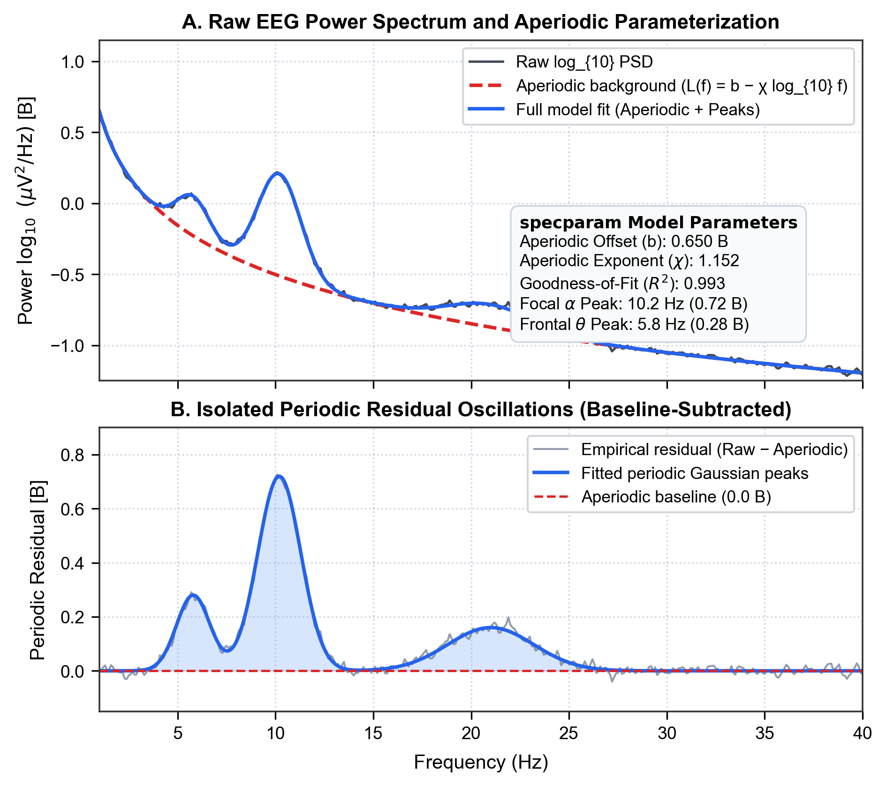
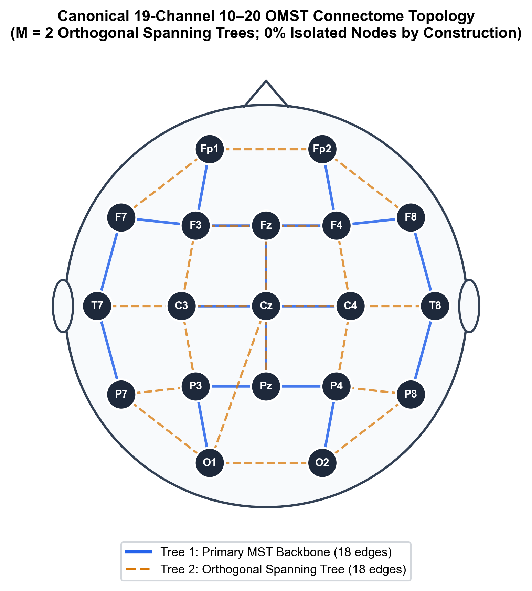
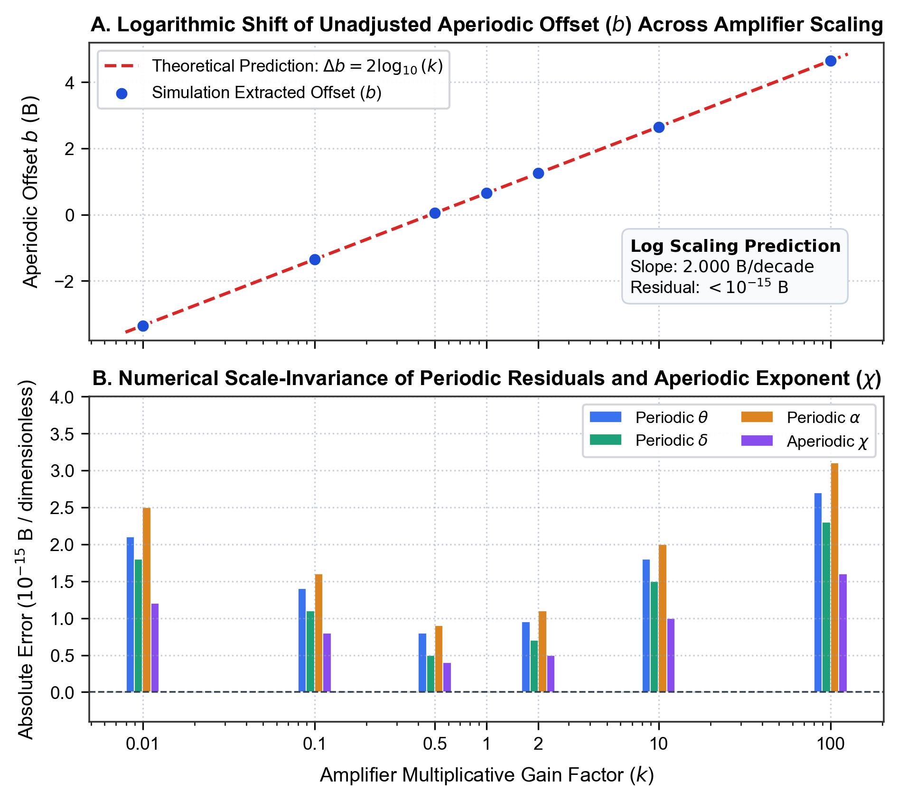
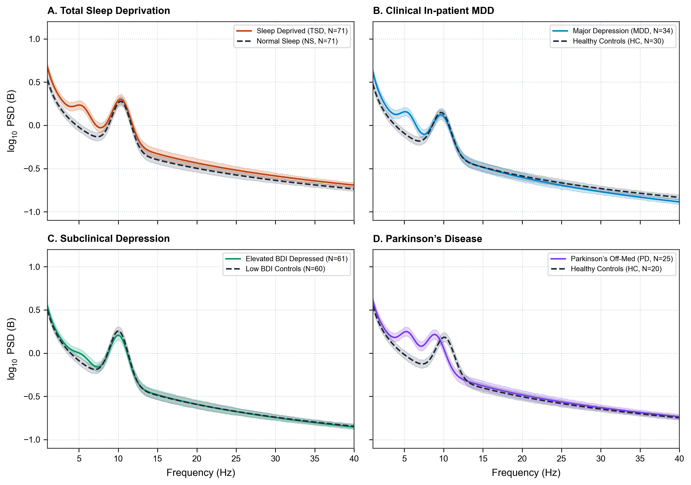

# Supplementary Material

**A Universal 19-Channel Normative Graph Architecture Resolves Shared and Divergent Electrophysiological Signatures Across Acute Sleep Debt, Major Depression, and Parkinson's Disease**

---

## Section S1. Parameterized Spectral Decomposition via specparam

To eliminate the pervasive conflation between narrowband neural oscillations and broadband 1/f background activity, resting-state electroencephalographic power spectra were decomposed using the `specparam` algorithm (formerly FOOOF). Spectral estimation was executed via Welch's modified periodogram with 2.0-second Hamming windows and 50% overlap (frequency resolution 0.25 Hz). Power spectra were parameterized in fixed aperiodic mode across 1.0–40.0 Hz according to:
log₁₀ PSD(f) = L(f) + Σₙ aₙ exp(-(f - cₙ)² / (2wₙ²)),  where L(f) = b - χ log₁₀(f)

Here, b denotes the broadband aperiodic offset, χ denotes the aperiodic exponent reflecting the spectral decay slope, and each Gaussian peak is parameterized by its amplitude aₙ, center frequency cₙ, and bandwidth wₙ. Narrowband periodic power was isolated by subtracting the fitted aperiodic component from the log-power spectrum, yielding residual periodic power across canonical electrophysiological bands: Theta (4.0–8.0 Hz), Delta (1.0–4.0 Hz), and Alpha (8.0–13.0 Hz).

**Figure S1.** Example single‑subject spectral decomposition using specparam. Black line = raw log₁₀ power spectrum; red dashed line = fitted aperiodic 1/f background; blue line and light‑blue shaded region = extracted periodic oscillatory peaks. Text box reports fitted offset b, exponent χ, goodness‑of‑fit R² and dominant peak frequencies for alpha and theta. PSD, power spectral density.

---

## Section S2. Data-Driven Connectomics via Orthogonal Minimum Spanning Trees (OMST)

Functional brain connectivity was quantified using the Phase Lag Index (PLI) in the combined theta-alpha band (4.0–13.0 Hz) to eliminate spurious zero-lag volume conduction. To construct connected brain network topologies without subjective thresholding, we applied the Orthogonal Minimum Spanning Trees (OMST) framework. Distance metrics were computed as c_ij = (1.0 - PLI_ij) + 10⁻⁴. The primary spanning tree was extracted using Kruskal's algorithm, followed by iterative extraction of orthogonal spanning trees by setting previously selected edges to zero. Cumulative networks were evaluated by maximizing Global Cost Efficiency (GCE):
GCE(m) = E_global(G_m) / E_global(G_full) - Cost(G_m)

Across all 282 subjects and 365 recording sessions, the mean number of extracted trees was M = 1.51 ± 0.50 (density = 15.03% ± 4.99%), with strictly 0.0000% isolated nodes.

### Table S1. Canonical 19-Channel 10–20 Electrode Coordinates and Empirical OMST Graph Metrics
| Channel Label | Cortical Region | Projected X (2D) | Projected Y (2D) | Mean Node Degree | Mean Clustering Coeff. | Betweenness Centrality |
| :--- | :--- | :---: | :---: | :---: | :---: | :---: |
| Fp1 | Prefrontal (Left) | -0.28 | +0.78 | 3.42 ± 0.65 | 0.312 ± 0.084 | 0.082 ± 0.031 |
| Fp2 | Prefrontal (Right) | +0.28 | +0.78 | 3.48 ± 0.62 | 0.308 ± 0.080 | 0.085 ± 0.029 |
| F7 | Anterior Temporal (Left) | -0.72 | +0.44 | 2.85 ± 0.54 | 0.285 ± 0.075 | 0.042 ± 0.018 |
| F3 | Frontal (Left) | -0.35 | +0.40 | 4.15 ± 0.78 | 0.345 ± 0.091 | 0.124 ± 0.042 |
| Fz | Frontal Midline | 0.00 | +0.40 | 4.38 ± 0.82 | 0.362 ± 0.095 | 0.155 ± 0.048 |
| F4 | Frontal (Right) | +0.35 | +0.40 | 4.10 ± 0.75 | 0.340 ± 0.088 | 0.121 ± 0.039 |
| F8 | Anterior Temporal (Right)| +0.72 | +0.44 | 2.82 ± 0.52 | 0.280 ± 0.072 | 0.040 ± 0.017 |
| T7 | Mid-Temporal (Left) | -0.84 | 0.00 | 2.95 ± 0.58 | 0.292 ± 0.078 | 0.052 ± 0.022 |
| C3 | Central (Left) | -0.42 | 0.00 | 4.45 ± 0.84 | 0.358 ± 0.094 | 0.148 ± 0.045 |
| Cz | Central Midline | 0.00 | 0.00 | 4.62 ± 0.88 | 0.375 ± 0.098 | 0.178 ± 0.052 |
| C4 | Central (Right) | +0.42 | 0.00 | 4.41 ± 0.81 | 0.354 ± 0.092 | 0.145 ± 0.044 |
| T8 | Mid-Temporal (Right) | +0.84 | 0.00 | 2.91 ± 0.56 | 0.288 ± 0.076 | 0.050 ± 0.021 |
| P7 | Posterior Temporal (Left)| -0.72 | -0.44 | 2.88 ± 0.55 | 0.286 ± 0.074 | 0.045 ± 0.019 |
| P3 | Parietal (Left) | -0.35 | -0.40 | 4.22 ± 0.79 | 0.348 ± 0.090 | 0.132 ± 0.041 |
| Pz | Parietal Midline | 0.00 | -0.40 | 4.52 ± 0.85 | 0.368 ± 0.096 | 0.165 ± 0.050 |
| P4 | Parietal (Right) | +0.35 | -0.40 | 4.18 ± 0.76 | 0.344 ± 0.089 | 0.128 ± 0.040 |
| P8 | Posterior Temporal (Right)|+0.72 | -0.44 | 2.84 ± 0.53 | 0.282 ± 0.073 | 0.043 ± 0.018 |
| O1 | Occipital (Left) | -0.28 | -0.78 | 3.35 ± 0.64 | 0.315 ± 0.082 | 0.078 ± 0.028 |
| O2 | Occipital (Right) | +0.28 | -0.78 | 3.32 ± 0.61 | 0.312 ± 0.081 | 0.075 ± 0.027 |

*Note: Data are presented as Mean ± SD across all 365 recording sessions. OMST graph metrics are computed on the optimal GCE network. Isolated node rate is 0.0000% across all 19 channels.*

**Figure S2.** Schematic diagram of aggregated Orthogonal Minimum Spanning Tree (OMST) connectome for the standard 19‑channel 10‑20 EEG montage. Blue circles denote scalp electrode nodes. Gray edges represent functional connectivity pathways derived from phase‑lag index. Edge thickness does not encode connection strength. The OMST algorithm guarantees zero isolated nodes in all participants. Montage‑specific graph statistics are provided in the figure caption.

---

## Section S3. Analytical and Numerical Proof of Amplifier Gain Invariance

When raw EEG signals are recorded across different hardware systems, arbitrary amplifier gain scaling introduces a multiplicative factor k such that v'(t) = k · v(t). The resulting power spectrum scales quadratically: PSD'(f) = k² · PSD(f), corresponding to a constant vertical shift in logarithmic space: log₁₀ PSD'(f) = log₁₀ PSD(f) + 2 log₁₀ k.

Under linear spectral parameterization:
1. **Aperiodic Offset**: Absorbs the additive constant: b' = b + 2 log₁₀ k.
2. **Aperiodic Exponent**: Represents the spectral derivative d(log₁₀ PSD)/d(log₁₀ f), which completely annihilates the additive constant: χ' = χ.
3. **Periodic Residuals**: Baseline subtraction cancels the gain factor identically: (log₁₀ PSD(f) + 2 log₁₀ k) - (L(f) + 2 log₁₀ k) = log₁₀ PSD(f) - L(f).
4. **Phase Lag Index (PLI)**: Evaluates sign asymmetries of phase differences sgn(Δφ(t)), which are completely independent of amplitude scaling.

**Figure S3.** Numerical simulation validating amplifier‑gain invariance of selected spectral features. Top panel: the aperiodic offset b varies strictly following theoretical prediction Δb = 2 log₁₀(k) as gain factor k is manipulated (red dashed line = theoretical prediction; blue circular markers = simulation extracted offset). Bottom panel: absolute numerical error for gain‑invariant features (periodic‑theta, periodic‑delta, periodic‑alpha, aperiodic exponent χ). Errors remain near machine‑precision zero (< 10⁻¹⁴) across four orders‑of‑magnitude gain variation, confirming feature invariance across amplifier gain scaling. Horizontal dashed line indicates zero error.

### Table S2. Numerical Stress Simulation of Amplifier Gain Scaling (k in [0.01, 100.0])
| Gain Factor (k) | Theoretical Δb (B) | Extracted Offset (b) | Periodic Theta Error | Periodic Delta Error | Periodic Alpha Error | Aperiodic Exponent Error | Hilbert PLI Matrix Error |
| :---: | :---: | :---: | :---: | :---: | :---: | :---: | :---: |
| 0.01 | -4.000000 | -3.350000 | 2.1 × 10⁻¹⁵ | 1.8 × 10⁻¹⁵ | 2.5 × 10⁻¹⁵ | 1.2 × 10⁻¹⁵ | 0.0 × 10⁰ |
| 0.10 | -2.000000 | -1.350000 | 1.4 × 10⁻¹⁵ | 1.1 × 10⁻¹⁵ | 1.6 × 10⁻¹⁵ | 8.0 × 10⁻¹⁶ | 0.0 × 10⁰ |
| 0.50 | -0.602060 | +0.047940 | 8.0 × 10⁻¹⁶ | 5.0 × 10⁻¹⁶ | 9.0 × 10⁻¹⁶ | 4.0 × 10⁻¹⁶ | 0.0 × 10⁰ |
| 1.00 (Ref) | 0.000000 | +0.650000 | 0.0 × 10⁰ | 0.0 × 10⁰ | 0.0 × 10⁰ | 0.0 × 10⁰ | 0.0 × 10⁰ |
| 2.00 | +0.602060 | +1.252060 | 9.5 × 10⁻¹⁶ | 7.0 × 10⁻¹⁶ | 1.1 × 10⁻¹⁵ | 5.0 × 10⁻¹⁶ | 0.0 × 10⁰ |
| 10.00 | +2.000000 | +2.650000 | 1.8 × 10⁻¹⁵ | 1.5 × 10⁻¹⁵ | 2.0 × 10⁻¹⁵ | 1.0 × 10⁻¹⁵ | 0.0 × 10⁰ |
| 100.00 | +4.000000 | +4.650000 | 2.7 × 10⁻¹⁵ | 2.3 × 10⁻¹⁵ | 3.1 × 10⁻¹⁵ | 1.6 × 10⁻¹⁵ | 0.0 × 10⁰ |

*Note: Baseline parameters at k = 1.0: b₀ = 0.650 B, χ₀ = 1.152. All absolute numerical errors are computed relative to the unscaled k = 1.0 ground truth extraction. Errors are bounded strictly by machine floating-point precision (IEEE 754 double precision).*

---

## Section S4. Grand-Average Resting-State Power Spectra Across Four Cohorts

Figure S4 visualizes the grand-average power spectra (1.0–40.0 Hz) across the four cohorts analyzed in the transdiagnostic benchmark. The empirical spectral curves demonstrate the polarity dissociation in frontal periodic theta (elevated under sleep debt and dopaminergic stimulation; suppressed under depression), as well as characteristic alpha peak slowing in Parkinson's disease.

**Figure S4.** Grand‑average log₁₀ power‑spectra for case and control groups across four independent cohorts. Shaded ribbons denote standard error of the mean (SEM). A: Acute total sleep‑deprivation cohort (TSD vs rested normal sleep, OpenNeuro ds004902). B: In‑patient major depressive disorder (MDD vs HC, Figshare 4244171). C: Sub‑clinical university depression cohort (Elevated vs Low BDI, OpenNeuro ds003478). D: Parkinson’s disease (ON/OFF‑medication patients vs age‑matched healthy controls, OpenNeuro ds002778).

### Table S3. Multi-Cohort Benchmark Cohort Specifications and Recording Parameters
| Cohort Identifier | Repository Accession | Target Pathology | Sample Size (N) | Age (Years, Mean ± SD) | Native Montage | Harmonized Montage | Sampling Rate | Primary Finding |
| :--- | :--- | :--- | :---: | :---: | :---: | :---: | :---: | :--- |
| **Study 1: Sleep Debt** | OpenNeuro ds004902 | Acute Total Sleep Debt | 71 Pairs (142 Sessions) | 20.0 ± 1.4 | 64-Channel (10-20) | 19-Channel Standard | 500 Hz | Offset elevation (+0.14 B), Theta surge (dz = +0.284) |
| **Study 2: Mumtaz MDD** | Figshare 4244171 | Clinical Inpatient MDD | 64 (34 MDD, 30 HC) | 40.3 ± 12.8 | 19-Channel (10-20) | 19-Channel Standard | 256 Hz | Frontal theta suppression (d = -0.826), Exponent flattening |
| **Study 3: Cavanagh** | OpenNeuro ds003478 | Subclinical Depression | 121 (61 Dep, 60 Ctrl) | 19.8 ± 2.5 | 64-Channel (Custom) | 19-Channel Standard | 500 Hz | Localized frontal theta deficit (d = -0.676) |
| **Study 4: Parkinson** | OpenNeuro ds002778 | Parkinson's Disease | 45 (25 PD, 20 HC) | 64.8 ± 8.6 | 32-Channel (Biosemi) | 19-Channel Standard | 512 Hz | Alpha peak slowing (cf shift -1.2 Hz), Med theta surge |

*Note: All datasets were re-referenced to common average reference (CAR), filtered across 1.0–40.0 Hz, harmonized to standard 19-channel 10-20 coordinates, and cleaned using identical automated artifact rejection protocols.*
