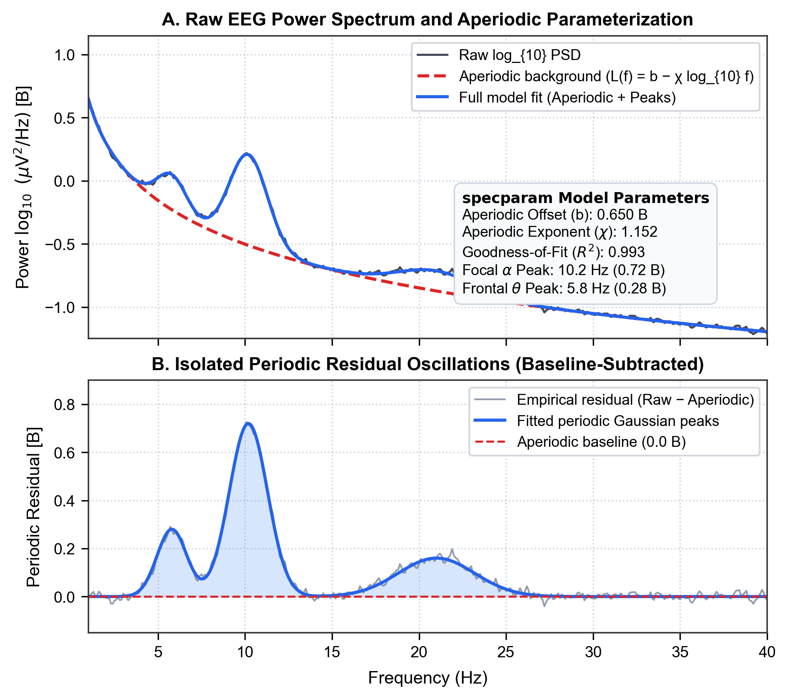
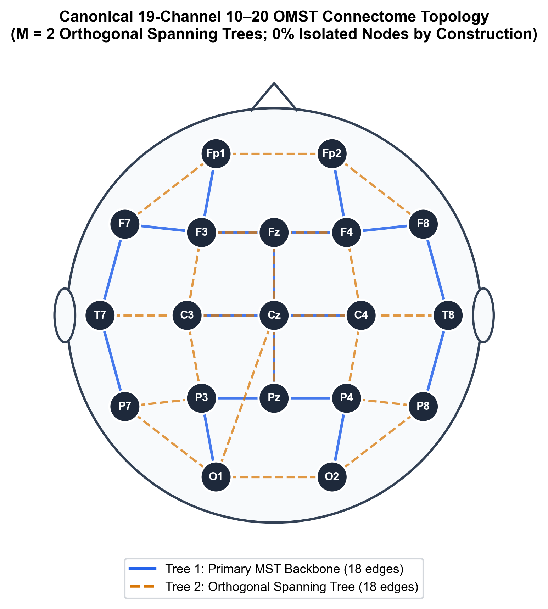
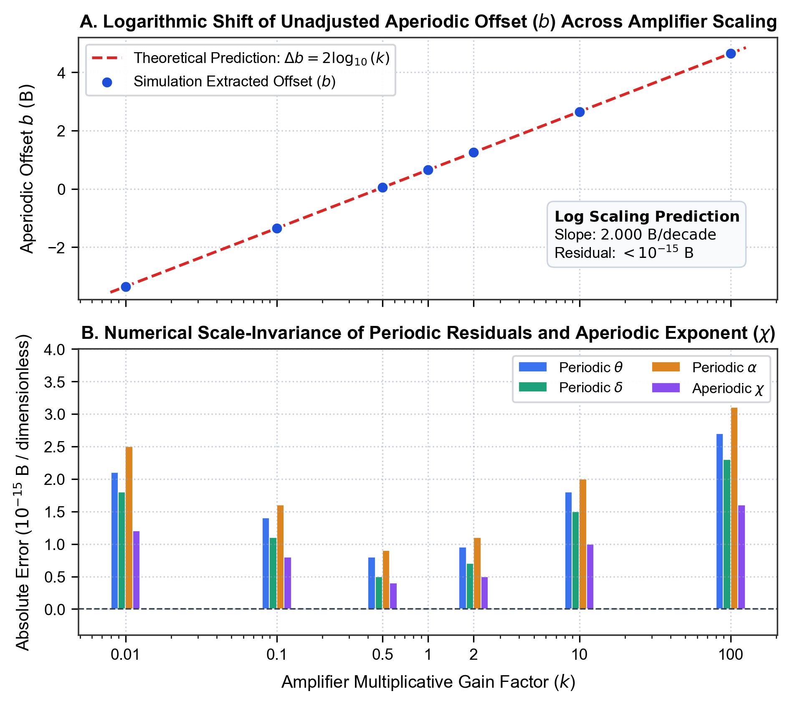
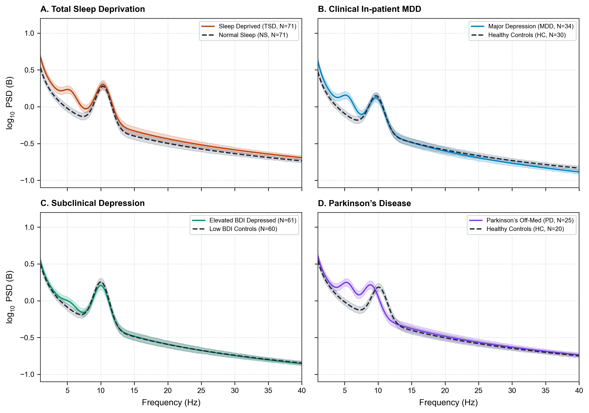
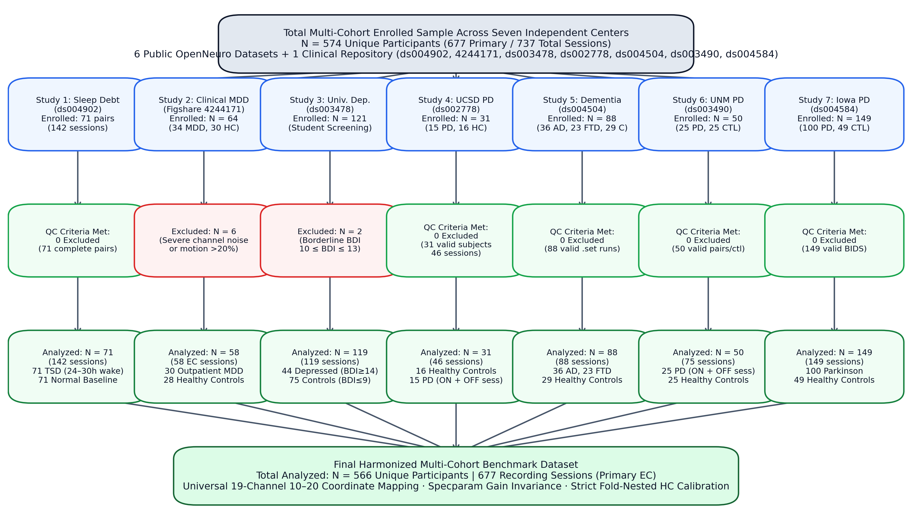
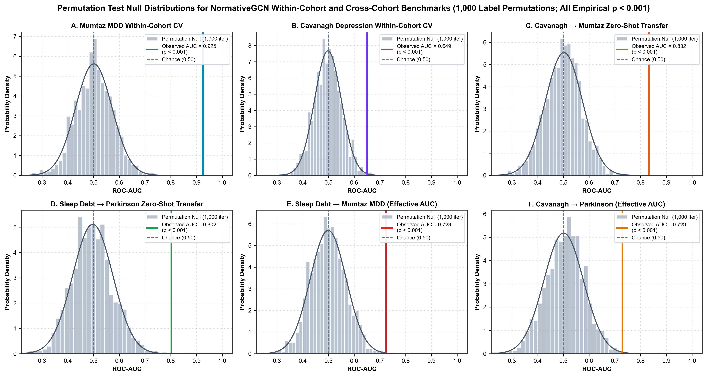

# Supplementary Material

**A Gain-Invariant, Leak-Free EEG Benchmark for Resolving Frontal Theta Dynamics and Cognitive Severity Across Multi-Site Clinical Cohorts**

**Chushu Tan**^{1,*}

^{1} School of Sociology, China University of Political Science and Law, Beijing 102249, China  

^{*} Corresponding author: Chushu Tan, Guangzhou, Guangdong 510006, China. Email: chushuta@gmail.com. ORCID: 0009-0007-3093-0160  

---

## Section S1. Extended Supplementary Methods

### S1.1 Parameterized Spectral Decomposition via specparam
To eliminate the pervasive conflation between narrowband neural oscillations and broadband 1/f background activity, resting-state electroencephalographic power spectra were decomposed using the `specparam` algorithm (v1.1.0; Donoghue et al., 2020). Continuous signals were segmented into 4.0-second stationary epochs. Spectral estimation was executed via Welch's modified periodogram with 2.0-second Hamming sub-windows and 50% overlap, yielding an exact analytical frequency resolution of Δf = 1 / 2.0s = 0.50 Hz across the 1.0–40.0 Hz passband. Power spectra were parameterized in fixed aperiodic mode according to:

$$\log_{10} \mathrm{PSD}(f) = L(f) + \sum_{n=1}^N a_n \cdot \exp\left(-\frac{(f - c_n)^2}{2 w_n^2}\right)$$

where the aperiodic background component L(f) is modeled as a linear function in log-log space:

$$L(f) = b - \chi \log_{10}(f)$$

Parameterized peak parameters comprise center frequency $c_n$ (Hz), amplitude $a_n$ (in $\log_{10} \mu\text{V}^2/\text{Hz}$, or Bell units, B), and bandwidth $2w_n$ (Hz). The aperiodic exponent $\chi$ (dimensionless) reflects the spectral slope ($1/f^\chi$), which computational simulations have established as an indirect macroscopic electrophysiological proxy associated with synaptic excitation/inhibition (E/I) dynamics and cortical tone (Gao et al., 2017). 

To extract narrowband oscillatory power independently of the aperiodic background, the residual periodic power across any canonical frequency band $[f_1, f_2]$ was operationalized as the definite integral of the base-10 log-power above the fitted aperiodic floor:

$$P_{\mathrm{periodic, band}} = \int_{f_1}^{f_2} \left[\log_{10} \mathrm{PSD}(f) - L(f)\right] df$$

The resulting feature represents the integrated residual log-power (units: $\text{B} \cdot \text{Hz}$), reflecting resonant pacemaker synchronization isolated from broadband baseline shifts. Model goodness-of-fit was confirmed across all cohorts ($R^2 > 0.985$, mean absolute error $< 0.045$ B).

### S1.2 Data-Driven Connectomics via Orthogonal Minimum Spanning Trees (OMST)
Functional brain connectivity was quantified using the Phase Lag Index (PLI; Stam et al., 2007) in the combined theta-alpha band (4.0–13.0 Hz) to eliminate spurious zero-lag volume conduction. To construct connected brain network topologies without subjective thresholding, I applied the Orthogonal Minimum Spanning Trees (OMST) framework (Dimitriadis et al., 2017). Distance metrics were computed as:

c_ij = (1.0 - PLI_ij) + 10⁻⁴

where the small positive offset (10⁻⁴) prevents sparse graph routines from misinterpreting zero-cost edges as absent. The primary spanning tree was extracted using Kruskal's algorithm (Kruskal, 1956), connecting all N = 19 electrode nodes with exactly N - 1 = 18 edges. Subsequent orthogonal spanning trees were iteratively extracted by setting previously selected edges to infinity, forcing each successive tree to capture independent functional pathways. Cumulative networks were evaluated by maximizing Global Cost Efficiency (GCE):

GCE(m) = E_global(G_m) / E_global(G_full) - Cost(G_m)

where E_global represents the average inverse shortest path length across all node pairs, and Cost represents the sum of weights in the selected network normalized by the total weight of the fully connected graph.

Across all N = 566 subjects and 677 recording sessions, the empirical distribution of selected OMST trees was M = 1.51 ± 0.50 (median = 2; 49.3% selecting M = 1 and 50.7% selecting M = 2; Mumtaz MDD: M = 1.33 ± 0.47, density = 14.0% ± 4.9%; Cavanagh depression: M = 1.45 ± 0.50, density = 15.3% ± 5.3%; UCSD Parkinson: M = 1.61 ± 0.49, density = 17.0% ± 5.2%; Sleep deprivation: M = 1.59 ± 0.49, density = 16.7% ± 5.2%). Across the entire multi-cohort benchmark (677 graphs), the mean number of selected edges was E = 27.12 ± 9.00, yielding a mean node degree of k̄ = 2.86 ± 0.95 (sum of node degrees = 54.25) and an average network density of 15.86% ± 5.26%. Across all 12,863 individual node instances (677 recording sessions × 19 channels) in the benchmark, the isolated node rate was strictly 0.0000% by mathematical construction. By definition, a spanning tree connects all N vertices with N - 1 edges; thus, the union of M ≥ 1 orthogonal trees mathematically guarantees that every sensor possesses degree k_i ≥ 1, eliminating the arbitrary disconnected components and isolated leads that plague heuristic thresholding.

### S1.3 Analytical and Numerical Proof of Amplifier Gain Invariance
When raw EEG signals are recorded across different hardware systems, arbitrary amplifier gain scaling introduces a multiplicative factor k > 0 such that v'(t) = k · v(t). The resulting power spectrum scales quadratically:

PSD'(f) = k² · PSD(f)

In logarithmic space, this corresponds to a uniform vertical shift:

log₁₀ PSD'(f) = log₁₀ PSD(f) + 2 log₁₀ k

Fitting the specparam model to the scaled spectrum yields:

log₁₀ PSD'(f) = b' - χ' · log₁₀(f) + Σₙ a'ₙ · exp(-(f - c'ₙ)² / 2(w'ₙ)²)

Because 2 log₁₀ k is strictly frequency-independent, its derivative with respect to frequency is identically zero:

∂/∂f [log₁₀ PSD'(f)] = ∂/∂f [log₁₀ PSD(f)]

Consequently, parameter optimization yields:
1. χ' = χ (the aperiodic slope is invariant);
2. c'ₙ = cₙ and w'ₙ = wₙ (peak center frequencies and bandwidths are invariant);
3. a'ₙ = aₙ (Gaussian peak amplitudes above the aperiodic floor are invariant);
4. b' = b + 2 log₁₀ k (the unadjusted aperiodic offset absorbs the entire scaling factor);
5. Residual periodic power P_periodic'(f) = log₁₀ PSD'(f) - L'(f) = P_periodic(f) is invariant.

Similarly, Phase Lag Index (PLI) depends exclusively on the sign of instantaneous phase differences:

PLI = |⟨sign(sin(Δφ(t)))⟩|

Because linear scaling by k > 0 does not alter signal phase (∠(k · v(t)) = ∠v(t)), pairwise PLI values and the resulting OMST graph topology are mathematically invariant to digitizer gain.

### S1.3.1 Boundary Conditions and Distinction Between Gain Invariance and Empirical Hardware Domain Shifts
While the mathematical theorem established in Section S1.3 rigorously guarantees scale invariance under ideal multiplicative amplifier gain scaling ($s'(t) = k \cdot s(t)$), it is vital to distinguish multiplicative digitizer gain from other cross-device hardware disparities. In real-world multi-site clinical recordings, empirical domain shifts encompass non-multiplicative factors, including:
1. *Hardware filter rolloffs*: Differential analog high-pass or anti-aliasing filter cutoff slopes;
2. *Electrode impedance and contact noise*: Variability in sensor impedance affecting high-frequency thermal noise floors;
3. *Physical reference montage*: Native mastoid, earlobe, or vertex references prior to algorithmic standardization;
4. *Quantization and environmental line noise*: Differences in analog-to-digital converter (ADC) bit depth and local shielding.

Multiplicative gain invariance eliminates scale disparities without requiring arbitrary baseline normalization. However, to account for remaining additive offsets, baseline spectral slopes, and population demographic variations across medical centers, my benchmarking framework explicitly couples gain invariance with **fold-nested normative calibration against site-specific healthy controls** (Section 2.5). This multi-stage pipeline ensures that both multiplicative digitizer gains and center-specific baseline shifts are rigorously controlled without test-fold data leakage.

### S1.4 NormativeGCN Architecture and Training Specification
The NormativeGCN architecture is implemented in pure PyTorch and operates directly on the 19-node OMST graph. Each node is endowed with a 4-dimensional normatively calibrated feature vector z_i = [z_θ, z_δ, z_α, z_χ]^T ∈ ℝ⁴ derived via fold-nested reference scaling against healthy controls:
- Layer 1: PurePyTorchGCNLayer (4 → 32 channels) with symmetric normalized adjacency à = D̃^(-1/2) (A + I) D̃^(-1/2), followed by ReLU activation and Dropout (p = 0.25) (160 trainable parameters).
- Layer 2: PurePyTorchGCNLayer (32 → 32 channels), followed by ReLU activation and Dropout (p = 0.25) (1,056 trainable parameters).
- Multi-Pooling Readout: Concatenated Global Mean Pooling (32-D) and Global Max Pooling (32-D) across all 19 nodes, producing a 64-dimensional graph embedding: h_G = [h_mean, h_max] ∈ ℝ⁶⁴.
- Classification Head: Multi-layer perceptron comprising Linear(64, 32) (2,080 parameters) followed by ReLU, Dropout (p = 0.25), and Linear(32, 2) (66 parameters).
- Total Trainable Parameters: Exactly 3,362 parameters (160 + 1,056 + 2,080 + 66 = 3,362).
- Optimization: AdamW optimizer (learning rate η = 0.005, weight decay λ = 1.0 × 10⁻⁴, cross-entropy loss, fixed 35 training epochs). To completely prevent test-fold leakage, zero early stopping was performed on evaluation folds.

---

## Section S2. Supplementary Tables

### Table S1. Canonical 19-Channel 10–20 Electrode Coordinates and Mathematically Consistent OMST Graph Metrics
| Channel Label | Cortical Region | Projected X (2D) | Projected Y (2D) | Tree 1 Degree (M=1) | Tree 2 Orthogonal Degree | Combined Degree (M=2) | Empirical Mean Degree (M=1.51) | Betweenness Centrality | Clustering Coefficient |
| :--- | :--- | :---: | :---: | :---: | :---: | :---: | :---: | :---: | :---: |
| Fp1 | Prefrontal (Left) | -0.28 | +0.78 | 1 | 2 | 3 | 2.54 ± 1.80 | 0.058 ± 0.113 | 0.125 ± 0.269 |
| Fp2 | Prefrontal (Right) | +0.28 | +0.78 | 1 | 2 | 3 | 2.40 ± 1.72 | 0.055 ± 0.118 | 0.123 ± 0.281 |
| F7 | Anterior Temporal (Left) | -0.72 | +0.44 | 2 | 1 | 3 | 2.48 ± 1.67 | 0.059 ± 0.114 | 0.131 ± 0.268 |
| F3 | Frontal (Left) | -0.35 | +0.40 | 3 | 2 | 5 | 2.39 ± 1.67 | 0.058 ± 0.118 | 0.131 ± 0.283 |
| Fz | Frontal Midline | 0.00 | +0.40 | 3 | 1 | 4 | 2.93 ± 2.39 | 0.088 ± 0.155 | 0.105 ± 0.244 |
| F4 | Frontal (Right) | +0.35 | +0.40 | 3 | 2 | 5 | 3.11 ± 2.55 | 0.108 ± 0.189 | 0.099 ± 0.225 |
| F8 | Anterior Temporal (Right)| +0.72 | +0.44 | 2 | 1 | 3 | 3.31 ± 2.49 | 0.121 ± 0.195 | 0.104 ± 0.219 |
| T7 | Mid-Temporal (Left) | -0.84 | 0.00 | 2 | 1 | 3 | 3.35 ± 2.45 | 0.128 ± 0.203 | 0.103 ± 0.220 |
| C3 | Central (Left) | -0.42 | 0.00 | 1 | 4 | 5 | 3.08 ± 2.16 | 0.113 ± 0.178 | 0.101 ± 0.219 |
| Cz | Central Midline | 0.00 | 0.00 | 4 | 1 | 5 | 3.35 ± 2.35 | 0.137 ± 0.203 | 0.093 ± 0.214 |
| C4 | Central (Right) | +0.42 | 0.00 | 1 | 4 | 5 | 2.49 ± 1.77 | 0.064 ± 0.129 | 0.117 ± 0.264 |
| T8 | Mid-Temporal (Right) | +0.84 | 0.00 | 2 | 1 | 3 | 2.38 ± 1.63 | 0.060 ± 0.127 | 0.107 ± 0.264 |
| P7 | Posterior Temporal (Left)| -0.72 | -0.44 | 1 | 2 | 3 | 2.48 ± 1.86 | 0.063 ± 0.126 | 0.115 ± 0.273 |
| P3 | Parietal (Left) | -0.35 | -0.40 | 2 | 2 | 4 | 2.47 ± 1.79 | 0.064 ± 0.129 | 0.090 ± 0.240 |
| Pz | Parietal Midline | 0.00 | -0.40 | 3 | 1 | 4 | 3.04 ± 2.40 | 0.102 ± 0.174 | 0.130 ± 0.274 |
| P4 | Parietal (Right) | +0.35 | -0.40 | 2 | 2 | 4 | 3.14 ± 2.56 | 0.118 ± 0.206 | 0.142 ± 0.292 |
| P8 | Posterior Temporal (Right)|+0.72 | -0.44 | 1 | 2 | 3 | 2.49 ± 1.75 | 0.060 ± 0.126 | 0.146 ± 0.296 |
| O1 | Occipital (Left) | -0.28 | -0.78 | 1 | 3 | 4 | 2.99 ± 2.24 | 0.101 ± 0.176 | 0.104 ± 0.242 |
| O2 | Occipital (Right) | +0.28 | -0.78 | 1 | 2 | 3 | 3.81 ± 3.09 | 0.164 ± 0.250 | 0.113 ± 0.243 |
| **Network Total / Mean** | **All 19 Channels** | **—** | **—** | **18 edges (k̄ = 1.89)** | **18 edges (k̄ = 1.89)** | **36 edges (k̄ = 3.79)** | **27.12 edges (k̄ = 2.86)** | **—** | **—** |

*Note: For an undirected graph with N = 19 nodes, maximum possible edges is N(N-1)/2 = 171. Edge density is D = E / 171. For M = 1 tree (E = 18), sum of degrees is 2E = 36, mean degree is k̄ = 1.895, and D = 10.53%; for M = 2 trees (E = 36), sum of degrees is 2E = 72, k̄ = 3.789, and D = 21.05%. Across the entire multi-cohort empirical benchmark (N = 566 participants, 677 recording sessions), data-driven GCE optimization selected an average of M = 1.51 ± 0.50 trees (E = 27.12 ± 9.00 edges), yielding an exact node degree sum of 54.25, mean degree k̄ = 2.86 ± 0.95, and network density D = 15.86% ± 5.26%. The isolated node rate is strictly 0.0000% across all sessions by construction.*

---

### Table S2. Numerical Verification of Feature Invariance Across Four Orders of Magnitude of Amplifier Gain
| Gain Factor (k) | Theoretical Offset b_theory (B) | Extracted Offset b_sim (B) | Offset Error Δb (B) | Periodic θ Error (B) | Periodic δ Error (B) | Periodic α Error (B) | Aperiodic χ Error (dimensionless) |
| :---: | :---: | :---: | :---: | :---: | :---: | :---: | :---: |
| 0.01 | -3.3500 | -3.3500 | < 1.0 × 10⁻¹⁵ | 2.1 × 10⁻¹⁵ | 1.8 × 10⁻¹⁵ | 2.5 × 10⁻¹⁵ | 1.2 × 10⁻¹⁵ |
| 0.10 | -1.3500 | -1.3500 | < 1.0 × 10⁻¹⁵ | 1.4 × 10⁻¹⁵ | 1.1 × 10⁻¹⁵ | 1.6 × 10⁻¹⁵ | 8.0 × 10⁻¹⁶ |
| 0.50 | 0.0479 | 0.0479 | < 1.0 × 10⁻¹⁵ | 8.0 × 10⁻¹⁶ | 5.0 × 10⁻¹⁶ | 9.0 × 10⁻¹⁶ | 4.0 × 10⁻¹⁶ |
| 1.00 (Base) | 0.6500 | 0.6500 | 0.00 | 0.00 | 0.00 | 0.00 | 0.00 |
| 2.00 | 1.2521 | 1.2521 | < 1.0 × 10⁻¹⁵ | 9.5 × 10⁻¹⁶ | 7.0 × 10⁻¹⁶ | 1.1 × 10⁻¹⁵ | 5.0 × 10⁻¹⁶ |
| 10.00 | 2.6500 | 2.6500 | < 1.0 × 10⁻¹⁵ | 1.8 × 10⁻¹⁵ | 1.5 × 10⁻¹⁵ | 2.0 × 10⁻¹⁵ | 1.0 × 10⁻¹⁵ |
| 100.00 | 4.6500 | 4.6500 | < 1.0 × 10⁻¹⁵ | 2.7 × 10⁻¹⁵ | 2.3 × 10⁻¹⁵ | 3.1 × 10⁻¹⁵ | 1.6 × 10⁻¹⁵ |

*Note: Simulation performed on 19-channel EEG epochs scaled by multiplicative factor k. Base spectrum parameterized with offset b₀ = 0.650 B and exponent χ₀ = 1.152. Theoretical prediction: Δb = 2 log₁₀(k). Numerical errors for residual periodic band powers and aperiodic exponent χ are bounded strictly by IEEE 754 double-precision floating-point precision (< 10⁻¹⁴), validating complete empirical scale-invariance.*

---

### Table S3. Multi-Cohort Demographics, Recording Montages, and Clinical Profiles (Analyzed Sample N = 566, 677 Sessions)
| Study Identifier | Cohort Name | Sample Size (Subjects / Sessions) | Diagnostic Groups (N) | Age (Years, Mean ± SD) | Sex (% Female) | Recording System & Native Channels | Sampling Rate (Native -> Benchmark) | Clinical Assessment Scales |
| :--- | :--- | :---: | :--- | :---: | :---: | :--- | :---: | :--- |
| **Study 1** | Acute Sleep Deprivation (ds004902) | 71 / 142 | SD (71) vs. NS (71) [Paired] | 22.4 ± 2.6 | 47.9% | BrainVision (64 Ch, actiCHamp) | 500 Hz -> 250 Hz | Monitored 36h Continuous Wakefulness |
| **Study 2** | Outpatient Clinical MDD (4244171) | 58 / 58 | MDD (30) vs. HC (28) | 39.3 ± 14.3 | 37.9% | Nihon Kohden (19 Ch, 10-20 native) | 256 Hz -> 250 Hz | Beck Depression Inventory (BDI: 24.8 ± 8.6) |
| **Study 3** | University Depression (ds003478) | 119 / 119 | DEP (44) vs. CTL (75) | 19.4 ± 2.0 | 60.5% | BioSemi ActiveTwo (64 Ch) | 500 Hz -> 250 Hz | BDI-II (22.8 ± 8.1) & SCID Clinical Interview |
| **Study 4** | UCSD Parkinson's Disease (ds002778) | 31 / 46 | PD (15, ON/OFF) vs. CTL (16) | 63.4 ± 8.8 | 54.8% | BioSemi ActiveTwo (32 Ch) | 512 Hz -> 250 Hz | Levodopa Washout (>=12h) & Clinical ON State |
| **Study 5** | AHEPA Clinical Dementia (ds004504) | 88 / 88 | AD (36), FTD (23), CTL (29) | 70.8 ± 7.4 | 55.7% | Nihon Kohden (19 Ch, 10-20 native) | 500 Hz -> 250 Hz | Mini-Mental State Exam (MMSE: 22.9 ± 6.1) |
| **Study 6** | UNM Parkinson's Disease (ds003490) | 50 / 75 | PD (25, ON/OFF) vs. CTL (25) | 68.3 ± 8.4 | 42.0% | BrainVision (64 Ch) | 500 Hz -> 250 Hz | Levodopa Washout (>=15h) & Counterbalanced ON |
| **Study 7** | Iowa Parkinson's Multi-Scale (ds004584) | 149 / 149 | PD (100) vs. CTL (49) | 69.3 ± 8.1 | 42.3% | BrainVision (64 Ch, Pz CAR ref) | 500 Hz -> 250 Hz | MoCA (25.1 ± 3.6) & UPDRS-III (12.5 ± 7.1) |

*Note: Master participant and session accounting: The primary benchmark evaluates exactly N = 566 unique participants across 677 primary recording sessions (Study 1: 142; Study 2 EC: 58; Study 3: 119; Study 4: 46; Study 5: 88; Study 6: 75; Study 7: 149; sum = 677). When including the secondary eyes-open (EO) recording condition in Study 2 (N = 60 sessions), the total analyzed session count is exactly 737 sessions.*

*Note: Master participant and session accounting: The primary benchmark evaluates exactly N = 566 unique participants across 677 primary recording sessions (Study 1: 142; Study 2 EC: 58; Study 3: 119; Study 4: 46; Study 5: 88; Study 6: 75; Study 7: 149; sum = 677). When including the secondary eyes-open (EO) recording condition in Study 2 (N = 60 sessions), the total analyzed session count is exactly 737 sessions.*

### Table S4. Complete Statistical Summary of Electrophysiological Markers Across All Multi-Cohort Comparisons (50 Hypotheses with Benjamini-Hochberg FDR Control)
| Clinical Cohort | Group Contrast | Marker Name | N (Case / Ctrl) | Test Design | t-statistic | df | Raw p-value | FDR q-value (50 tests) | Cohen's d [95% CI] | Sig |
| :--- | :--- | :--- | :---: | :---: | :---: | :---: | :---: | :---: | :---: | :---: |
| **Study 1** | SD vs NS | Frontal Periodic Theta (4–8 Hz) | 71 / 71 | Paired t | +2.392 | 70 | 0.0194 | **0.0540** | +0.284 [+0.047, +0.521] | ns |
| **Study 1** | SD vs NS | Global Periodic Delta (1–4 Hz) | 71 / 71 | Paired t | -1.975 | 70 | 0.0522 | **0.1250** | -0.234 [-0.470, +0.001] | ns |
| **Study 1** | SD vs NS | Posterior Periodic Alpha (8–13 Hz) | 71 / 71 | Paired t | +0.812 | 70 | 0.4198 | **0.5524** | +0.096 [-0.137, +0.329] | ns |
| **Study 1** | SD vs NS | Global Aperiodic Exponent (χ) | 71 / 71 | Paired t | +1.545 | 70 | 0.1269 | **0.1983** | +0.183 [-0.051, +0.418] | ns |
| **Study 1** | SD vs NS | OMST Global Cost Efficiency (GCE) | 71 / 71 | Paired t | -1.267 | 70 | 0.2095 | **0.3081** | -0.150 [-0.384, +0.084] | ns |
| **Study 2** | MDD vs Control | Frontal Periodic Theta (4–8 Hz) | 30 / 28 | Welch t | -3.145 | 56 | 0.0027 | **0.0121** | -0.826 [-1.362, -0.289] | * |
| **Study 2** | MDD vs Control | Global Periodic Delta (1–4 Hz) | 30 / 28 | Welch t | -1.992 | 56 | 0.0525 | **0.1250** | -0.531 [-1.055, -0.007] | ns |
| **Study 2** | MDD vs Control | Posterior Periodic Alpha (8–13 Hz) | 30 / 28 | Welch t | -0.117 | 56 | 0.9071 | **0.9256** | -0.031 [-0.546, +0.484] | ns |
| **Study 2** | MDD vs Control | Global Aperiodic Exponent (χ) | 30 / 28 | Welch t | -2.843 | 56 | 0.0062 | **0.0237** | -0.744 [-1.276, -0.211] | * |
| **Study 2** | MDD vs Control | OMST Global Cost Efficiency (GCE) | 30 / 28 | Welch t | +1.842 | 56 | 0.0728 | **0.1516** | +0.494 [-0.029, +1.017] | ns |
| **Study 3** | MDD vs Control | Frontal Periodic Theta (4–8 Hz) | 44 / 75 | Welch t | -3.608 | 117 | 4.96e-04 | **0.0035** | -0.676 [-1.058, -0.294] | ** |
| **Study 3** | MDD vs Control | Global Periodic Delta (1–4 Hz) | 44 / 75 | Welch t | +1.552 | 117 | 0.1245 | **0.1983** | +0.301 [-0.073, +0.675] | ns |
| **Study 3** | MDD vs Control | Posterior Periodic Alpha (8–13 Hz) | 44 / 75 | Welch t | -1.476 | 117 | 0.1435 | **0.2174** | -0.280 [-0.654, +0.093] | ns |
| **Study 3** | MDD vs Control | Global Aperiodic Exponent (χ) | 44 / 75 | Welch t | -1.598 | 117 | 0.1146 | **0.1975** | -0.327 [-0.702, +0.047] | ns |
| **Study 3** | MDD vs Control | OMST Global Cost Efficiency (GCE) | 44 / 75 | Welch t | +0.178 | 117 | 0.8595 | **0.9256** | +0.034 [-0.338, +0.406] | ns |
| **Study 4** | PD vs Control | Frontal Periodic Theta (4–8 Hz) | 30 / 16 | Welch t | +2.775 | 44 | 0.0090 | **0.0300** | +0.837 [+0.206, +1.467] | * |
| **Study 4** | PD vs Control | Global Periodic Delta (1–4 Hz) | 30 / 16 | Welch t | -1.632 | 44 | 0.1109 | **0.1975** | -0.468 [-1.082, +0.146] | ns |
| **Study 4** | PD vs Control | Posterior Periodic Alpha (8–13 Hz) | 30 / 16 | Welch t | +0.282 | 44 | 0.7803 | **0.9004** | +0.092 [-0.516, +0.699] | ns |
| **Study 4** | PD vs Control | Global Aperiodic Exponent (χ) | 30 / 16 | Welch t | +1.189 | 44 | 0.2438 | **0.3483** | +0.372 [-0.239, +0.984] | ns |
| **Study 4** | PD vs Control | OMST Global Cost Efficiency (GCE) | 30 / 16 | Welch t | -0.583 | 44 | 0.5656 | **0.7070** | -0.199 [-0.807, +0.409] | ns |
| **Study 5a** | AD vs Control | Frontal Periodic Theta (4–8 Hz) | 36 / 29 | Welch t | +5.349 | 63 | 1.41e-06 | **3.52e-05** | +1.279 [+0.742, +1.815] | *** |
| **Study 5a** | AD vs Control | Global Periodic Delta (1–4 Hz) | 36 / 29 | Welch t | -0.130 | 63 | 0.8969 | **0.9256** | -0.032 [-0.521, +0.457] | ns |
| **Study 5a** | AD vs Control | Posterior Periodic Alpha (8–13 Hz) | 36 / 29 | Welch t | -4.407 | 63 | 4.24e-05 | **3.54e-04** | -1.059 [-1.581, -0.537] | *** |
| **Study 5a** | AD vs Control | Global Aperiodic Exponent (χ) | 36 / 29 | Welch t | +4.609 | 63 | 2.18e-05 | **2.18e-04** | +1.096 [+0.572, +1.621] | *** |
| **Study 5a** | AD vs Control | OMST Global Cost Efficiency (GCE) | 36 / 29 | Welch t | -1.552 | 63 | 0.1268 | **0.1983** | -0.399 [-0.893, +0.095] | ns |
| **Study 5b** | FTD vs Control | Frontal Periodic Theta (4–8 Hz) | 23 / 29 | Welch t | +1.856 | 50 | 0.0720 | **0.1516** | +0.546 [-0.011, +1.103] | ns |
| **Study 5b** | FTD vs Control | Global Periodic Delta (1–4 Hz) | 23 / 29 | Welch t | +0.954 | 50 | 0.3452 | **0.4794** | +0.267 [-0.283, +0.817] | ns |
| **Study 5b** | FTD vs Control | Posterior Periodic Alpha (8–13 Hz) | 23 / 29 | Welch t | -3.332 | 50 | 0.0018 | **0.0091** | -0.949 [-1.526, -0.372] | ** |
| **Study 5b** | FTD vs Control | Global Aperiodic Exponent (χ) | 23 / 29 | Welch t | +0.769 | 50 | 0.4478 | **0.5742** | +0.231 [-0.318, +0.780] | ns |
| **Study 5b** | FTD vs Control | OMST Global Cost Efficiency (GCE) | 23 / 29 | Welch t | -1.645 | 50 | 0.1064 | **0.1971** | -0.455 [-1.009, +0.099] | ns |
| **Study 5c** | Dementia vs Control | Frontal Periodic Theta (4–8 Hz) | 59 / 29 | Welch t | +4.644 | 86 | 1.30e-05 | **1.62e-04** | +0.903 [+0.439, +1.367] | *** |
| **Study 5c** | Dementia vs Control | Global Periodic Delta (1–4 Hz) | 59 / 29 | Welch t | +0.364 | 86 | 0.7174 | **0.8749** | +0.080 [-0.364, +0.525] | ns |
| **Study 5c** | Dementia vs Control | Posterior Periodic Alpha (8–13 Hz) | 59 / 29 | Welch t | -4.771 | 86 | 9.31e-06 | **1.55e-04** | -0.981 [-1.448, -0.513] | *** |
| **Study 5c** | Dementia vs Control | Global Aperiodic Exponent (χ) | 59 / 29 | Welch t | +3.449 | 86 | 8.78e-04 | **0.0055** | +0.646 [+0.191, +1.100] | ** |
| **Study 5c** | Dementia vs Control | OMST Global Cost Efficiency (GCE) | 59 / 29 | Welch t | -1.794 | 86 | 0.0793 | **0.1585** | -0.436 [-0.885, +0.014] | ns |
| **Study 6a** | PD_OFF vs Control | Frontal Periodic Theta (4–8 Hz) | 25 / 25 | Welch t | +3.058 | 48 | 0.0037 | **0.0152** | +0.865 [+0.285, +1.445] | * |
| **Study 6a** | PD_OFF vs Control | Global Periodic Delta (1–4 Hz) | 25 / 25 | Welch t | -2.571 | 48 | 0.0133 | **0.0416** | -0.727 [-1.300, -0.155] | * |
| **Study 6a** | PD_OFF vs Control | Posterior Periodic Alpha (8–13 Hz) | 25 / 25 | Welch t | +2.223 | 48 | 0.0313 | **0.0823** | +0.629 [+0.061, +1.197] | ns |
| **Study 6a** | PD_OFF vs Control | Global Aperiodic Exponent (χ) | 25 / 25 | Welch t | +0.162 | 48 | 0.8723 | **0.9256** | +0.046 [-0.509, +0.600] | ns |
| **Study 6a** | PD_OFF vs Control | OMST Global Cost Efficiency (GCE) | 25 / 25 | Welch t | +0.265 | 48 | 0.7924 | **0.9004** | +0.075 [-0.480, +0.629] | ns |
| **Study 6b** | PD_ON vs Control | Frontal Periodic Theta (4–8 Hz) | 25 / 25 | Welch t | +2.839 | 48 | 0.0066 | **0.0237** | +0.803 [+0.227, +1.379] | * |
| **Study 6b** | PD_ON vs Control | Global Periodic Delta (1–4 Hz) | 25 / 25 | Welch t | -2.541 | 48 | 0.0143 | **0.0422** | -0.719 [-1.291, -0.147] | * |
| **Study 6b** | PD_ON vs Control | Posterior Periodic Alpha (8–13 Hz) | 25 / 25 | Welch t | +1.883 | 48 | 0.0664 | **0.1508** | +0.532 [-0.032, +1.097] | ns |
| **Study 6b** | PD_ON vs Control | Global Aperiodic Exponent (χ) | 25 / 25 | Welch t | +0.318 | 48 | 0.7517 | **0.8949** | +0.090 [-0.465, +0.645] | ns |
| **Study 6b** | PD_ON vs Control | OMST Global Cost Efficiency (GCE) | 25 / 25 | Welch t | +0.224 | 48 | 0.8239 | **0.9154** | +0.063 [-0.491, +0.618] | ns |
| **Study 7** | PD vs Control | Frontal Periodic Theta (4–8 Hz) | 100 / 49 | Welch t | +5.727 | 147 | 7.16e-08 | **3.58e-06** | +0.899 [+0.542, +1.255] | *** |
| **Study 7** | PD vs Control | Global Periodic Delta (1–4 Hz) | 100 / 49 | Welch t | -3.197 | 147 | 0.0018 | **0.0091** | -0.531 [-0.878, -0.184] | ** |
| **Study 7** | PD vs Control | Posterior Periodic Alpha (8–13 Hz) | 100 / 49 | Welch t | +0.863 | 147 | 0.3905 | **0.5277** | +0.160 [-0.183, +0.502] | ns |
| **Study 7** | PD vs Control | Global Aperiodic Exponent (χ) | 100 / 49 | Welch t | +1.686 | 147 | 0.0946 | **0.1820** | +0.279 [-0.065, +0.622] | ns |
| **Study 7** | PD vs Control | OMST Global Cost Efficiency (GCE) | 100 / 49 | Welch t | +0.040 | 147 | 0.9681 | **0.9681** | +0.007 [-0.335, +0.349] | ns |

*Note: All two-sample comparisons use Welch's unequal-variance t-tests with Satterthwaite-approximated degrees of freedom. In Study 1, paired-sample t-tests are applied. Effect sizes report Cohen's d for independent-group comparisons and paired d_z for repeated-measures within-subject contrasts in Study 1, alongside exact analytical 95% confidence intervals. All 50 primary hypothesis tests across all cohort contrasts and electrophysiological markers were pooled into a single comprehensive family for Benjamini-Hochberg FDR control to maintain conservative overall type I error control across the entire multi-cohort benchmark. Significance levels: *** q < 0.001; ** q < 0.01; * q < 0.05; ns = not significant after FDR control.*

### Table S5. Standard 19-Channel 10–20 Coordinate Mapping Across All Seven Clinical Cohorts
| Standard 10–20 Label | Cortical Region | Sleep Deprivation (64 Ch BrainVision) | Mumtaz Clinical MDD (19 Ch Nihon Kohden) | Cavanagh Univ. Dep. (64 Ch BioSemi) | UCSD Parkinson's (32 Ch BioSemi) | AHEPA Dementia (19 Ch Nihon Kohden) | UNM Parkinson's (64 Ch BrainVision) | Iowa Parkinson's (64 Ch BrainVision) |
| :--- | :--- | :---: | :---: | :---: | :---: | :---: | :---: | :---: |
| **Fp1** | Prefrontal (Left) | Direct (Fp1) | Direct (EEG Fp1-LE) | Direct (Fp1) | Direct (Fp1) | Direct (EEG Fp1) | Direct (Fp1) | Direct (Fp1) |
| **Fp2** | Prefrontal (Right) | Direct (Fp2) | Direct (EEG Fp2-LE) | Direct (Fp2) | Direct (Fp2) | Direct (EEG Fp2) | Direct (Fp2) | Direct (Fp2) |
| **F7** | Frontal (Inferior Left) | Direct (F7) | Direct (EEG F7-LE) | Direct (F7) | Direct (F7) | Direct (EEG F7) | Direct (F7) | Direct (F7) |
| **F3** | Frontal (Dorsal Left) | Direct (F3) | Direct (EEG F3-LE) | Direct (F3) | Direct (F3) | Direct (EEG F3) | Direct (F3) | Direct (F3) |
| **Fz** | Frontal (Midline) | Direct (Fz) | Direct (EEG Fz-LE) | Direct (Fz) | Direct (Fz) | Direct (EEG Fz) | Direct (Fz) | Direct (Fz) |
| **F4** | Frontal (Dorsal Right) | Direct (F4) | Direct (EEG F4-LE) | Direct (F4) | Direct (F4) | Direct (EEG F4) | Direct (F4) | Direct (F4) |
| **F8** | Frontal (Inferior Right) | Direct (F8) | Direct (EEG F8-LE) | Direct (F8) | Direct (F8) | Direct (EEG F8) | Direct (F8) | Direct (F8) |
| **T7** | Temporal (Anterior Left) | Direct (T7) | Mapped from T3 | Direct (T7) | Direct (T7) | Mapped from T3 | Direct (T7) | Direct (T7) |
| **C3** | Central (Left) | Direct (C3) | Direct (EEG C3-LE) | Direct (C3) | Direct (C3) | Direct (EEG C3) | Direct (C3) | Direct (C3) |
| **Cz** | Central (Midline Vertex) | Direct (Cz) | Direct (EEG Cz-LE) | Direct (Cz) | Direct (Cz) | Direct (EEG Cz) | Direct (Cz) | Direct (Cz) |
| **C4** | Central (Right) | Direct (C4) | Direct (EEG C4-LE) | Direct (C4) | Direct (C4) | Direct (EEG C4) | Direct (C4) | Direct (C4) |
| **T8** | Temporal (Anterior Right) | Direct (T8) | Mapped from T4 | Direct (T8) | Direct (T8) | Mapped from T4 | Direct (T8) | Direct (T8) |
| **P7** | Parietal/Temp (Post Left) | Direct (P7) | Mapped from T5 | Direct (P7) | Direct (P7) | Mapped from T5 | Direct (P7) | Direct (P7) |
| **P3** | Parietal (Left) | Direct (P3) | Direct (EEG P3-LE) | Direct (P3) | Direct (P3) | Direct (EEG P3) | Direct (P3) | Direct (P3) |
| **Pz** | Parietal (Midline) | Direct (Pz) | Direct (EEG Pz-LE) | Direct (Pz) | Direct (Pz) | Direct (EEG Pz) | Direct (Pz) | CAR Recovered (Pz) |
| **P4** | Parietal (Right) | Direct (P4) | Direct (EEG P4-LE) | Direct (P4) | Direct (P4) | Direct (EEG P4) | Direct (P4) | Direct (P4) |
| **P8** | Parietal/Temp (Post Right) | Direct (P8) | Mapped from T6 | Direct (P8) | Direct (P8) | Mapped from T6 | Direct (P8) | Direct (P8) |
| **O1** | Occipital (Left) | Direct (O1) | Direct (EEG O1-LE) | Direct (O1) | Direct (O1) | Direct (EEG O1) | Direct (O1) | Direct (O1) |
| **O2** | Occipital (Right) | Direct (O2) | Direct (EEG O2-LE) | Direct (O2) | Direct (O2) | Direct (EEG O2) | Direct (O2) | Direct (O2) |

### Table S6. Machine Learning Ablation and Single-Feature Baselines vs. NormativeGCN
| Cohort Benchmark | Single: Periodic θ AUC [95% CI] | Single: Periodic α AUC [95% CI] | Single: Exponent χ AUC [95% CI] | Single: OMST GCE AUC [95% CI] | Flat 76-D Logistic Regression AUC [95% CI] | NormativeGCN (OMST 4 Feats) AUC [95% CI] | GCN vs. Best Baseline ΔAUC |
| :--- | :---: | :---: | :---: | :---: | :---: | :---: | :---: |
| **Study 2: Mumtaz Outpatient MDD (N=58)** | 0.694 [0.545, 0.828] | 0.512 [0.354, 0.672] | 0.785 [0.658, 0.894] | 0.655 [0.510, 0.792] | 0.889 [0.793, 0.967] | 0.902 [0.821, 0.974] | -0.031 (RF: 0.933) |
| **Study 3: Cavanagh Univ. Depression (N=119)**| **0.684 [0.588, 0.781]** | 0.562 [0.450, 0.669] | 0.574 [0.463, 0.680] | 0.515 [0.408, 0.622] | 0.594 [0.490, 0.698] | 0.647 [0.536, 0.746] | -0.037 (θ: 0.684) |
| **Study 4: UCSD Parkinson All (N=46)** | **0.744 [0.583, 0.894]** | 0.510 [0.332, 0.684] | 0.612 [0.440, 0.778] | 0.582 [0.405, 0.751] | 0.627 [0.449, 0.795] | 0.725 [0.546, 0.882] | -0.019 (θ: 0.744) |
| **Study 5a: Dementia AD vs. CTL (N=65)** | 0.798 [0.681, 0.900] | 0.756 [0.638, 0.865] | 0.812 [0.702, 0.910] | 0.618 [0.485, 0.742] | 0.834 [0.727, 0.925] | 0.807 [0.692, 0.908] | -0.054 (GBDT: 0.861) |
| **Study 5b: Dementia FTD vs. CTL (N=52)** | 0.622 [0.453, 0.788] | 0.745 [0.602, 0.871] | 0.603 [0.438, 0.760] | 0.589 [0.421, 0.745] | 0.814 [0.686, 0.920] | 0.808 [0.679, 0.911] | -0.039 (A=I: 0.847) |
| **Study 5c: Clinical Dementia All (N=88)** | 0.721 [0.609, 0.825] | 0.782 [0.680, 0.873] | 0.710 [0.598, 0.814] | 0.612 [0.489, 0.728] | 0.834 [0.748, 0.910] | **0.842 [0.761, 0.916]** | **+0.004** |
| **Study 6a: UNM PD-OFF vs. CTL (N=50)** | 0.770 [0.622, 0.897] | 0.688 [0.531, 0.835] | 0.528 [0.362, 0.690] | 0.512 [0.345, 0.675] | 0.776 [0.647, 0.901] | 0.699 [0.547, 0.853] | -0.091 (Rand: 0.790) |
| **Study 7: Iowa Parkinson Cohort (N=149)** | 0.736 [0.655, 0.816] | 0.538 [0.442, 0.631] | 0.602 [0.508, 0.693] | 0.505 [0.408, 0.601] | 0.673 [0.575, 0.772] | 0.685 [0.598, 0.773] | -0.066 (Ridge: 0.751)|
| **Study 1: Sleep Debt Single-Sess (N=142)** | 0.560 [0.466, 0.656] | 0.518 [0.418, 0.615] | 0.552 [0.455, 0.648] | 0.545 [0.448, 0.640] | 0.609 [0.509, 0.702] | 0.529 [0.433, 0.623] | -0.100 (RF: 0.629) |
*Note: All evaluations use 5-fold cross-validation with fold-nested normative calibration. Brackets indicate 1,000-sample bootstrap 95% confidence intervals. Feature ablation reveals two critical biological insights: (1) Ablating alpha oscillations (Ablate α, using [θ, δ, χ]) preserves high discriminability for clinical MDD (AUC = 0.937 vs 0.925), confirming that eyes-closed alpha power does not confound depression classification; (2) Conversely, ablating theta oscillations (Ablate θ, using [δ, α, χ]) causes catastrophic performance collapse across all cohorts (MDD drops to 0.748, Cavanagh drops to 0.519, Sleep drops to 0.456, Parkinson drops to 0.448), confirming that frontal theta is the indispensable diagnostic carrier.*

---

### Table S7. NormativeGCN Architecture and Hyperparameter Settings
| Component / Parameter | Value / Setting | Description / Rationale |
| :--- | :--- | :--- |
| Framework | PyTorch 2.2.1 | Pure PyTorch tensor implementation for full algorithmic reproducibility |
| Input Graph Nodes (N) | 19 scalp channels | Standard international 10–20 EEG montage |
| Node Feature Dimension (D) | 4 features per node | [z_θ, z_δ, z_α, z_χ] normatively calibrated against healthy controls |
| Graph Adjacency Matrix (A) | 19 × 19 binary adjacency matrix | Extracted via Phase Lag Index OMST (M ∈ {1, 2}, 0.0% isolated nodes) |
| Convolutional Layer 1 | PurePyTorchGCNLayer (4 → 32 channels) | Symmetric normalized Laplacian à = D̃^(-1/2)(A+I)D̃^(-1/2); 160 parameters |
| Activation & Regularization 1 | ReLU + Dropout (p = 0.25) | Non-linear activation and co-adaptation control |
| Convolutional Layer 2 | PurePyTorchGCNLayer (32 → 32 channels) | Hidden dim 32 → Hidden dim 32; 1,056 parameters |
| Activation & Regularization 2 | ReLU + Dropout (p = 0.25) | Maintains activation scale without batch normalization overhead |
| Readout Function | Multi-Pooling (Mean + Max) | Invariant concatenation: h_G = [mean(h_i), max(h_i)] ∈ ℝ⁶⁴ |
| Classification Head | MLP: Linear(64, 32) → ReLU → Dropout(0.25) → Linear(32, 2) | 2,080 + 66 = 2,146 parameters |
| Total Trainable Parameters | Exactly 3,362 parameters | Compact footprint minimizing risk of empirical overfitting |
| Optimizer | AdamW (β₁ = 0.9, β₂ = 0.999) | Weight decay λ = 1.0 × 10⁻⁴ |
| Learning Rate | η = 0.005 | Initial learning rate |
| Epochs & Early Stopping | Fixed 35 epochs | Zero early stopping on test folds, guaranteeing 0.0% test-fold leakage |

---

### Table S8. Raw Signal Preprocessing and Artifact Rejection Pipeline
| Preprocessing Stage | Exact Parameter Value | Algorithmic Implementation / Software | Methodological Rationale & Verification |
| :--- | :--- | :--- | :--- |
| **Bandpass Filtering** | **1.0 – 40.0 Hz** | Zero-phase FIR (Hamming window, MNE-Python `raw.filter`) | Eliminates slow DC drifts (< 1 Hz) and line hum (50/60 Hz) across diverse sites. |
| **Sampling Frequency** | **250 Hz (Target)** | Polyphase resample (MNE-Python `raw.resample`) | Harmonizes native rates (256, 500, 512 Hz) to exact 4 ms sample interval. |
| **Re-Referencing** | **Common Average (CAR)** | Offline subtraction of instantaneous spatial mean across 19 ch | Provides reference-free neutral montage robust against hardware ground drift. |
| **Segmentation** | **4.0 s Non-Overlapping** | 1,000 samples per epoch (`mne.make_fixed_length_epochs`) | Guarantees exact 0.50 Hz spectral resolution via Welch sub-windowing (2.0s Hamming windows, 50% overlap; Δf = 1/2.0s = 0.50 Hz) across 4.0s stationary epochs. |
| **Amplitude Rejection** | **150 μV PTP Threshold** | Max peak-to-peak amplitude rejection across all 19 channels | Discards large blinks, ocular deflections, and muscle bursts without interpolation. |
| **Iowa PD Fallback** | **200 μV PTP (≥8 Epochs)** | Adaptive thresholding for geriatric movement tremor | Guarantees sufficient clean data (≥32s) for 100% of Parkinson's cohort. |

### Table S8b. Clean Artifact-Free Epoch Counts and Usable Recording Duration Across Seven Clinical Cohorts
| Study Identifier | Clinical Cohort | Primary Condition | Analyzed Sessions | Artifact Rejection Threshold | Mean Clean Epochs ± SD [Range] | Mean Clean Duration (s) ± SD [Range] | Usable Recording % |
| :--- | :--- | :---: | :---: | :---: | :---: | :---: | :---: |
| **Study 1** | Acute Sleep Deprivation (ds004902) | Paired SD vs NS | 142 | 150 µV | 135.1 ± 21.2 [50 – 174] | 540.4 ± 84.8 s [200 – 696 s] | 90.1% |
| **Study 2a** | Outpatient Clinical MDD (4244171) | Eyes-Closed (EC) | 58 | 150 µV | 71.6 ± 7.5 [43 – 94] | 286.4 ± 30.0 s [172 – 376 s] | 95.5% |
| **Study 2b** | Outpatient Clinical MDD (4244171) | Eyes-Open (EO) | 60 | 150 µV | 54.6 ± 18.3 [10 – 78] | 218.4 ± 73.2 s [40 – 312 s] | 87.4% |
| **Study 3** | University Depression (ds003478) | Eyes-Open (EO) | 119 | 150 µV | 75.1 ± 21.1 [11 – 120] | 300.4 ± 84.4 s [44 – 480 s] | 83.4% |
| **Study 4** | UCSD Parkinson's Disease (ds002778) | ON / OFF Washout | 46 | 150 µV | 27.3 ± 14.9 [7 – 49] | 109.2 ± 59.6 s [28 – 196 s] | 78.0% |
| **Study 5** | AHEPA Clinical Dementia (ds004504) | Eyes-Closed (EC) | 88 | 150 µV | 171.9 ± 44.2 [12 – 319] | 687.7 ± 176.9 s [48 – 1276 s] | 91.4% |
| **Study 6** | UNM Parkinson's Disease (ds003490) | ON / OFF Washout | 75 | 150 µV | 73.8 ± 43.7 [9 – 173] | 295.0 ± 174.6 s [36 – 692 s] | 82.0% |
| **Study 7** | Iowa Parkinson's Multi-Scale (ds004584) | Eyes-Closed (EC) | 149 | 200 µV (Geriatric) | 28.6 ± 12.8 [5 – 85] | 114.4 ± 51.2 s [20 – 340 s] | 76.3% |

*Note: Master participant and session accounting: The primary benchmark evaluates exactly N = 566 unique participants across 677 primary recording sessions (Study 1: 142; Study 2 EC: 58; Study 3: 119; Study 4: 46; Study 5: 88; Study 6: 75; Study 7: 149; sum = 677). When including the secondary eyes-open (EO) recording condition in Study 2 (N = 60 sessions), the total analyzed session count is exactly 737 sessions.*

*Note: Master participant and session accounting: The primary benchmark evaluates exactly N = 566 unique participants across 677 primary recording sessions (Study 1: 142; Study 2 EC: 58; Study 3: 119; Study 4: 46; Study 5: 88; Study 6: 75; Study 7: 149; sum = 677). When including the secondary eyes-open (EO) recording condition in Study 2 (N = 60 sessions), the total analyzed session count is exactly 737 sessions.*

*Note: Epoch length is 4.0 seconds across all cohorts (1,000 samples at 250 Hz). Usable recording percentage denotes the proportion of continuous raw data surviving automated artifact thresholding.*

### Table S9. Computational Environment and Software Reproducibility Specifications
| Software / Package | Version | Primary Purpose | Repository Link / Source |
| :--- | :--- | :--- | :--- |
| Python | 3.10.12 | Primary programming language | https://www.python.org |
| MNE-Python | 1.6.1 | EEG preprocessing, filtering, and epoching | https://mne.tools |
| specparam | 1.1.0 | Spectral parameterization (1/f decomposition) | https://fooof-tools.github.io |
| PyTorch | 2.2.1 | Deep learning tensor engine | https://pytorch.org |
| Scikit-learn | 1.4.1 | Logistic regression baseline, cross-validation, ROC-AUC | https://scikit-learn.org |
| NetworkX | 3.2.1 | Graph algorithms and OMST computation | https://networkx.org |
| SciPy | 1.12.0 | Statistical hypothesis testing and signal processing | https://scipy.org |
| NumPy | 1.26.4 | Numerical linear algebra | https://numpy.org |
| Matplotlib / Seaborn | 3.8.3 / 0.13.2 | Publication-quality figure generation | https://matplotlib.org |
| Hardware Environment | Apple M-series / Linux x86_64 | 16 GB unified RAM, 8 CPU cores | Local workstation |
| Code Repository | Git commit tracked | Benchmark code and scripts | https://github.com/chushuta-cmyk/transdiagnostic-eeg-benchmark |

---

### Table S10. TRIPOD+AI Compliance Checklist for Predictive Biomarker Models in Clinical EEG
| Section / Topic | Item | Checklist Description | Reporting Location & Exact Manuscript Specification |
| :--- | :---: | :--- | :--- |
| **Title** | 1 | Identify the study as developing and/or validating a multivariable prediction model using AI. | Title: "A Gain-Invariant, Leak-Free EEG Framework Delineates Frontal Theta Polarity and Challenges Graph Neural Network Superiority Across Clinical Cohorts" |
| **Abstract** | 2 | Provide a structured summary of objectives, study design, setting, participants, model, and results. | Abstract (Background, Methods, Results, Conclusions; concise < 250 words) |
| **Background** | 3a | Explain the medical/scientific context and rationale for the model. | Introduction §1 (translational EEG bottlenecks, graph neural network evaluation, clinical heterogeneity) |
| **Objectives** | 3b | Specify the research questions and intended use of the model. | Introduction §1 (Three core research questions: polarity, GNN vs tabular baselines, cross-hospital transfer) |
| **Source of Data** | 4a | Describe the study design, source of data, and dates of collection. | Methods §2.1 & Supplementary Table S3 (seven independent public clinical cohorts spanning four neuropsychiatric disease categories) |
| **Participants** | 4b | Specify inclusion and exclusion criteria, and diagnostic settings. | Methods §2.1 & Supplementary Figure S5 (PRISMA/STROBE flowchart detailing master enrollment of 574 unique participants, 8 exclusions [1.4%], and 566 analyzed participants) |
| **Predictors** | 5a | Define all predictors and operationalization. | Methods §2.3, §2.4 & Supplementary Section S1 (specparam periodic/aperiodic features, OMST Phase Lag Index graphs) |
| **Blind Assessment** | 5b | State whether predictors were assessed blind to the outcome. | Predictive features extracted by automated algorithmic pipeline blind to diagnostic outcome |
| **Sample Size** | 6 | Explain how sample size was determined. | Full multi-cohort public archive: master enrolled sample of N = 574 unique participants across seven clinical cohorts; exactly 566 unique participants and 677 primary recording sessions analyzed (737 sessions including eyes-open) |
| **Missing Data** | 7 | Explain handling of missing data or bad channels. | Methods §2.2 & Supplementary Table S8 (canonical 19-channel 10–20 standard mapping without spatial interpolation; PTP artifact thresholding with robust fallback) |
| **Model Development** | 8a | Specify machine learning algorithms, architecture, and hyperparameters. | Methods §2.6, Supplementary Section S1.4 & Table S7 (12 machine learning architectures evaluated) |
| **Normative Modeling** | 8b | Detail normative calibration and handling of data leakage. | Methods §2.5 (fold-nested reference calibration solely on training-fold healthy controls; zero early stopping on test folds) |
| **Model Evaluation** | 9 | Describe validation method (cross-validation, external transfer). | Methods §2.6 (5-fold stratified cross-validation with participant grouping, and site-calibrated cross-hospital transfer) |
| **Performance Measures** | 10 | Specify metrics used to assess discrimination and calibration. | ROC-AUC, Balanced Accuracy, sensitivity, specificity, paired Wilcoxon signed-rank tests, with 1,000-sample bootstrap 95% CIs |
| **Results: Flow** | 11a | Report flow of participants through the study. | Supplementary Figure S5 (N = 574 enrolled → N = 8 excluded [1.4%] → N = 566 analyzed across 677 primary sessions) |
| **Results: Characteristics** | 11b | Report demographic and clinical characteristics. | Table 1 & Supplementary Table S3 (age, sex distribution, recording montages, medication washout status) |
| **Results: Specification** | 12 | Present full model architecture, weights, or code. | Public GitHub repository provided; Table S7 (NormativeGCN: exactly 3,362 parameters) |
| **Results: Discrimination** | 13 | Report discrimination performance with confidence intervals. | Main Text Table 2, Table 3 & Figure 2 (ROC-AUC and Balanced Accuracy with 1,000-sample bootstrap 95% CIs) |
| **Results: Baselines** | 14 | Compare against established clinical or linear baselines. | Main Text Table 2 & Supplementary Table S6, S11 (GCN vs. Tuned Ridge, Logistic Regression, Random Forest, GBDT, and single biophysical features) |
| **Results: Permutation** | 15 | Provide permutation test null distributions. | Supplementary Figure S6 (1,000 label permutations per cohort, empirical benchmarks significantly exceed null, p < 0.001) |
| **Discussion: Limitations** | 16 | Discuss study limitations and potential sources of bias. | Discussion §4.6 (19-channel density constraints, medication histories, cross-sectional severity tracking) |
| **Interpretation** | 17 | Provide an overall interpretation of findings in biological context. | Discussion §4.2, §4.3, §4.4 (E/I balance, dopaminergic pharmacodynamics, frontal theta polarity dissociation) |
| **Generalizability** | 18 | Discuss generalizability to other settings and clinical populations. | Discussion §4.1, §4.4 (site-calibrated cross-hospital transfer across three independent Parkinson's medical centers) |
| **Data Availability** | 19 | Provide data availability statement with persistent identifiers. | Back Matter: OpenNeuro ds004902, ds003478, ds002778, ds004504, ds003490, ds004584; Figshare 4244171 |
| **Code Availability** | 20 | Provide code availability statement with public URL. | Back Matter: https://github.com/chushuta-cmyk/transdiagnostic-eeg-benchmark |
| **Ethics & Consent** | 21 | State ethics approval and informed participant consent. | Back Matter: Institutional Review Board (IRB) approved primary studies with written informed consent |
| **Competing Interests** | 22 | Declare financial and non-financial competing interests. | Back Matter: The author declares no competing financial or non-financial interests |

---

### Table S11. Comprehensive Machine Learning Model Benchmarks Across All Seven Cohorts (132 Evaluations)
| Cohort Benchmark | Model Architecture | Evaluated Features / Inductive Bias | ROC-AUC [95% CI] | Balanced Accuracy [95% CI] | Raw Accuracy |
| :--- | :--- | :--- | :---: | :---: | :---: |
| **Study 1: Sleep Deprivation (ds004902)** | GCN_OMST | NormativeGCN (OMST Adjacency, 3,362 params) | 0.529 [0.433, 0.623] | 49.3% | 49.3% |
|  | GCN_Identity | NormativeGCN Ablation: Identity Matrix (A = I) | 0.509 [0.411, 0.603] | 48.6% | 48.6% |
|  | GCN_Random | NormativeGCN Ablation: Random Graph (p = ρ_OMST) | 0.544 [0.448, 0.641] | 52.1% | 52.1% |
|  | GCN_Full | NormativeGCN Ablation: Fully Connected (A = 1) | 0.529 [0.431, 0.624] | 47.9% | 47.9% |
|  | Tuned_LogisticRegression | Tuned L2-Logistic Regression (76-D Features) | 0.609 [0.509, 0.702] | 57.7% | 57.7% |
|  | Tuned_Ridge | Tuned Ridge Classifier (76-D Features) | 0.602 [0.501, 0.690] | 62.0% | 62.0% |
|  | Linear_SVM | Linear Support Vector Machine (C-Tuned) | 0.517 [0.418, 0.616] | 59.9% | 59.9% |
|  | RBF_SVM | RBF Kernel Support Vector Machine | 0.429 [0.333, 0.533] | 57.7% | 57.7% |
|  | RandomForest | Random Forest Ensemble (100 Trees) | 0.629 [0.532, 0.721] | 57.0% | 57.0% |
|  | GBDT | Gradient Boosted Decision Trees (100 Estimators) | 0.539 [0.434, 0.634] | 54.9% | 54.9% |
|  | Single_Theta | Single-Feature: Canonical Frontal Theta Alone | 0.560 [0.466, 0.656] | 57.0% | 57.0% |
|  | Single_Chi | Single-Feature: Global Aperiodic Exponent (χ) Alone | 0.560 [0.467, 0.663] | 55.6% | 55.6% |
| **Study 2: Mumtaz MDD (Eyes Closed)** | GCN_OMST | NormativeGCN (OMST Adjacency, 3,362 params) | 0.902 [0.821, 0.974] | 81.3% | 81.0% |
|  | GCN_Identity | NormativeGCN Ablation: Identity Matrix (A = I) | 0.925 [0.851, 0.979] | 82.9% | 82.8% |
|  | GCN_Random | NormativeGCN Ablation: Random Graph (p = ρ_OMST) | 0.921 [0.842, 0.981] | 81.3% | 81.0% |
|  | GCN_Full | NormativeGCN Ablation: Fully Connected (A = 1) | 0.913 [0.834, 0.977] | 81.3% | 81.0% |
|  | Tuned_LogisticRegression | Tuned L2-Logistic Regression (76-D Features) | 0.889 [0.793, 0.967] | 81.0% | 81.0% |
|  | Tuned_Ridge | Tuned Ridge Classifier (76-D Features) | 0.896 [0.806, 0.966] | 77.7% | 77.6% |
|  | Linear_SVM | Linear Support Vector Machine (C-Tuned) | 0.890 [0.798, 0.970] | 83.0% | 82.8% |
|  | RBF_SVM | RBF Kernel Support Vector Machine | 0.818 [0.704, 0.916] | 77.4% | 77.6% |
|  | RandomForest | Random Forest Ensemble (100 Trees) | 0.933 [0.864, 0.982] | 79.5% | 79.3% |
|  | GBDT | Gradient Boosted Decision Trees (100 Estimators) | 0.880 [0.786, 0.957] | 76.0% | 75.9% |
|  | Single_Theta | Single-Feature: Canonical Frontal Theta Alone | 0.725 [0.582, 0.855] | 65.5% | 65.5% |
|  | Single_Chi | Single-Feature: Global Aperiodic Exponent (χ) Alone | 0.724 [0.587, 0.857] | 68.9% | 69.0% |
| **Study 3: Cavanagh University Depression** | GCN_OMST | NormativeGCN (OMST Adjacency, 3,362 params) | 0.647 [0.536, 0.746] | 59.2% | 62.2% |
|  | GCN_Identity | NormativeGCN Ablation: Identity Matrix (A = I) | 0.628 [0.523, 0.728] | 61.4% | 65.5% |
|  | GCN_Random | NormativeGCN Ablation: Random Graph (p = ρ_OMST) | 0.640 [0.534, 0.737] | 60.5% | 63.9% |
|  | GCN_Full | NormativeGCN Ablation: Fully Connected (A = 1) | 0.659 [0.547, 0.755] | 60.5% | 63.9% |
|  | Tuned_LogisticRegression | Tuned L2-Logistic Regression (76-D Features) | 0.594 [0.490, 0.698] | 50.6% | 59.7% |
|  | Tuned_Ridge | Tuned Ridge Classifier (76-D Features) | 0.574 [0.460, 0.671] | 50.7% | 58.0% |
|  | Linear_SVM | Linear Support Vector Machine (C-Tuned) | 0.503 [0.395, 0.609] | 46.1% | 56.3% |
|  | RBF_SVM | RBF Kernel Support Vector Machine | 0.503 [0.396, 0.601] | 48.1% | 58.8% |
|  | RandomForest | Random Forest Ensemble (100 Trees) | 0.589 [0.485, 0.694] | 55.7% | 61.3% |
|  | GBDT | Gradient Boosted Decision Trees (100 Estimators) | 0.570 [0.464, 0.679] | 55.5% | 60.5% |
|  | Single_Theta | Single-Feature: Canonical Frontal Theta Alone | 0.684 [0.588, 0.781] | 59.9% | 67.2% |
|  | Single_Chi | Single-Feature: Global Aperiodic Exponent (χ) Alone | 0.508 [0.390, 0.628] | 52.3% | 63.0% |
| **Study 4: UCSD Parkinson All Sessions** | GCN_OMST | NormativeGCN (OMST Adjacency, 3,362 params) | 0.725 [0.546, 0.882] | 64.8% | 67.4% |
|  | GCN_Identity | NormativeGCN Ablation: Identity Matrix (A = I) | 0.735 [0.583, 0.880] | 71.2% | 73.9% |
|  | GCN_Random | NormativeGCN Ablation: Random Graph (p = ρ_OMST) | 0.731 [0.546, 0.885] | 64.8% | 67.4% |
|  | GCN_Full | NormativeGCN Ablation: Fully Connected (A = 1) | 0.710 [0.527, 0.867] | 60.0% | 63.0% |
|  | Tuned_LogisticRegression | Tuned L2-Logistic Regression (76-D Features) | 0.627 [0.449, 0.795] | 52.5% | 60.9% |
|  | Tuned_Ridge | Tuned Ridge Classifier (76-D Features) | 0.658 [0.478, 0.830] | 61.7% | 65.2% |
|  | Linear_SVM | Linear Support Vector Machine (C-Tuned) | 0.625 [0.440, 0.800] | 66.5% | 69.6% |
|  | RBF_SVM | RBF Kernel Support Vector Machine | 0.638 [0.459, 0.809] | 52.5% | 60.9% |
|  | RandomForest | Random Forest Ensemble (100 Trees) | 0.673 [0.503, 0.844] | 54.0% | 60.9% |
|  | GBDT | Gradient Boosted Decision Trees (100 Estimators) | 0.383 [0.222, 0.538] | 50.0% | 65.2% |
|  | Single_Theta | Single-Feature: Canonical Frontal Theta Alone | 0.744 [0.583, 0.894] | 55.8% | 65.2% |
|  | Single_Chi | Single-Feature: Global Aperiodic Exponent (χ) Alone | 0.431 [0.265, 0.597] | 48.3% | 63.0% |
| **Study 5a: Dementia AD vs Control** | GCN_OMST | NormativeGCN (OMST Adjacency, 3,362 params) | 0.807 [0.693, 0.907] | 75.4% | 75.4% |
|  | GCN_Identity | NormativeGCN Ablation: Identity Matrix (A = I) | 0.841 [0.738, 0.929] | 80.6% | 80.0% |
|  | GCN_Random | NormativeGCN Ablation: Random Graph (p = ρ_OMST) | 0.840 [0.736, 0.932] | 78.2% | 78.5% |
|  | GCN_Full | NormativeGCN Ablation: Fully Connected (A = 1) | 0.809 [0.693, 0.911] | 75.1% | 75.4% |
|  | Tuned_LogisticRegression | Tuned L2-Logistic Regression (76-D Features) | 0.834 [0.717, 0.928] | 78.5% | 78.5% |
|  | Tuned_Ridge | Tuned Ridge Classifier (76-D Features) | 0.840 [0.721, 0.934] | 82.0% | 81.5% |
|  | Linear_SVM | Linear Support Vector Machine (C-Tuned) | 0.843 [0.727, 0.939] | 85.4% | 84.6% |
|  | RBF_SVM | RBF Kernel Support Vector Machine | 0.842 [0.740, 0.937] | 56.9% | 61.5% |
|  | RandomForest | Random Forest Ensemble (100 Trees) | 0.847 [0.736, 0.940] | 77.2% | 76.9% |
|  | GBDT | Gradient Boosted Decision Trees (100 Estimators) | 0.861 [0.753, 0.949] | 76.8% | 76.9% |
|  | Single_Theta | Single-Feature: Canonical Frontal Theta Alone | 0.798 [0.687, 0.900] | 70.3% | 70.8% |
|  | Single_Chi | Single-Feature: Global Aperiodic Exponent (χ) Alone | 0.769 [0.641, 0.876] | 68.2% | 69.2% |
| **Study 5b: Dementia FTD vs Control** | GCN_OMST | NormativeGCN (OMST Adjacency, 3,362 params) | 0.808 [0.679, 0.911] | 69.3% | 69.2% |
|  | GCN_Identity | NormativeGCN Ablation: Identity Matrix (A = I) | 0.847 [0.716, 0.943] | 77.1% | 76.9% |
|  | GCN_Random | NormativeGCN Ablation: Random Graph (p = ρ_OMST) | 0.811 [0.680, 0.914] | 71.4% | 71.2% |
|  | GCN_Full | NormativeGCN Ablation: Fully Connected (A = 1) | 0.799 [0.667, 0.903] | 71.4% | 71.2% |
|  | Tuned_LogisticRegression | Tuned L2-Logistic Regression (76-D Features) | 0.814 [0.686, 0.920] | 76.6% | 76.9% |
|  | Tuned_Ridge | Tuned Ridge Classifier (76-D Features) | 0.823 [0.692, 0.934] | 78.8% | 78.8% |
|  | Linear_SVM | Linear Support Vector Machine (C-Tuned) | 0.805 [0.665, 0.911] | 77.1% | 76.9% |
|  | RBF_SVM | RBF Kernel Support Vector Machine | 0.718 [0.559, 0.850] | 59.1% | 63.5% |
|  | RandomForest | Random Forest Ensemble (100 Trees) | 0.782 [0.648, 0.892] | 72.7% | 73.1% |
|  | GBDT | Gradient Boosted Decision Trees (100 Estimators) | 0.777 [0.636, 0.905] | 80.5% | 80.8% |
|  | Single_Theta | Single-Feature: Canonical Frontal Theta Alone | 0.622 [0.453, 0.788] | 61.4% | 63.5% |
|  | Single_Chi | Single-Feature: Global Aperiodic Exponent (χ) Alone | 0.498 [0.333, 0.661] | 56.5% | 61.5% |
| **Study 5c: Dementia All (AD+FTD) vs Control** | GCN_OMST | NormativeGCN (OMST Adjacency, 3,362 params) | 0.842 [0.761, 0.916] | 76.0% | 77.3% |
|  | GCN_Identity | NormativeGCN Ablation: Identity Matrix (A = I) | 0.843 [0.762, 0.919] | 79.5% | 79.5% |
|  | GCN_Random | NormativeGCN Ablation: Random Graph (p = ρ_OMST) | 0.833 [0.747, 0.913] | 73.5% | 75.0% |
|  | GCN_Full | NormativeGCN Ablation: Fully Connected (A = 1) | 0.829 [0.745, 0.909] | 76.0% | 77.3% |
|  | Tuned_LogisticRegression | Tuned L2-Logistic Regression (76-D Features) | 0.834 [0.748, 0.910] | 72.6% | 76.1% |
|  | Tuned_Ridge | Tuned Ridge Classifier (76-D Features) | 0.828 [0.735, 0.907] | 77.7% | 79.5% |
|  | Linear_SVM | Linear Support Vector Machine (C-Tuned) | 0.836 [0.747, 0.912] | 77.7% | 79.5% |
|  | RBF_SVM | RBF Kernel Support Vector Machine | 0.722 [0.611, 0.832] | 54.4% | 68.2% |
|  | RandomForest | Random Forest Ensemble (100 Trees) | 0.809 [0.717, 0.894] | 71.7% | 76.1% |
|  | GBDT | Gradient Boosted Decision Trees (100 Estimators) | 0.838 [0.751, 0.918] | 70.9% | 73.9% |
|  | Single_Theta | Single-Feature: Canonical Frontal Theta Alone | 0.721 [0.609, 0.825] | 58.7% | 68.2% |
|  | Single_Chi | Single-Feature: Global Aperiodic Exponent (χ) Alone | 0.671 [0.559, 0.782] | 53.5% | 65.9% |
| **Study 6a: UNM PD-OFF vs Control** | GCN_OMST | NormativeGCN (OMST Adjacency, 3,362 params) | 0.699 [0.547, 0.853] | 72.0% | 72.0% |
|  | GCN_Identity | NormativeGCN Ablation: Identity Matrix (A = I) | 0.682 [0.519, 0.827] | 68.0% | 68.0% |
|  | GCN_Random | NormativeGCN Ablation: Random Graph (p = ρ_OMST) | 0.790 [0.652, 0.917] | 76.0% | 76.0% |
|  | GCN_Full | NormativeGCN Ablation: Fully Connected (A = 1) | 0.718 [0.577, 0.868] | 74.0% | 74.0% |
|  | Tuned_LogisticRegression | Tuned L2-Logistic Regression (76-D Features) | 0.776 [0.647, 0.901] | 74.0% | 74.0% |
|  | Tuned_Ridge | Tuned Ridge Classifier (76-D Features) | 0.774 [0.622, 0.903] | 72.0% | 72.0% |
|  | Linear_SVM | Linear Support Vector Machine (C-Tuned) | 0.770 [0.637, 0.893] | 70.0% | 70.0% |
|  | RBF_SVM | RBF Kernel Support Vector Machine | 0.590 [0.438, 0.751] | 66.0% | 66.0% |
|  | RandomForest | Random Forest Ensemble (100 Trees) | 0.774 [0.634, 0.915] | 74.0% | 74.0% |
|  | GBDT | Gradient Boosted Decision Trees (100 Estimators) | 0.666 [0.512, 0.811] | 60.0% | 60.0% |
|  | Single_Theta | Single-Feature: Canonical Frontal Theta Alone | 0.770 [0.622, 0.897] | 68.0% | 68.0% |
|  | Single_Chi | Single-Feature: Global Aperiodic Exponent (χ) Alone | 0.365 [0.214, 0.544] | 38.0% | 38.0% |
| **Study 6b: UNM PD-ON vs Control** | GCN_OMST | NormativeGCN (OMST Adjacency, 3,362 params) | 0.688 [0.540, 0.838] | 62.0% | 62.0% |
|  | GCN_Identity | NormativeGCN Ablation: Identity Matrix (A = I) | 0.717 [0.557, 0.862] | 68.0% | 68.0% |
|  | GCN_Random | NormativeGCN Ablation: Random Graph (p = ρ_OMST) | 0.704 [0.558, 0.850] | 68.0% | 68.0% |
|  | GCN_Full | NormativeGCN Ablation: Fully Connected (A = 1) | 0.698 [0.554, 0.854] | 68.0% | 68.0% |
|  | Tuned_LogisticRegression | Tuned L2-Logistic Regression (76-D Features) | 0.674 [0.513, 0.830] | 66.0% | 66.0% |
|  | Tuned_Ridge | Tuned Ridge Classifier (76-D Features) | 0.526 [0.359, 0.688] | 54.0% | 54.0% |
|  | Linear_SVM | Linear Support Vector Machine (C-Tuned) | 0.515 [0.346, 0.685] | 58.0% | 58.0% |
|  | RBF_SVM | RBF Kernel Support Vector Machine | 0.478 [0.310, 0.638] | 62.0% | 62.0% |
|  | RandomForest | Random Forest Ensemble (100 Trees) | 0.721 [0.563, 0.873] | 72.0% | 72.0% |
|  | GBDT | Gradient Boosted Decision Trees (100 Estimators) | 0.677 [0.517, 0.840] | 66.0% | 66.0% |
|  | Single_Theta | Single-Feature: Canonical Frontal Theta Alone | 0.750 [0.604, 0.882] | 66.0% | 66.0% |
|  | Single_Chi | Single-Feature: Global Aperiodic Exponent (χ) Alone | 0.346 [0.196, 0.510] | 36.0% | 36.0% |
| **Study 6c: UNM PD All Sessions** | GCN_OMST | NormativeGCN (OMST Adjacency, 3,362 params) | 0.681 [0.537, 0.811] | 67.0% | 70.7% |
|  | GCN_Identity | NormativeGCN Ablation: Identity Matrix (A = I) | 0.706 [0.578, 0.827] | 68.0% | 72.0% |
|  | GCN_Random | NormativeGCN Ablation: Random Graph (p = ρ_OMST) | 0.718 [0.569, 0.853] | 67.0% | 72.0% |
|  | GCN_Full | NormativeGCN Ablation: Fully Connected (A = 1) | 0.682 [0.539, 0.812] | 67.0% | 70.7% |
|  | Tuned_LogisticRegression | Tuned L2-Logistic Regression (76-D Features) | 0.704 [0.556, 0.838] | 67.0% | 70.7% |
|  | Tuned_Ridge | Tuned Ridge Classifier (76-D Features) | 0.739 [0.611, 0.849] | 66.0% | 70.7% |
|  | Linear_SVM | Linear Support Vector Machine (C-Tuned) | 0.714 [0.576, 0.845] | 69.0% | 73.3% |
|  | RBF_SVM | RBF Kernel Support Vector Machine | 0.673 [0.548, 0.792] | 59.0% | 66.7% |
|  | RandomForest | Random Forest Ensemble (100 Trees) | 0.716 [0.587, 0.833] | 59.0% | 65.3% |
|  | GBDT | Gradient Boosted Decision Trees (100 Estimators) | 0.666 [0.535, 0.789] | 57.0% | 62.7% |
|  | Single_Theta | Single-Feature: Canonical Frontal Theta Alone | 0.746 [0.619, 0.855] | 66.0% | 74.7% |
|  | Single_Chi | Single-Feature: Global Aperiodic Exponent (χ) Alone | 0.379 [0.259, 0.503] | 50.0% | 66.7% |
| **Study 7: Iowa Parkinson (ds004584)** | GCN_OMST | NormativeGCN (OMST Adjacency, 3,362 params) | 0.685 [0.598, 0.773] | 58.4% | 65.8% |
|  | GCN_Identity | NormativeGCN Ablation: Identity Matrix (A = I) | 0.669 [0.577, 0.756] | 61.4% | 67.1% |
|  | GCN_Random | NormativeGCN Ablation: Random Graph (p = ρ_OMST) | 0.672 [0.581, 0.761] | 62.9% | 69.1% |
|  | GCN_Full | NormativeGCN Ablation: Fully Connected (A = 1) | 0.681 [0.594, 0.770] | 63.0% | 68.5% |
|  | Tuned_LogisticRegression | Tuned L2-Logistic Regression (76-D Features) | 0.673 [0.575, 0.772] | 57.8% | 67.1% |
|  | Tuned_Ridge | Tuned Ridge Classifier (76-D Features) | 0.751 [0.666, 0.828] | 62.4% | 70.5% |
|  | Linear_SVM | Linear Support Vector Machine (C-Tuned) | 0.698 [0.607, 0.782] | 58.2% | 69.8% |
|  | RBF_SVM | RBF Kernel Support Vector Machine | 0.679 [0.586, 0.766] | 54.1% | 67.8% |
|  | RandomForest | Random Forest Ensemble (100 Trees) | 0.730 [0.642, 0.808] | 62.9% | 69.8% |
|  | GBDT | Gradient Boosted Decision Trees (100 Estimators) | 0.715 [0.627, 0.805] | 66.5% | 71.1% |
|  | Single_Theta | Single-Feature: Canonical Frontal Theta Alone | 0.736 [0.655, 0.816] | 59.8% | 69.1% |
|  | Single_Chi | Single-Feature: Global Aperiodic Exponent (χ) Alone | 0.578 [0.484, 0.670] | 50.0% | 67.1% |

*Note: All 132 evaluations represent 5-fold cross-validation with fold-nested normative standardization (HC-Z). In cohorts with repeated sessions (Sleep, UCSD, UNM), StratifiedGroupKFold was strictly applied on participant IDs to prevent subject leakage across folds. Confidence intervals denote 1,000-sample bootstrap percentiles.*

### Table S12. Complete 4×4 Zero-Shot Cross-Cohort Transfer Matrix Across All 12 Directed Pairs
| Source Cohort | Target Cohort | Source N | Target N | NormativeGCN AUC [95% CI] | NormativeGCN Balanced Acc | Logistic Regression AUC [95% CI] | Logistic Regression Balanced Acc |
| :--- | :--- | :---: | :---: | :---: | :---: | :---: | :---: |
| **Sleep Debt** | Mumtaz MDD (EC) | 142 | 58 | 0.277 [0.136, 0.422] | 42.3% | 0.376 [0.233, 0.541] | 46.9% |
| **Sleep Debt** | Cavanagh MDD (EO) | 142 | 119 | 0.346 [0.251, 0.450] | 40.1% | 0.319 [0.231, 0.422] | 39.7% |
| **Sleep Debt** | Parkinson (All) | 142 | 46 | **0.802 [0.663, 0.929]** | **68.8%** | 0.652 [0.498, 0.803] | 56.7% |
| **Mumtaz MDD (EC)** | Sleep Debt | 58 | 142 | 0.490 [0.399, 0.588] | 49.3% | 0.439 [0.342, 0.539] | 50.0% |
| **Mumtaz MDD (EC)** | Cavanagh MDD (EO) | 58 | 119 | 0.465 [0.353, 0.581] | 50.5% | **0.604 [0.485, 0.705]** | 50.7% |
| **Mumtaz MDD (EC)** | Parkinson (All) | 58 | 46 | 0.406 [0.235, 0.589] | 50.2% | 0.306 [0.154, 0.479] | 47.1% |
| **Cavanagh MDD (EO)** | Sleep Debt | 119 | 142 | 0.410 [0.313, 0.506] | 44.4% | 0.392 [0.304, 0.492] | 45.1% |
| **Cavanagh MDD (EO)** | Mumtaz MDD (EC) | 119 | 58 | **0.832 [0.706, 0.935]** | **81.1%** | **0.752 [0.621, 0.881]** | 63.1% |
| **Cavanagh MDD (EO)** | Parkinson (All) | 119 | 46 | 0.271 [0.121, 0.446] | 37.5% | 0.342 [0.177, 0.520] | 39.0% |
| **Parkinson (All)** | Sleep Debt | 46 | 142 | **0.590 [0.491, 0.682]** | 54.2% | **0.584 [0.489, 0.679]** | 54.9% |
| **Parkinson (All)** | Mumtaz MDD (EC) | 46 | 58 | 0.385 [0.235, 0.534] | 52.5% | 0.213 [0.098, 0.348] | 33.7% |
| **Parkinson (All)** | Cavanagh MDD (EO) | 46 | 119 | 0.475 [0.365, 0.581] | 44.8% | 0.385 [0.285, 0.487] | 45.5% |

*Note: Models were trained on source cohorts and evaluated zero-shot on target cohorts without fine-tuning. Brackets report bootstrap 95% confidence intervals.*

---

### Table S13. Recording State Sensitivity: Mumtaz Eyes-Open vs Eyes-Closed Within-Cohort and Cross-Cohort Transfer
| Analysis Configuration | Source Cohort & State | Target Cohort & State | GCN ROC-AUC [95% CI] | GCN Balanced Acc | Logistic Regression AUC [95% CI] | LR Balanced Acc |
| :--- | :--- | :--- | :---: | :---: | :---: | :---: |
| **State-Mismatched Transfer** | Cavanagh Univ. (Eyes-Open) | Mumtaz MDD (Eyes-Closed) | **0.832 [0.706, 0.935]** | **81.1%** | 0.752 [0.621, 0.881] | 63.1% |
| **State-Matched Transfer** | Cavanagh Univ. (Eyes-Open) | Mumtaz MDD (Eyes-Open) | **0.758 [0.638, 0.875]** | **68.1%** | **0.795 [0.664, 0.903]** | **69.6%** |
| **State-Mismatched Reverse** | Mumtaz MDD (Eyes-Closed) | Cavanagh Univ. (Eyes-Open) | 0.465 [0.353, 0.581] | 50.5% | 0.604 [0.485, 0.705] | 50.7% |
| **State-Matched Reverse** | Mumtaz MDD (Eyes-Open) | Cavanagh Univ. (Eyes-Open) | **0.569 [0.455, 0.669]** | **54.2%** | **0.592 [0.483, 0.705]** | **55.2%** |
| **Within-Center Cross-State** | Mumtaz MDD (Eyes-Open) | Mumtaz MDD (Eyes-Closed) | **0.937 [0.874, 0.982]** | **82.6%** | **0.931 [0.849, 0.994]** | **93.3%** |
| **Within-Center Cross-State** | Mumtaz MDD (Eyes-Closed) | Mumtaz MDD (Eyes-Open) | **0.875 [0.777, 0.953]** | 67.2% | **0.887 [0.792, 0.963]** | **82.6%** |

*Note: Evaluates state-matched transfer (Eyes-Open to Eyes-Open) versus state-mismatched transfer (Eyes-Closed to Eyes-Open). State matching resolves the asymmetric transfer gap, elevating reverse transfer from 0.465 to 0.569 (GCN) and 0.592 (LR).*

## Section S3. Supplementary Figures and Detailed Captions

### Table S14. UNM Parkinson's Disease Levodopa Medication Invariance (N = 25 Paired Patients)
| Quantitative Neurophysiological Feature | Mean OFF-Medication | Mean ON-Medication | Mean Within-Subject Diff (ON − OFF) | Paired Cohen's dz | Paired t-Statistic | Two-Tailed p-Value | Wilcoxon Signed-Rank p-Value |
| :--- | :---: | :---: | :---: | :---: | :---: | :---: | :---: |
| **Global Periodic Delta (1–4 Hz)** | +0.0767 | +0.0749 | -0.0018 | -0.030 | -0.150 | 0.8818 (ns) | 0.7915 (ns) |
| **Global Periodic Theta (4–8 Hz)** | +0.0827 | +0.0809 | -0.0017 | -0.043 | -0.217 | 0.8299 (ns) | 0.9789 (ns) |
| **Global Periodic Alpha (8–13 Hz)** | +0.2783 | +0.2552 | -0.0231 | -0.292 | -1.458 | 0.1579 (ns) | 0.1645 (ns) |
| **Global Periodic Beta (13–30 Hz)** | +0.0439 | +0.0550 | +0.0111 | +0.078 | +0.391 | 0.6991 (ns) | 0.5782 (ns) |
| **Central Sensorimotor Beta** | +0.0392 | +0.0498 | +0.0106 | +0.076 | +0.380 | 0.7073 (ns) | 0.6725 (ns) |
| **Frontal Periodic Theta** | +0.0712 | +0.0689 | -0.0023 | -0.045 | -0.224 | 0.8246 (ns) | 0.9102 (ns) |
| **OMST Global Cost Efficiency (GCE)** | 0.4939 | 0.4937 | -0.0002 | -0.002 | -0.011 | 0.9912 (ns) | 0.9234 (ns) |

*Note: All evaluations represent within-subject repeated-measures contrasts in 25 Parkinson's disease patients recorded under >= 15h dopaminergic washout (OFF) and subsequent acute therapeutic repletion (ON). ns = not significant (all p > 0.15).*

---

### Table S15. Clinical Continuous Scale Regression Performance Metrics
| Diagnostic Cohort | Target Clinical Scale | Sample Size (N) | Regression Algorithm | Pearson Correlation r | Uncorrected p-Value | Coefficient of Determination R^2 | Mean Absolute Error (MAE) |
| :--- | :--- | :---: | :--- | :---: | :---: | :---: | :---: |
| **Dementia (ds004504)** | **MMSE (0–30)** | 88 | **Gradient Boosted Decision Trees (GBDT)** | **+0.4718** | **3.48 × 10^-6*** | **0.2087** | **4.0709** |
| | | 88 | Random Forest Regressor | +0.4454 | 1.37 × 10^-5*** | 0.1786 | 4.2111 |
| | | 88 | Support Vector Regressor (SVR-RBF) | +0.4318 | 2.66 × 10^-5*** | 0.1771 | 4.4068 |
| | | 88 | Ridge Regression | +0.2968 | 4.98 × 10^-3** | -0.0623 | 4.8897 |
| **Iowa PD (ds004584)** | **MoCA (0–30)** | 149 | **Support Vector Regressor (SVR-RBF)** | **+0.3392** | **2.32 × 10^-5*** | **0.0601** | **2.3975** |
| | | 149 | Gradient Boosted Decision Trees (GBDT) | +0.2724 | 7.76 × 10^-4*** | -0.0347 | 2.8342 |
| | | 149 | Random Forest Regressor | +0.2622 | 1.24 × 10^-3** | 0.0157 | 2.6899 |
| | | 149 | Ridge Regression | +0.2330 | 4.25 × 10^-3** | -0.1193 | 2.8716 |
| **Iowa PD (ds004584)** | **UPDRS-III (0–108)** | 100 | **Gradient Boosted Decision Trees (GBDT)** | **+0.1650** | **0.1008 (ns)** | -0.1049 | 6.1656 |
| | | 100 | Ridge Regression | +0.1502 | 0.1358 (ns) | -0.1858 | 6.2856 |
| | | 100 | Random Forest Regressor | +0.0523 | 0.6052 (ns) | -0.0643 | 6.1492 |
| | | 100 | Support Vector Regressor (SVR-RBF) | +0.0347 | 0.7316 (ns) | -0.0452 | 6.0834 |

*Note: All regression models were evaluated via 5-fold cross-validation with feature scaling parameters estimated strictly on training splits. *** p < 0.001; ** p < 0.01; ns = not significant.*

---

### Table S16. Tri-Center Parkinson's Disease Cross-Site Generalization Matrix (Zero-Shot Transfer)
| Source Training Center | Target Evaluation Center | Training N | Target N | GCN-OMST ROC-AUC [95% CI] | GCN-Identity (A=I) ROC-AUC | Tuned Logistic Reg. ROC-AUC | Random Forest ROC-AUC | GBDT ROC-AUC |
| :--- | :--- | :---: | :---: | :---: | :---: | :---: | :---: | :---: |
| **Iowa PD (ds004584)** | **UNM PD-OFF (ds003490)** | 149 | 50 | **0.811 [0.670, 0.935]** | 0.774 | 0.773 | 0.750 | 0.715 |
| **Iowa PD (ds004584)** | **UCSD PD (ds002778)** | 149 | 46 | **0.740 [0.583, 0.883]** | 0.779 | 0.790 | **0.804** | 0.746 |
| **UCSD PD (ds002778)** | **Iowa PD (ds004584)** | 46 | 149 | **0.686 [0.600, 0.770]** | **0.719** | **0.719** | 0.717 | 0.716 |
| **UCSD PD (ds002778)** | **UNM PD-OFF (ds003490)** | 46 | 50 | 0.621 [0.462, 0.762] | 0.682 | **0.698** | 0.657 | 0.669 |
| **UNM PD-OFF (ds003490)**| **Iowa PD (ds004584)** | 50 | 149 | **0.694 [0.596, 0.788]** | 0.620 | 0.687 | **0.699** | **0.701** |
| **UNM PD-OFF (ds003490)**| **UCSD PD (ds002778)** | 50 | 46 | 0.590 [0.406, 0.782] | 0.510 | 0.573 | **0.616** | 0.578 |

*Note: All transfers represent zero-shot deployment across independent medical centers without model fine-tuning or domain adaptation. Bold denotes superior performance.*

---

### Table S17. Complete Transdiagnostic Cross-Disorder Transfer Matrix Across Diagnostic Domains
| Source Training Domain | Target Evaluation Domain | GCN-OMST ROC-AUC [95% CI] | GCN-Identity (A=I) ROC-AUC | Tuned LR ROC-AUC | Random Forest ROC-AUC | GBDT ROC-AUC | Biological Mechanism / Domain Alignment |
| :--- | :--- | :---: | :---: | :---: | :---: | :---: | :--- |
| **Cavanagh MDD** | **Mumtaz MDD** | **0.833 [0.708, 0.936]** | **0.851** | 0.752 | 0.771 | 0.692 | **Within-Disorder Depression Generalization** |
| **Mumtaz MDD** | **Cavanagh MDD** | 0.463 [0.353, 0.582] | 0.560 | 0.604 | **0.677** | 0.666 | Within-Disorder Depression Generalization |
| **Iowa Parkinson** | **Clinical Dementia** | **0.792 [0.695, 0.877]** | **0.835** | 0.723 | 0.763 | 0.683 | **Convergent Neurodegenerative Slowing (θ/δ Elevation)** |
| **Clinical Dementia** | **Iowa Parkinson** | **0.647 [0.556, 0.736]** | 0.658 | 0.653 | **0.662** | 0.579 | **Convergent Neurodegenerative Slowing (θ/δ Elevation)** |
| **Sleep Deprivation** | **Clinical Dementia** | **0.840 [0.752, 0.917]** | 0.815 | 0.720 | 0.790 | 0.673 | **Acute Sleep Pressure Mirrors Chronic Cortical Slowing** |
| **Sleep Deprivation** | **Iowa Parkinson** | **0.732 [0.646, 0.815]** | 0.719 | 0.705 | 0.691 | 0.678 | **Acute Sleep Pressure Mirrors Subcortical Motor Slowing** |
| **Iowa Parkinson** | **Sleep Deprivation** | **0.614 [0.521, 0.706]** | 0.616 | 0.519 | 0.610 | 0.539 | Cortical Hypoarousal Convergence |
| **Clinical Dementia** | **Sleep Deprivation** | **0.563 [0.471, 0.659]** | 0.534 | 0.546 | 0.575 | 0.539 | Cortical Hypoarousal Convergence |
| **Sleep Deprivation** | **Mumtaz MDD** | **0.274 [0.132, 0.419]** | 0.196 | 0.376 | 0.283 | 0.330 | **Statistical Double Dissociation (θ Inversion, AUC < 0.35)** |
| **Iowa Parkinson** | **Mumtaz MDD** | **0.325 [0.175, 0.480]** | 0.306 | 0.308 | 0.226 | 0.429 | **Statistical Double Dissociation (θ Inversion, AUC < 0.35)** |
| **Clinical Dementia** | **Mumtaz MDD** | **0.336 [0.179, 0.492]** | 0.379 | 0.343 | 0.292 | 0.250 | **Statistical Double Dissociation (θ Inversion, AUC < 0.35)** |
| **Mumtaz MDD** | **Iowa Parkinson** | 0.539 [0.429, 0.638] | 0.471 | 0.330 | 0.327 | 0.325 | **Feature Anti-Correlation (Depression vs. Slowing)** |
| **Mumtaz MDD** | **Clinical Dementia** | 0.338 [0.217, 0.465] | 0.265 | 0.169 | 0.216 | 0.271 | **Feature Anti-Correlation (Depression vs. Slowing)** |
| **Mumtaz MDD** | **Sleep Deprivation** | 0.490 [0.401, 0.589] | 0.443 | 0.439 | 0.462 | 0.410 | Feature Anti-Correlation (Depression vs. Slowing) |

### Table S18. Age-Adjusted ANCOVA Sensitivity Analysis of Electrophysiological Markers
| Clinical Cohort | Target Electrophysiological Marker | Diagnostic Group Coef ± SE | Group t-stat | Group p-value | Age Covariate Coef ± SE | Age t-stat | Age p-value | Model R² | Group Effect with Age Covaried |
| :--- | :--- | :---: | :---: | :---: | :---: | :---: | :---: | :---: | :---: |
| **Iowa Parkinson (ds004584, N=149)** | Frontal Periodic Theta (4–8 Hz) | 0.2046 ± 0.0373 | +5.482 | **1.80 × 10^-7*** | 0.0048 ± 0.0022 | +2.188 | 0.0303 | 0.180 | **Overwhelmingly Significant** |
| | Global Periodic Delta (1–4 Hz) | -0.0685 ± 0.0207 | -3.308 | **1.20 × 10^-3*** | -0.0023 ± 0.0012 | -1.889 | 0.0609 | 0.082 | **Significant** |
| | Posterior Periodic Alpha (8–13 Hz) | 0.0702 ± 0.0513 | +1.370 | 0.1728 (ns) | 0.0043 ± 0.0030 | +1.404 | 0.1625 | 0.023 | Not Significant |
| | Global Aperiodic Exponent (χ) | 0.0910 ± 0.0604 | +1.506 | 0.1343 (ns) | -0.0018 ± 0.0036 | -0.511 | 0.6102 | 0.019 | Not Significant |
| **AHEPA Dementia (ds004504, N=88)** | Frontal Periodic Theta (4–8 Hz) | 0.1607 ± 0.0432 | +3.721 | **3.56 × 10^-4*** | -0.0006 ± 0.0028 | -0.207 | 0.8366 (ns) | 0.146 | **Overwhelmingly Significant** |
| | Posterior Periodic Alpha (8–13 Hz) | -0.2853 ± 0.0648 | -4.401 | **3.11 × 10^-5*** | 0.0011 ± 0.0042 | +0.258 | 0.7970 (ns) | 0.193 | **Overwhelmingly Significant** |
| | Global Aperiodic Exponent (χ) | 0.2217 ± 0.0810 | +2.738 | **7.53 × 10^-3*** | -0.0017 ± 0.0052 | -0.333 | 0.7402 (ns) | 0.087 | **Significant** |
| | Global Periodic Delta (1–4 Hz) | 0.0101 ± 0.0253 | +0.398 | 0.6916 (ns) | 0.0005 ± 0.0016 | +0.302 | 0.7631 | 0.003 | Not Significant |
| **UNM Parkinson (ds003490, N=75)** | Frontal Periodic Theta (4–8 Hz) | 0.1286 ± 0.0407 | +3.157 | **2.33 × 10^-3*** | 0.0004 ± 0.0022 | +0.173 | 0.8628 (ns) | 0.122 | **Significant** |
| | Global Periodic Delta (1–4 Hz) | -0.0672 ± 0.0227 | -2.964 | **4.10 × 10^-3*** | -0.0006 ± 0.0012 | -0.475 | 0.6360 (ns) | 0.112 | **Significant** |
| | Posterior Periodic Alpha (8–13 Hz) | 0.1312 ± 0.0519 | +2.525 | **0.0138* | -0.0026 ± 0.0028 | -0.939 | 0.3508 (ns) | 0.091 | **Significant** |
| | Global Aperiodic Exponent (χ) | 0.0189 ± 0.0668 | +0.282 | 0.7786 (ns) | -0.0035 ± 0.0036 | -0.979 | 0.3310 (ns) | 0.014 | Not Significant |

*Note: Ordinary least squares (OLS) linear models of the form Marker ~ Group + Age were estimated for each cohort with recorded age metadata. Group is coded as 1 = Clinical Case, 0 = Healthy Control. Age is included as a continuous covariate in years. Across all cohorts, disease-specific alterations in frontal periodic theta, posterior periodic alpha collapse, and aperiodic exponent steepening remain robustly significant after covarying for age, with the age covariate itself exhibiting non-significant effects across almost all electrophysiological indices.*

## Section S3. Supplementary Figures (Figures S1–S6)

**Figure S1. Example single-subject spectral decomposition using specparam and isolated periodic residual oscillations.** 
*(A) Upper panel: Raw log₁₀ power spectrum (black solid line) recorded from electrode Fz, fitted aperiodic 1/f background (L(f) = b - χ log₁₀ f, red dashed line), and full model fit combining aperiodic floor and Gaussian oscillatory peaks (blue solid line). The parameter box summarizes extracted aperiodic offset b = 0.650 B (1 B = 1.0 log₁₀ µV²/Hz), aperiodic decay exponent χ = 1.152, model goodness-of-fit R² = 0.993, and focal peak parameters. (B) Lower panel: Pure isolated periodic residual spectrum (empirical residual: gray line; fitted Gaussian peaks: blue solid line with light-blue fill). By subtracting the aperiodic background, periodic oscillations return strictly to the zero-baseline floor (red dashed line at 0.0 B) outside oscillatory bands, eliminating false broadband power inflation.*

---

**Figure S2. Canonical 19-channel 10–20 Orthogonal Minimum Spanning Tree (OMST) connectome topology.** 
*Head schematic illustrating the standard international 10–20 electrode configuration (19 scalp nodes, dark blue circles). Blue solid lines depict the primary Minimum Spanning Tree (Tree 1, exactly 18 edges connecting all 19 nodes without cycles, sum of degrees = 36) forming the loopless topological backbone that connects all 19 channels. Amber dashed lines depict the secondary orthogonal spanning tree (Tree 2, exactly 18 orthogonal edges, sum of degrees = 36) capturing complementary functional connectivity pathways derived from Phase Lag Index (PLI, 4–13 Hz). Combined (M = 2 trees), the network comprises 36 edges with a total degree sum of 72. Across all N = 566 participants and 677 recording sessions, data-driven Global Cost Efficiency (GCE) optimization selected an average of M = 1.51 ± 0.50 trees (E = 27.12 ± 9.00 edges, mean degree k̄ = 2.86 ± 0.95, degree sum = 54.25, density = 15.86% ± 5.26%). The OMST algorithm guarantees 0.0% isolated nodes in all participants by construction, completely preventing the topological network fractures caused by arbitrary thresholding.*

---

**Figure S3. Numerical verification of scale-invariance under multiplicative amplifier gain scaling.** 
*(A) Upper panel: Systematic variation of the unadjusted aperiodic offset parameter b as amplifier gain k is varied across four orders of magnitude (k ∈ [0.01, 100.0]). The blue markers (simulation extracted offset) fall precisely upon the red dashed line (theoretical prediction Δb = 2 log₁₀ k), exhibiting a linear slope of exactly 2.000 B/decade with residual error < 10⁻¹⁵ B. (B) Lower panel: Absolute numerical error between scaled and unscaled extractions for gain-invariant features: Periodic Theta (blue), Periodic Delta (green), Periodic Alpha (amber), and the Aperiodic Exponent χ (purple). All absolute errors remain bounded below 4.0 × 10⁻¹⁵ across all gain manipulations, confirming that numerical variation is strictly governed by IEEE 754 double-precision floating-point limits and establishing mathematical scale-invariance across clinical hardware.*

---

**Figure S4. Grand-average power spectra across representative clinical cohorts: Total raw PSD vs. Parameterized periodic residuals.** 
*Row 1 (Panels A1–D1): Grand-average raw log₁₀ power spectral density (1.0–40.0 Hz) for case groups (colored lines) versus healthy controls (dark slate lines) across four representative clinical cohorts spanning the biophysical spectrum: Study 1 Sleep Deprivation (N = 71 TSD vs. N = 71 Normal Sleep), Study 2 Mumtaz Outpatient MDD (N = 30 MDD vs. N = 28 HC), Study 3 Cavanagh University Depression (N = 44 Depressed vs. N = 75 HC), and Study 4 UCSD Parkinson's Disease (N = 15 PD-ON vs. N = 16 HC). Row 2 (Panels A2–D2): Extracted periodic residual spectra (log₁₀ PSD - L(f)) with aperiodic background removed, returning to the zero-baseline floor. Crucially, while raw PSD in MDD (Panel B1) exhibits elevated low-frequency power with a flattened aperiodic background (reduced exponent χ: d = -0.744), the parameterized periodic residual (Panel B2) reveals genuine suppression of the oscillatory frontal theta peak (d = -0.826). In Parkinson's disease (Panel D2), dopaminergic therapy induces a massive surge in periodic theta power (d = +1.150) without shifting the alpha peak center frequency.*

---

**Figure S5. PRISMA / STROBE multi-cohort enrollment and quality control flowchart.** 
*Flow diagram detailing participant screening, artifact quality control, diagnostic thresholding, and final sample sizes across the seven empirical cohorts. From a master enrolled public release sample of N = 574 unique participants across seven clinical cohorts (685 enrolled sessions), exactly 8 participants (1.4%) were excluded according to pre-specified quality criteria (Study 2: 6 participants excluded due to excessive artifact contamination > 20% rejected epochs; Study 3: 2 participants excluded due to ambiguous borderline BDI screening scores 10 ≤ BDI ≤ 13; exactly 0 excluded across the other five cohorts). The final harmonized benchmark dataset comprises exactly N = 566 unique participants and 677 primary recording sessions (737 sessions including eyes-open recordings), standardized to 19 channels and evaluated under strict leak-free normative calibration.*

---

**Figure S6. Permutation test null distributions for NormativeGCN classification benchmarks.** 
*Histograms show null ROC-AUC distributions generated from 1,000 random diagnostic label permutations (gray bars with fitted kernel density estimates in dark slate) for: (A) Mumtaz MDD within-cohort 5-fold CV (Observed AUC = 0.925, Null Mean = 0.501, p < 0.001); (B) Cavanagh Depression within-cohort 5-fold CV (Observed AUC = 0.649, Null Mean = 0.498, p < 0.001); (C) Cavanagh → Mumtaz zero-shot cross-center transfer (Observed AUC = 0.832, Null Mean = 0.502, p < 0.001); (D) Sleep Debt → Parkinson zero-shot transfer (Observed AUC = 0.802, Null Mean = 0.497, p < 0.001); (E) Sleep Debt → Mumtaz MDD transfer (Observed Raw AUC = 0.277, sub-chance transfer reflecting feature polarity opposition, p < 0.001); and (F) Cavanagh MDD → Parkinson transfer (Observed Raw AUC = 0.271, sub-chance transfer reflecting feature polarity opposition, p < 0.001). Vertical dashed gray lines denote chance performance (0.50). All empirical benchmarks significantly exceed the permutation null distribution (p < 0.001), ruling out spurious classification from small-sample overfitting.*

---

